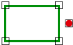

# Disjoint
<!-- id: disjoint-4 -->

Espacio de nombres: [Digi21.DigiNG.Entities.Relations](/digi3d-ai/programacion/.net/referencia/digi21.diging/digi21.diging.entities.relations/)  
Ensamblado: [Digi21.DigiNG](/digi3d-ai/programacion/.net/referencia/digi21.diging/)

Indica si el punto y el área son disjuntos.



```csharp
public static bool Disjoint(ReadOnlyPoint point, ReadOnlyLine area)
public static bool Disjoint(ReadOnlyPoint point, ReadOnlyPolygon area)
```

| Parámetro | Descripción |
| :--- | :--- |
| `point` | Punto, de tipo [ReadOnlyPoint](/digi3d-ai/programacion/.net/referencia/digi21.diging/digi21.diging.entities/clases/readonlypoint/). |
| `area` | Área: una [ReadOnlyLine](/digi3d-ai/programacion/.net/referencia/digi21.diging/digi21.diging.entities/clases/readonlyline/) cerrada o un [ReadOnlyPolygon](/digi3d-ai/programacion/.net/referencia/digi21.diging/digi21.diging.entities/clases/readonlypolygon/). En el ensamblado instalado, este parámetro se llama `line` o `polygon`. |

## Valor devuelto

`true` si el punto no coincide con ningún vértice del área (anillo exterior ni huecos) y no está en el interior del área. Es el valor contrario de `Coincident(point, area) || Within(point, area)`.

El método devuelve `true` con un punto fuera del área, con un punto dentro de un hueco de un polígono y con un punto sobre un lado del área que no coincide con ningún vértice.

Con un `Point` creado en memoria, el método devuelve siempre `true`; lee la nota de [PointArea](/digi3d-ai/programacion/.net/referencia/digi21.diging/digi21.diging.entities.relations/clases/pointarea/).

## Excepciones

| Excepción | Cuándo |
| :--- | :--- |
| `ArgumentNullException` | `point` o `area` es `null`. |

## Ejemplo

Lee el [ejemplo de PointArea](/digi3d-ai/programacion/.net/referencia/digi21.diging/digi21.diging.entities.relations/clases/pointarea/#ejemplo).
