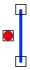

# Disjoint
<!-- id: disjoint-5 -->

Espacio de nombres: [Digi21.DigiNG.Entities.Relations](/digi3d-ai/programacion/.net/referencia/digi21.diging/digi21.diging.entities.relations/)  
Ensamblado: [Digi21.DigiNG](/digi3d-ai/programacion/.net/referencia/digi21.diging/)

Indica si el punto y la línea son disjuntos.



```csharp
public static bool Disjoint(ReadOnlyPoint point, ReadOnlyLine line)
```

| Parámetro | Descripción |
| :--- | :--- |
| `point` | Punto, de tipo [ReadOnlyPoint](/digi3d-ai/programacion/.net/referencia/digi21.diging/digi21.diging.entities/clases/readonlypoint/). |
| `line` | Línea, de tipo [ReadOnlyLine](/digi3d-ai/programacion/.net/referencia/digi21.diging/digi21.diging.entities/clases/readonlyline/). |

## Valor devuelto

`true` si la coordenada del punto no coincide con ningún vértice de la línea, extremos incluidos. El método devuelve `true` si el punto está sobre un lado de la línea sin coincidir con ningún vértice.

Con un `Point` creado en memoria, el método devuelve siempre `true`; lee la nota de [PointLine](/digi3d-ai/programacion/.net/referencia/digi21.diging/digi21.diging.entities.relations/clases/pointline/).

## Excepciones

| Excepción | Cuándo |
| :--- | :--- |
| `ArgumentNullException` | `point` o `line` es `null`. |

## Ejemplo

Lee el [ejemplo de PointLine](/digi3d-ai/programacion/.net/referencia/digi21.diging/digi21.diging.entities.relations/clases/pointline/#ejemplo).
