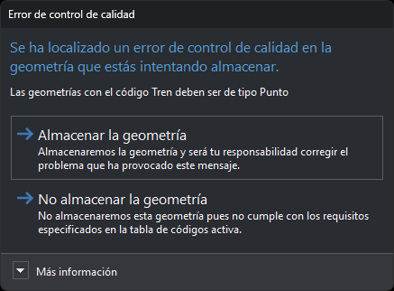
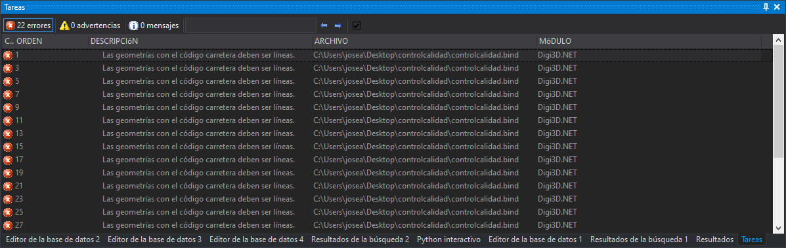

# Guiones de control de calidad
<!-- id: guiones-de-control-de-calidad -->

Los controles de calidad de Digi3D.AI son funciones de Python. La tabla de códigos guarda las funciones en la pestaña [Entorno Python](/digi3d-ai/referencia/editor-de-tablas-de-codigos/pestanas/entorno-python.md) y asigna a cada código las funciones que se le aplican en la propiedad **Controles de calidad a aplicar** ([Propiedades del código](/digi3d-ai/referencia/editor-de-tablas-de-codigos/pestanas/codigos/propiedades-del-codigo.md)).

Digi3D.AI no compila ningún ensamblado .NET para los controles de calidad: el intérprete de Python que lleva Digi3D.AI ejecuta el contenido de la pestaña Entorno Python cada vez que se carga o cambia la tabla de códigos, y llama a las funciones asignadas a cada código.

La referencia del lenguaje de los controles de calidad está en [Controles de calidad en Python](/digi3d-ai/programacion/python/controles-de-calidad/README.md). El repositorio [Guiones-Control-Calidad-Python-Digi3D](https://github.com/digi21/Guiones-Control-Calidad-Python-Digi3D) contiene 64 controles listos para usar, descritos en [Repositorio de controles de calidad en Python](/digi3d-ai/programacion/python/guiones-control-calidad/README.md).

## Cuándo se ejecutan

* **Al digitalizar.** Si la variable [CONTROL_CALIDAD_AL_FINALIZAR_ENTIDAD](/digi3d-ai/referencia/ventana-de-dibujo/variables/c/control-calidad.md) está activada (menú **Control de calidad/Analizar control de calidad al digitalizar entidad**) y el código de la geometría tiene a **Sí** la propiedad **Analizar control de calidad al digitalizar**, Digi3D.AI ejecuta los controles del código antes de guardar la geometría. Cada función recibe `adding_geometry=True`.
* **Bajo demanda.** Las órdenes [CONTROL_CALIDAD_COD](/digi3d-ai/referencia/ventana-de-dibujo/ordenes/c/control-calidad-cod.md), [CONTROL_CALIDAD_ENTIDADES_VISIBLES](/digi3d-ai/referencia/ventana-de-dibujo/ordenes/c/control-calidad-entidades-visibles.md), [CONTROL_CALIDAD_SELECCION](/digi3d-ai/referencia/ventana-de-dibujo/ordenes/c/control-calidad-seleccion.md) y las opciones del menú **Control de calidad** ejecutan los controles de cada código de cada geometría analizada, valga lo que valga la propiedad **Analizar control de calidad al digitalizar**. Cada función recibe `adding_geometry=False`.

Una geometría con varios códigos se analiza una vez por código: cada vez, la función recibe en `code_index` el índice del código que se analiza.

## Cómo comunica Digi3D.AI los errores

Al digitalizar:

* Un error de geometría (`GeometryError` o `GeometryRelationError`) abre el cuadro de diálogo **Error de control de calidad**, con el mensaje del error y dos opciones: **Almacenar la geometría** y **No almacenar la geometría**. Si el error tiene coordenadas, **Almacenar la geometría** desplaza la vista a esas coordenadas. **No almacenar la geometría** descarta la geometría y muestra el mensaje en un globo.

    

* Una advertencia (`GeometryWarning`) se muestra en un globo y la geometría se guarda.
* Un error de un campo de base de datos (`DatabaseFieldError`) abre un cuadro de diálogo para corregir el valor del campo. Si el usuario cancela, la geometría no se guarda. Si lo corrige, Digi3D.AI vuelve a ejecutar los controles del código; los errores de geometría y las advertencias con un mensaje ya mostrado no se vuelven a mostrar.

Bajo demanda, cada error y cada advertencia se añade al [panel de tareas](/digi3d-ai/referencia/paneles/tareas.md). Hacer doble clic en una tarea desplaza la vista a las coordenadas del error o a la geometría.

## Páginas de esta sección

* [Creación de un guion de control de calidad](creacion-de-un-guion-de-control-de-calidad/README.md): cómo se declara una función de control de calidad y cómo se asigna a un código.
* [Tipos de errores](creacion-de-un-guion-de-control-de-calidad/tipos-de-errores/README.md): qué puede devolver la función y qué hace Digi3D.AI con cada resultado.
* [Ejemplos de controles de calidad](../ejemplos/README.md).