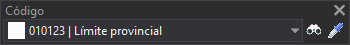

# Código
<!-- id: codigo -->

Permite ejecutar órdenes relacionadas con los códigos.

La barra de herramientas Código se habilita únicamente si seleccionas la opción **Barra de herramientas mono-codificación** en el campo [Interfaz para seleccionar código](../cuadros-de-dialogo/configuracion/diging/interfaz-para-seleccionar-codigo.md) de la configuración del programa.

## Botones

* Desplegable que permite seleccionar el código activo.
* Botón que ejecuta la orden [COD](/digi3d-ai/referencia/ventana-de-dibujo/ordenes/c/cod.md).
* Botón que ejecuta la orden [CLONAR\_CÓDIGOS](/digi3d-ai/referencia/ventana-de-dibujo/ordenes/c/clonar-codigos.md).
