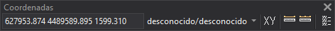

# Coordenadas
<!-- id: coordenadas -->

La barra de herramientas Coordenadas permite realizar tareas relacionadas con las coordenadas X e Y.

## Botones

* Ventana que muestra las coordenadas del dispositivo de entrada en la ventana de dibujo. Esta ventana permite además introducir coordenadas.
* Botón **Copiar coordenadas al portapapeles**, que copia al portapapeles como texto las coordenadas que muestra la ventana anterior en el momento de pulsarlo, con el mismo formato: X, Y y Z separadas por un espacio y con el número de decimales de la ventana de dibujo. Para copiar las coordenadas de un punto concreto, usa la orden [COPIAR\_COORDENADAS](/digi3d-ai/referencia/ventana-de-dibujo/ordenes/c/copiar-coordenadas.md).
* Botón que muestra las unidades de la ventana de dibujo, para X e Y, seguidas de las unidades de Z. Al pulsar el botón de unidades se muestra el sistema de referencia de coordenadas horizontal de la ventana de dibujo. La flecha de este botón despliega las opciones **Mostrar sistema de referencia de coordenadas horizontal...** y **Mostrar sistema de referencia de coordenadas vertical...**, que abren el cuadro de diálogo [Parámetros del sistema de referencia de coordenadas](../cuadros-de-dialogo/parametros-del-sistema-de-referencia-de-coordenadas.md).
* Botón que ejecuta la orden [XY](/digi3d-ai/referencia/ventana-de-dibujo/ordenes/x/xy.md).
* Botón que ejecuta la orden [MIDE](/digi3d-ai/referencia/ventana-de-dibujo/ordenes/m/mide.md).
* Botón que ejecuta la orden [MIDE+](../ventana-de-dibujo/ordenes/m/mide-mas.md).
* Botón que ejecuta la orden [AGREGA](/digi3d-ai/referencia/ventana-de-dibujo/ordenes/a/agrega.md).
