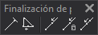

# Finalización de polilínea
<!-- id: finalizacion-de-polilinea -->

La barra de herramientas Finalización de polilínea permite ejecutar órdenes relacionadas con la finalización de la línea que estás digitalizando.

## Botones

* Botón que ejecuta la orden [FIN_ENT](../ventana-de-dibujo/ordenes/f/fin-ent.md).
* Botón que ejecuta la orden [CIERRA_ENT](../ventana-de-dibujo/ordenes/c/cierra-ent.md).
* Botón que ejecuta la orden [U](/digi3d-ai/referencia/ventana-de-dibujo/ordenes/u/u.md).
* Botón que ejecuta la orden [U2](/digi3d-ai/referencia/ventana-de-dibujo/ordenes/u/u2.md).
* Botón que ejecuta la orden [UM](/digi3d-ai/referencia/ventana-de-dibujo/ordenes/u/um.md).
