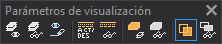

# Parámetros de visualización
<!-- id: parametros-visualizacion -->

Esta barra de herramientas permite cambiar cómo se dibujan las entidades en la ventana de dibujo y en la ventana fotogramétrica: códigos visibles, entidades eliminadas, patrones de línea, relleno de polígonos y sombreados.

Los botones **Visualiza eliminadas**, **Patrón**, **Rellenar polígonos**, **Rellenar polígonos en la vista fotogramétrica**, **Mostrar sombreados** y **Mostrar sombreados en la ventana fotogramétrica** aparecen pulsados mientras el parámetro que controlan está activo. Los botones **Rellenar polígonos en la vista fotogramétrica** y **Mostrar sombreados en la ventana fotogramétrica** están deshabilitados mientras no hay una vista fotogramétrica.

## Botones

El nombre en negrita es el texto de la información sobre herramientas del botón.

* **Visualización de códigos**: establece los códigos a visualizar en la ventana de dibujo. Este botón no tiene ninguna orden asociada en el código de la aplicación. Para elegir los códigos visibles, usa el panel [Visualización de códigos](/digi3d-ai/referencia/paneles/visualizacion-de-codigos.md).
* **Visualización de códigos en la ventana fotogramétrica**: establece los códigos a visualizar en la ventana fotogramétrica. Tampoco tiene ninguna orden asociada; usa el panel [Visualización de códigos](/digi3d-ai/referencia/paneles/visualizacion-de-codigos.md).
* **Visualiza eliminadas**: visualiza las entidades eliminadas. Activa o desactiva la variable [BORRADOS](/digi3d-ai/referencia/ventana-de-dibujo/variables/b/borrados.md).
* **Patrón**: visualiza patrones en la ventana de dibujo. Activa o desactiva la variable [PATRON](/digi3d-ai/referencia/ventana-de-dibujo/variables/p/patron.md).
* **Patrón en la ventana fotogramétrica**: visualiza patrones en el modelo fotogramétrico. Ejecuta la orden [PATRONS](/digi3d-ai/referencia/ventana-de-dibujo/ordenes/p/patrons.md).
* **Rellenar polígonos**: rellena los polígonos con su color de relleno en la ventana de dibujo. Activa o desactiva la variable [RELLENAR](/digi3d-ai/referencia/ventana-de-dibujo/variables/r/rellenar.md).
* **Rellenar polígonos en la vista fotogramétrica**: rellena los polígonos con su color de relleno en la vista fotogramétrica. Alterna el relleno de la vista fotogramétrica sin ejecutar ninguna orden.
* **Mostrar sombreados**: muestra colores no opacos en la ventana de dibujo. Alterna la visualización de colores no opacos en la ventana de dibujo sin ejecutar ninguna orden.
* **Mostrar sombreados en la ventana fotogramétrica**: muestra colores no opacos en la ventana fotogramétrica. Alterna la visualización de colores no opacos en la ventana fotogramétrica sin ejecutar ninguna orden.

Tres separadores dividen la barra en cuatro grupos: los dos botones de códigos y el de entidades eliminadas, los dos de patrones, los dos de relleno y los dos de sombreados.
