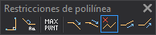

# Restricciones de polilínea
<!-- id: restricciones-de-polilinea -->

Esta barra de herramientas permite imponer restricciones a los vértices de las polilíneas que se digitalizan: la dirección de cada segmento, el número máximo de vértices y el sentido de la coordenada Z.

Cada botón aparece pulsado mientras la restricción que controla está activa.

## Botones

El nombre en negrita es el texto de la información sobre herramientas del botón.

* **Ortogonal**: hace que el segmento que se va a digitalizar sea perpendicular al último segmento. Activa o desactiva la variable [ORTO](/digi3d-ai/referencia/ventana-de-dibujo/variables/o/orto.md).
* **Ortogonal al ángulo activo**: hace que el segmento que se va a digitalizar sea perpendicular a la dirección definida por el ángulo activo. Activa o desactiva la variable [ORTO\_AA](/digi3d-ai/referencia/ventana-de-dibujo/variables/o/orto-aa.md).
* **Número máximo de puntos**: impone un número máximo de vértices; cuando la polilínea alcanza el número máximo de vértices, Digi3D.AI finaliza la digitalización de la polilínea. Si la restricción está desactivada, el botón ejecuta la variable [MAXPUNTOS](/digi3d-ai/referencia/ventana-de-dibujo/variables/m/maxpuntos.md) sin parámetros, que pide el número máximo. Si la restricción está activa, el botón ejecuta `MAXPUNTOS=0` y la desactiva.

Los cinco últimos botones establecen el valor de la variable [TIPO\_DE\_Z](/digi3d-ai/referencia/ventana-de-dibujo/ordenes/t/tipo-de-z.md). De esos cinco botones, aparece pulsado el que corresponde al valor actual de `TIPO_DE_Z`. De izquierda a derecha:

* **Z descendente**: impone que la coordenada Z del próximo vértice sea inferior a la del vértice que acabas de registrar. Ejecuta `TIPO_DE_Z=0`.
* **Z descendente moderada**: impone que la coordenada Z del próximo vértice sea inferior o igual a la del vértice que acabas de registrar. Ejecuta `TIPO_DE_Z=1`.
* **Sin restricciones de Z**: no impone ninguna restricción en la coordenada Z. Ejecuta `TIPO_DE_Z=2`.
* **Z ascendente moderada**: impone que la coordenada Z del próximo vértice sea superior o igual a la del vértice que acabas de registrar. Ejecuta `TIPO_DE_Z=3`.
* **Z ascendente**: impone que la coordenada Z del próximo vértice sea superior a la del vértice que acabas de registrar. Ejecuta `TIPO_DE_Z=4`.

Dos separadores dividen la barra en tres grupos: los dos botones de orto, el botón de número máximo de puntos y los cinco botones de Z.
