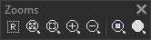

# Zooms
<!-- id: zooms -->

Esta barra de herramientas permite cambiar el factor de zoom y la zona del dibujo que se muestra en la ventana de dibujo.

## Botones

Cada botón ejecuta una orden en la ventana de dibujo. El nombre en negrita es el texto de la información sobre herramientas del botón; la descripción es el mensaje que muestra la barra de estado.

* **Regenerar**: regenera la ventana de dibujo. Ejecuta la orden [REGENERA](/digi3d-ai/referencia/ventana-de-dibujo/ordenes/r/regenera.md).
* **Zoom extendido**: muestra el modelo completo en la ventana de dibujo. Ejecuta la orden [ZOOME](/digi3d-ai/referencia/ventana-de-dibujo/ordenes/z/zoome.md).
* **Zoom ventana**: muestra la parte del modelo comprendida entre dos puntos. Ejecuta la orden [ZOOMV](/digi3d-ai/referencia/ventana-de-dibujo/ordenes/z/zoomv.md).
* **Zoom de acercar**: aumenta el factor de zoom de la ventana de dibujo. Ejecuta la orden [ZOOM+](/digi3d-ai/referencia/ventana-de-dibujo/ordenes/z/zoom-mas.md).
* **Zoom de alejar**: reduce el factor de zoom de la ventana de dibujo. Ejecuta la orden [ZOOM-](/digi3d-ai/referencia/ventana-de-dibujo/ordenes/z/zoom-menos.md).
* **Zoom a entidad**: centra la entidad seleccionada en la ventana de dibujo. Ejecuta la orden [ZOOM\_ENTIDAD](/digi3d-ai/referencia/ventana-de-dibujo/ordenes/z/zoom-entidad.md).
* **Zoom a recinto topológico virtual**: calcula un recinto topológico por inundación y realiza un zoom extendido al recinto. Ejecuta la orden [ZOOME\_R](/digi3d-ai/referencia/ventana-de-dibujo/ordenes/z/zoome-r.md). El botón está deshabilitado mientras no haya una topología temporal para inundación en memoria, y aparece pulsado mientras la orden ZOOME\_R está activa.

Un separador divide la barra en dos grupos: los cinco primeros botones y los dos últimos.
