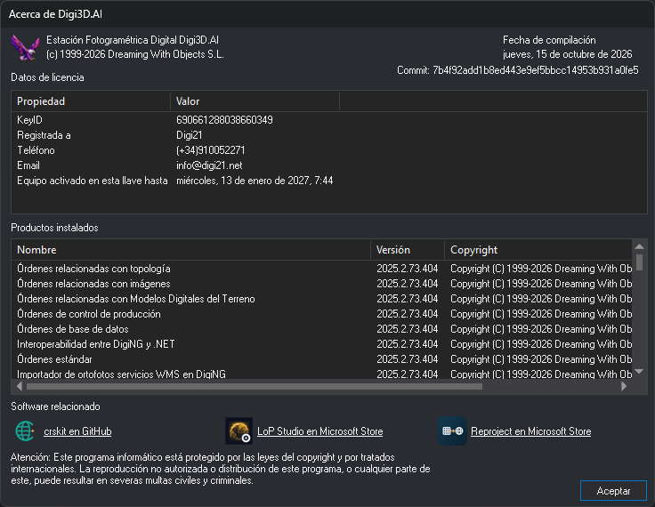

# Acerca de Digi3D.AI
<!-- id: acerca-de-digi3d-ai -->

Este cuadro de diálogo muestra la versión de Digi3D.AI, los datos de la licencia y las extensiones cargadas. Son los datos que pide el soporte técnico para identificar la instalación.

## Abrir el cuadro de diálogo

Selecciona la opción del menú **Ayuda/Acerca de Digi3D...**.

## Campos

* **Versión del programa**: la versión de Digi3D.AI instalada, por ejemplo 2027.0.0.417. Es el número que aparece en las [novedades de cada versión](../../novedades-version/README.md).
* **Fecha de compilación** y **Commit**: identifican la compilación exacta del programa. El commit es el identificador del código fuente con el que se compiló.
* **Datos de licencia**: las propiedades de la llave de protección:
  * **KeyID**: el número de la llave.
  * **Registrada a**, **Teléfono** y **Email**: los datos del cliente al que está registrada la llave.
  * **Equipo activado en esta llave hasta**: la fecha hasta la que este equipo está activado en la llave de protección. Es la fecha máxima que se eligió al activar el equipo. No aparece si el equipo no está activado en la llave.
* **Productos instalados**: el programa y cada una de las extensiones cargadas (órdenes, importadores y exportadores, sensores de la ventana fotogramétrica y dispositivos de entrada), con su nombre, su versión y su copyright. La versión indicada en algunas filas de **Productos instalados**, incluida *Estación fotogramétrica digital Digi3D.AI*, puede ser anterior a la **Versión del programa**.
* **Software relacionado**: otros programas de Digi21. Cada enlace abre su página en el navegador:
  * **crskit en GitHub**: el repositorio de crskit, la biblioteca de sistemas de referencia de coordenadas que usa Digi3D.AI.
  * **LoP Studio en Microsoft Store**: la página de LoP Studio en la Microsoft Store, desde la que se instala.
  * **Reproject en Microsoft Store**: la página de Reproject en la Microsoft Store, desde la que se instala.
* **Aceptar**: cierra el cuadro de diálogo.
