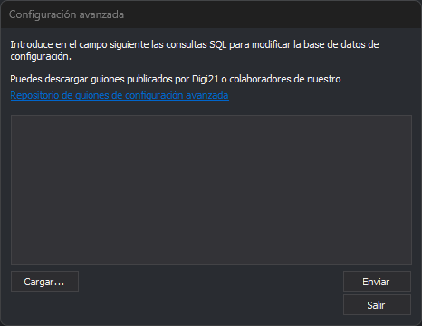

# Configuración avanzada
<!-- id: configuracion-avanzada -->



Este cuadro de diálogo ejecuta sentencias SQL sobre el [archivo de configuración Digi3DNET.db](../archivos/archivo-de-configuracion-digi3dnet.db.md), que guarda la configuración común a todos los usuarios del equipo. Sirve para aplicar de una vez un conjunto de cambios de configuración preparado en un guion, como los que publican Digi21 y otros usuarios en el [repositorio de guiones de configuración avanzada](https://github.com/digi21/ConfiguracionesAvanzadasDigi3D).

## Abrir el cuadro de diálogo

Selecciona la opción del menú **Herramientas/Configuración avanzada...**. La opción solo aparece en el menú que muestra Digi3D.AI cuando no hay ninguna ventana de dibujo ni fotogramétrica abierta.

## Uso del cuadro de diálogo

1. Escribe las sentencias SQL en el campo de texto, o pulsa **Cargar...** y selecciona un archivo `.sql`. El cuadro de diálogo **Abrir** se abre en la última carpeta desde la que cargaste un archivo. El archivo se lee en UTF-8 y su contenido sustituye al que haya en el campo.
2. Pulsa **Enviar** para ejecutar las sentencias.
3. Pulsa **Salir** para cerrar el cuadro de diálogo.

El enlace **Repositorio de guiones de configuración avanzada** abre ese repositorio en el navegador.

Al pulsar **Enviar**, Digi3D.AI procesa el campo de texto línea a línea:

* Cada línea se ejecuta por separado. Una sentencia no puede ocupar varias líneas. Una línea puede contener varias sentencias separadas por `;`.
* Las líneas que empiezan por `--` son comentarios y no se ejecutan.
* Las líneas vacías se omiten.
* Solo se procesan las 256 primeras líneas no vacías. Las líneas de comentario cuentan para ese límite. Las líneas siguientes no se ejecutan y Digi3D.AI no avisa.
* Si una sentencia falla, Digi3D.AI muestra el mensaje de error de SQLite y continúa con la línea siguiente. Las sentencias de la misma línea que van detrás de la que ha fallado no se ejecutan. Las sentencias de las líneas anteriores ya están aplicadas.
* Si no falla ninguna sentencia, Digi3D.AI no muestra ningún mensaje.

## Estructura de la base de datos

| Tabla | Contenido |
| :--- | :--- |
| `Keys` | Una fila por carpeta de configuración. `Id` es su identificador y `Path` su ruta, por ejemplo `App\Configuration` o `DigiNG\Configuration`. |
| `Ints` | Valores enteros. `Key` es el `Id` de la carpeta, `Value` el nombre del valor y `Data` el número. |
| `Doubles` | Valores reales, con las mismas columnas que `Ints`. |
| `Texts` | Valores de texto, con las mismas columnas que `Ints`. |
| `Blobs` | Valores binarios, con las mismas columnas que `Ints`. |

Ejemplo: esta línea asigna 1 al valor entero `FullMDI3D` de la carpeta `App\Configuration`:

```sql
UPDATE Ints SET Data = 1 WHERE Value = 'FullMDI3D' AND Key = (SELECT Id FROM Keys WHERE Path = 'App\Configuration');
```

Un valor que Digi3D.AI no ha leído nunca no tiene fila en su tabla. En ese caso `UPDATE` no modifica nada y hay que añadir la fila con `INSERT`.

La página [Valores del archivo de configuración](../archivos/valores-del-archivo-de-configuracion-digi3dnet.db.md) enumera todos los valores que Digi3D.AI guarda en la base de datos, con su carpeta, su tabla, su valor por defecto y el cuadro de diálogo que los modifica, o si solo se pueden cambiar por SQL.

## Cómo escribir un guion

* Copia las rutas de la columna `Path` respetando mayúsculas y minúsculas. Con `=`, SQLite distingue mayúsculas y minúsculas; con `LIKE`, no. Una misma carpeta puede aparecer con dos grafías: el valor `Order` del formato DGN está en `DigiNG\IO\Digi21.Io.DGN` y las opciones del importador DGN están en `DigiNG\IO\Digi21.Io.Dgn`.
* Escribe las rutas con una sola barra invertida. SQLite no usa `\` como carácter de escape.
* Para asignar un valor exista o no su fila, usa estas tres líneas. La primera crea la carpeta si no existe, la segunda borra las filas que tenga el valor y la tercera añade una fila con el valor nuevo. Si un valor tiene varias filas, Digi3D.AI solo usa una de ellas, así que no basta con añadir otra:

```sql
INSERT OR IGNORE INTO Keys (Path) VALUES ('DigiNG\Configuration');
DELETE FROM Ints WHERE Value = 'NombreDelValor' AND Key = (SELECT Id FROM Keys WHERE Path = 'DigiNG\Configuration');
INSERT INTO Ints (Key, Value, Data) SELECT Id, 'NombreDelValor', 1 FROM Keys WHERE Path = 'DigiNG\Configuration';
```

* Para devolver un valor a su estado inicial, borra su fila. La siguiente vez que Digi3D.AI lo lee, toma el valor que escribió el instalador en **HKEY\_LOCAL\_MACHINE** o, si el instalador no escribió ninguno, el valor por defecto del programa.
* El cuadro de diálogo no muestra el resultado de las consultas `SELECT`. Para consultar la base de datos, ábrela con _DB Browser for SQLite_.
* Guarda los archivos `.sql` en UTF-8 sin BOM.
* Después de ejecutar un guion, cierra Digi3D.AI y vuelve a abrirlo. Muchos valores solo se leen al arrancar el programa. Además, Digi3D.AI lee las opciones de los importadores al arrancar, y al pulsar **Aceptar** en el cuadro de diálogo **Configuración** vuelve a guardarlas con el valor leído: sin reiniciar, ese cuadro sustituiría los valores que acaba de escribir el guion.

## Guiones del repositorio

El [repositorio de guiones de configuración avanzada](https://github.com/digi21/ConfiguracionesAvanzadasDigi3D) contiene cinco guiones que eligen el formato de archivo de dibujo por defecto.

Digi3D.AI ordena los formatos de archivo de dibujo de menor a mayor según el valor entero `Order` de la carpeta `DigiNG\IO\<formato>`. El primer formato de la lista es el que proponen los cuadros de diálogo de guardar. Cada guion asigna 1 a todos los formatos y 0 al formato elegido:

| Guion | Formato por defecto |
| :--- | :--- |
| `FormatoArchivoPorDefectoArchivosDgn.sql` | DGN de MicroStation V8 |
| `FormatoArchivoPorDefectoArchivosDwg.sql` | DWG |
| `FormatoArchivoPorDefectoBinarioClasico.sql` | Binario de precisión simple (_.bin_) |
| `FormatoArchivoPorDefectoBinarioDoblePrecision.sql` | Binario de doble precisión (_.bind_) |
| `FormatoArchivoPorDefectoShapefile.sql` | Shapefile |

Contenido de `FormatoArchivoPorDefectoArchivosDgn.sql`:

```sql
-- Este guión configura Digi3D.NET para que el formato de archivo por defecto sea archivos DGN
UPDATE Ints SET Data=1 WHERE Value='Order' AND Key IN (SELECT id FROM Keys WHERE Path LIKE 'DigiNG\IO\%');
UPDATE Ints SET Data=0 WHERE Value='Order' AND Key=(SELECT id FROM Keys WHERE Path LIKE 'DigiNG\IO\Digi21.Io.Dgn');
```

Los otros cuatro guiones solo cambian el nombre de la carpeta de la última línea: `Digi21.Io.Dwg`, `Digi21.Io.Bin`, `Digi21.Io.BinDouble` y `Digi21.Io.SHP`.

Los formatos que tienen el mismo valor de `Order` no tienen un orden fijo entre ellos. Para fijar también el segundo y el tercer formato, usa el guion [Fijar el orden de varios formatos](#fijar-el-orden-de-varios-formatos).

## Más ejemplos

Los guiones siguientes no están en el repositorio. Copia cada uno en el campo de texto y pulsa **Enviar**.

### Fijar el orden de varios formatos

Este guion pone DGN en primer lugar, Shapefile en segundo y DWG en tercero. El resto de formatos va detrás, sin un orden fijo entre ellos:

```sql
UPDATE Ints SET Data = 3 WHERE Value = 'Order' AND Key IN (SELECT Id FROM Keys WHERE Path LIKE 'DigiNG\IO\%');
UPDATE Ints SET Data = 0 WHERE Value = 'Order' AND Key IN (SELECT Id FROM Keys WHERE Path LIKE 'DigiNG\IO\Digi21.Io.Dgn');
UPDATE Ints SET Data = 1 WHERE Value = 'Order' AND Key IN (SELECT Id FROM Keys WHERE Path LIKE 'DigiNG\IO\Digi21.Io.Shp');
UPDATE Ints SET Data = 2 WHERE Value = 'Order' AND Key IN (SELECT Id FROM Keys WHERE Path LIKE 'DigiNG\IO\Digi21.Io.Dwg');
```

### Recuperar el orden de formatos del instalador

Este guion borra el valor `Order` de todos los formatos. Al arrancar de nuevo, Digi3D.AI lee el orden que escribió el instalador, en el que el binario de doble precisión es el formato por defecto:

```sql
DELETE FROM Ints WHERE Value = 'Order' AND Key IN (SELECT Id FROM Keys WHERE Path LIKE 'DigiNG\IO\%');
```

### No mostrar el cuadro de parámetros de importación y exportación

Cuando una orden pide un archivo de dibujo, como [EXPORTAR](../ventana-de-dibujo/ordenes/e/exportar.md), [INS](../ventana-de-dibujo/ordenes/i/ins.md) o [BLOQUE](../ventana-de-dibujo/ordenes/b/bloque.md), Digi3D.AI muestra después de elegir el archivo un cuadro de diálogo con los parámetros de importación o exportación del formato. Con este guion, Digi3D.AI no muestra ese cuadro y usa los parámetros memorizados para el formato:

```sql
INSERT OR IGNORE INTO Keys (Path) VALUES ('DigiNG\Configuration');
DELETE FROM Ints WHERE Value = 'UtilizarParametrosImportacionExportacionPreconfigurados' AND Key = (SELECT Id FROM Keys WHERE Path = 'DigiNG\Configuration');
INSERT INTO Ints (Key, Value, Data) SELECT Id, 'UtilizarParametrosImportacionExportacionPreconfigurados', 1 FROM Keys WHERE Path = 'DigiNG\Configuration';
```

Para volver a mostrar el cuadro de diálogo, ejecuta el mismo guion con 0 en lugar de 1 en la última línea.

### Añadir los códigos desconocidos a la tabla de códigos en todos los formatos

Al abrir un archivo, los importadores asignan a cada entidad un código de la tabla de códigos. Si no encuentran un código que corresponda a la entidad, crean uno. Este guion hace que todos los importadores que tienen la opción **Añadir códigos desconocidos** añadan esos códigos nuevos a la tabla de códigos activa: binario de precisión simple, binario de doble precisión, DGN, DWG, FileGDB, GeoMedia, GeoPackage, KML, PostGIS, Shapefile y VEC.

```sql
UPDATE Ints SET Data = 1 WHERE Value = 'AñadirCódigosDesconocidos' AND Key IN (SELECT Id FROM Keys WHERE Path LIKE 'DigiNG\IO\%');
```

Digi3D.AI crea la fila de este valor al arrancar, para cada importador activo, así que basta con `UPDATE`. Para desactivar la opción en todos los formatos, ejecuta la misma línea con `Data = 0`.

### Mostrar una ventana de progreso al guardar archivos DGN

Con este guion, Digi3D.AI muestra un cuadro de diálogo modal mientras escribe un archivo DGN. Es el mismo valor que escribe la opción [Mostrar modal al guardar](configuracion/importador-exportador-de-archivos-bentley-microstation-v8/mostrar-modal-al-guardar.md) del cuadro de diálogo **Configuración**:

```sql
INSERT OR IGNORE INTO Keys (Path) VALUES ('DigiNG\IO\Digi21.Io.Dgn');
DELETE FROM Ints WHERE Value = 'MostrarModalAlGuardar' AND Key = (SELECT Id FROM Keys WHERE Path = 'DigiNG\IO\Digi21.Io.Dgn');
INSERT INTO Ints (Key, Value, Data) SELECT Id, 'MostrarModalAlGuardar', 1 FROM Keys WHERE Path = 'DigiNG\IO\Digi21.Io.Dgn';
```

### Cargar como huecos los anillos exteriores adicionales de los polígonos 3D de un shapefile

Un registro de un shapefile de polígonos 3D (_PolygonZ_) puede tener varios anillos exteriores. Digi3D.AI lo carga como una entidad compleja con un polígono por cada anillo exterior. Con este guion, lo carga como un único polígono: el primer anillo exterior es el contorno y los demás anillos exteriores pasan a ser huecos de ese polígono. Los huecos de los anillos exteriores adicionales se descartan.

Sirve para los archivos que guardan los huecos con la orientación de un anillo exterior. No afecta a los shapefiles de polígonos 2D ni a los de polígonos con medida (_PolygonM_).

```sql
INSERT OR IGNORE INTO Keys (Path) VALUES ('DigiNG\IO\Digi21.Io.Shp');
DELETE FROM Ints WHERE Value = 'ConsiderarMultiPoligonosComoPoligonos' AND Key = (SELECT Id FROM Keys WHERE Path = 'DigiNG\IO\Digi21.Io.Shp');
INSERT INTO Ints (Key, Value, Data) SELECT Id, 'ConsiderarMultiPoligonosComoPoligonos', 1 FROM Keys WHERE Path = 'DigiNG\IO\Digi21.Io.Shp';
```

### Desactivar formatos que no usas

Digi3D.AI carga al arrancar los formatos de archivo de dibujo cuyo valor `Activated` vale 1. Este guion desactiva los formatos PDF y SVG. Esos formatos desaparecen de los cuadros de diálogo de abrir y guardar, y Digi3D.AI no puede abrir ni exportar archivos en ellos:

```sql
UPDATE Ints SET Data = 0 WHERE Value = 'Activated' AND Key IN (SELECT Id FROM Keys WHERE Path IN ('DigiNG\IO\Digi21.Io.Pdf', 'DigiNG\IO\Digi21.Io.Svg'));
```

No desactives el formato de los archivos con los que trabajas ni el de sus archivos de referencia. Para volver a activar un formato, ejecuta la misma línea con `Data = 1`.

## Observaciones

* Los cambios afectan a todos los usuarios del equipo. La configuración propia de cada usuario se guarda en el registro de _Windows_, en **HKEY\_CURRENT\_USER**. Las sentencias SQL no la modifican. El cuadro de diálogo solo guarda ahí la última carpeta usada con **Cargar...**.
* El cuadro de diálogo no deshace los cambios. Antes de ejecutar un guion, haz una copia del archivo **C:\ProgramData\Digi3D.NET\Digi3DNET.db**.
* Si un cambio no tiene efecto, cierra Digi3D.AI y vuelve a abrirlo.
