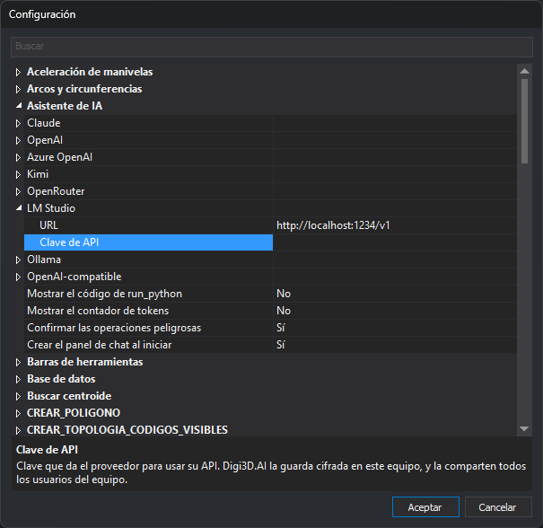

# Asistente de IA
<!-- id: configuracion-del-asistente-de-ia -->

Configura el [panel de chat con IA](../../../asistente-ia/README.md): la dirección y la clave de API de cada proveedor, y cuatro opciones de comportamiento del panel.

Configura estas opciones desde el cuadro de diálogo de **[Configuración](../README.md)**. El botón **⚙** de la cabecera del panel de chat abre ese cuadro con esta categoría seleccionada.

## Opciones

* **[URL](url-del-proveedor-de-ia.md)** — Dirección base de la API de un proveedor.
* **[Clave de API](clave-de-api-del-proveedor-de-ia.md)** — Clave que da el proveedor para usar su API.
* **[Mostrar el código de run_python](mostrar-codigo-run-python.md)** — Muestra en el chat el código Python que ejecuta el asistente y su salida.
* **[Mostrar el contador de tokens](mostrar-contador-de-tokens.md)** — Muestra en la cabecera del panel los tokens de la conversación.
* **[Confirmar las operaciones peligrosas](confirmar-operaciones-peligrosas.md)** — Pide confirmación antes de borrar geometrías, escribir o borrar archivos o acceder a la red.
* **[Crear el panel de chat al iniciar](crear-panel-de-chat-al-iniciar.md)** — Crea el panel de chat al arrancar Digi3D.AI.

La categoría contiene un elemento por proveedor. Cada elemento agrupa las opciones **URL** y **Clave de API** de ese proveedor.

## Proveedores

| Proveedor | URL por defecto | Necesita clave de API |
| :--- | :--- | :--- |
| Claude | `https://api.anthropic.com/v1` | Sí |
| OpenAI | `https://api.openai.com/v1` | Sí |
| Azure OpenAI | Ninguna: hay que escribirla | Sí |
| Kimi | `https://api.moonshot.ai/v1` | Sí |
| OpenRouter | `https://openrouter.ai/api/v1` | Sí |
| LM Studio | `http://localhost:1234/v1` | No |
| Ollama | `http://localhost:11434/v1` | No |
| OpenAI-compatible | Ninguna: hay que escribirla | No |

## Proveedor y modelo

Esta categoría no contiene el proveedor activo ni el modelo. Elígelos en los desplegables **Proveedor** y **Modelo** de la cabecera del panel de chat.

## Aplicación de los cambios

Los cambios se guardan al pulsar **Aceptar** en el cuadro Configuración. Al aceptar, el panel de chat vuelve a leer las opciones. Si cambia la URL o la clave de API del proveedor activo, el panel crea el asistente de nuevo y este olvida la conversación en curso, aunque los mensajes siguen en pantalla.

Las instrucciones para obtener la clave de cada proveedor están en [Proveedores en la nube](../../../asistente-ia/proveedores.md).
