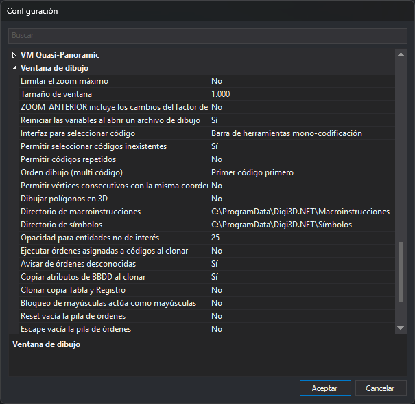

# Ventana de dibujo
<!-- id: diging -->

Agrupa las opciones de la ventana de dibujo: zoom, selección de códigos, órdenes, clonado, directorios de macroinstrucciones y de símbolos, y el campo **Sistema de referencia de coordenadas** del cuadro de diálogo **Nuevo proyecto**.

Configura estas opciones desde el cuadro de diálogo de **[Configuración](../README.md)**.
