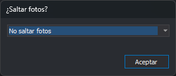

# Solicitar salto de fotos
<!-- id: solicitar-salto-de-fotos -->

Si activas esta opción, al abrir un proyecto de Inpho (archivo `.prj`) Digi3D.AI muestra el cuadro de diálogo **¿Saltar fotos?**, en el que puedes elegir cómo se forman los modelos estereoscópicos de cada pasada.

## Valores posibles

* **Sí**. Se muestra el cuadro de diálogo **¿Saltar fotos?** cada vez que se abre un proyecto de Inpho.
* **No**. No se muestra el cuadro de diálogo, y cada modelo se forma con dos fotos consecutivas de la pasada. Es el valor por defecto.

## Cuadro de diálogo ¿Saltar fotos?



El desplegable indica cómo se forman los modelos de cada pasada. Las fotos de una pasada se recorren en el orden en que aparecen en el archivo de proyecto. En la tabla, *n* es el valor de **Fotos a saltar** y las fotos se numeran 1, 2, 3… dentro de la pasada:

| Opción | Modelos que se forman | Ejemplo con *n* = 1 |
|---|---|---|
| **No saltar fotos** | Cada foto que tiene una foto siguiente en la pasada forma un modelo con esa foto siguiente. | 1-2, 2-3, 3-4… |
| **Saltar fotos** | Cada modelo se forma con una foto y la que está *n* + 1 posiciones después de esa foto en la pasada. Cada modelo posterior al primero empieza en la foto derecha del modelo anterior, así que las fotos intermedias no forman parte de ningún modelo. | 1-3, 3-5, 5-7… |
| **Saltar fotos pero utilizarlas para otro modelo** | Cada modelo se forma con una foto y la que está *n* + 1 posiciones después de esa foto en la pasada. Se empieza un modelo en cada foto de la pasada que tiene otra foto *n* + 1 posiciones después. | 1-3, 2-4, 3-5… |

El nombre de cada modelo es el de su foto izquierda y el de su foto derecha separados por un guion.

### Fotos a saltar

Indica el número de fotos que quedan entre la foto izquierda y la foto derecha de cada modelo. El campo Fotos a saltar solo se muestra si se elige una opción distinta de **No saltar fotos**. El campo admite de 0 a 1000 fotos, ambos extremos incluidos; con 0 fotos, las tres opciones forman los mismos modelos.

### Aceptar

Carga el proyecto con los modelos formados según la opción elegida. Si pulsas la tecla **Esc**, el cuadro de diálogo se cierra y el proyecto se carga sin saltar fotos.

> **Ver también:** [Omitir modelos para los cuales no hay foto](omitir-modelos-para-los-cuales-no-hay-foto.md), que se aplica después de formar los modelos.

<details>
<summary>Dónde se almacena</summary>

| Archivo | [Digi3DNET.db](../../../archivos/archivo-de-configuracion-digi3dnet.db.md) |
| :--- | :--- |
| Carpeta | `Digi3D\Extensiones\Digi3D.ConicSensor\Inpho` |
| Tabla | `Ints` |
| Valor | `MostrarDialogoSaltoFotos` |
| Valor por defecto | 0 |

Estas sentencias SQL asignan el valor 1, exista o no la fila. Ejecútalas en el cuadro de diálogo [Configuración avanzada](../../configuracion-avanzada.md) y reinicia Digi3D.AI:

```sql
INSERT OR IGNORE INTO Keys (Path) VALUES ('Digi3D\Extensiones\Digi3D.ConicSensor\Inpho');
DELETE FROM Ints WHERE Value = 'MostrarDialogoSaltoFotos' AND Key = (SELECT Id FROM Keys WHERE Path = 'Digi3D\Extensiones\Digi3D.ConicSensor\Inpho');
INSERT INTO Ints (Key, Value, Data) SELECT Id, 'MostrarDialogoSaltoFotos', 1 FROM Keys WHERE Path = 'Digi3D\Extensiones\Digi3D.ConicSensor\Inpho';
```

</details>
