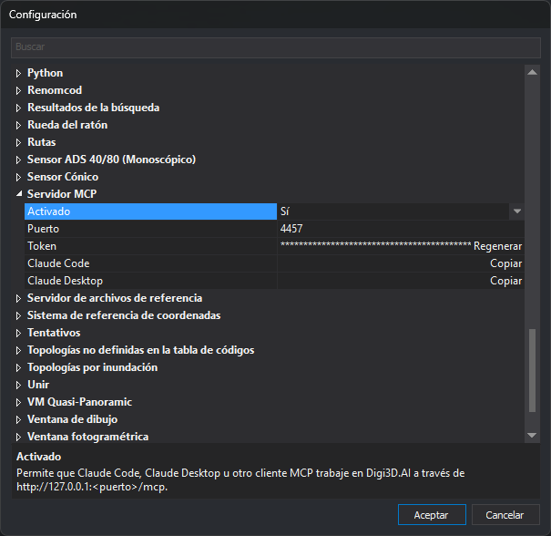

# Servidor MCP
<!-- id: configuracion-del-servidor-mcp -->

Configura el [servidor MCP](../../../asistente-ia/servidor-mcp.md), que permite a Claude Code, Claude Desktop u otro cliente MCP trabajar en Digi3D.AI.

Configura estas opciones desde el cuadro de diálogo de **[Configuración](../README.md)**.

## Opciones

* **[Activado](activar-servidor-mcp.md)** — Activa el servidor MCP.
* **[Puerto](puerto-del-servidor-mcp.md)** — Puerto TCP en el que escucha el servidor.
* **[Token](token-del-servidor-mcp.md)** — Clave que envían los clientes para conectar con el servidor MCP. El botón **Regenerar** crea un token nuevo.
* **[Claude Code](conectar-claude-code.md)** — El botón **Copiar** copia al portapapeles la orden que conecta Claude Code.
* **[Claude Desktop](conectar-claude-desktop.md)** — El botón **Copiar** copia al portapapeles la configuración que conecta Claude Desktop.

## Aplicación de los cambios

Los cambios se guardan al pulsar **Aceptar** en el cuadro Configuración. Si has cambiado **Activado**, **Puerto** o **Token**, Digi3D.AI guarda los tres valores y reinicia el servidor. Si no has cambiado ninguno de los tres, el servidor sigue funcionando sin reiniciarse.

Los botones **Regenerar** y **Copiar** también guardan los valores de **Activado**, **Puerto** y **Token** que muestra el cuadro de diálogo y reinician el servidor si ha cambiado alguno de esos tres valores. La orden y la configuración copiadas permiten conectar con el servidor aunque pulses **Cancelar** después de copiar la orden o la configuración con Copiar.

La opción [Confirmar las operaciones peligrosas](../asistente-de-ia/confirmar-operaciones-peligrosas.md) de la categoría Asistente de IA también afecta a los clientes MCP.
