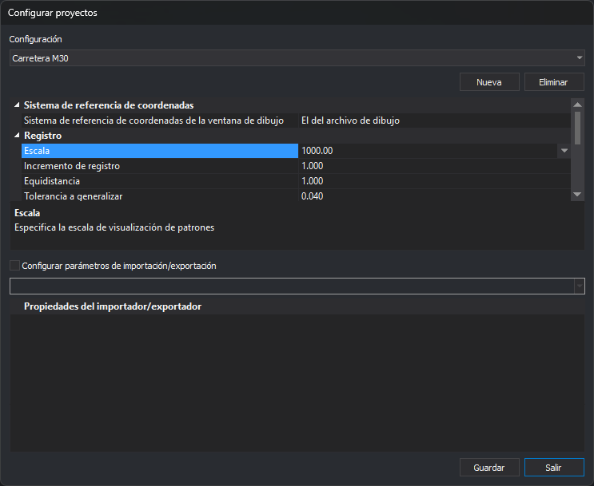
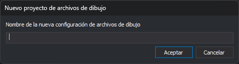

# Configurar proyectos
<!-- id: configurar-proyectos -->



Este cuadro de diálogo crea, modifica y elimina configuraciones de proyecto. Una configuración de proyecto agrupa los parámetros con los que se abre un archivo de dibujo: sistema de referencia de coordenadas, parámetros de registro, tabla de códigos, teclado y, opcionalmente, los parámetros de los importadores/exportadores.

Las configuraciones se usan en la pestaña [Archivo de dibujo](nuevo-proyecto/archivo-de-dibujo.md) del cuadro de diálogo Nuevo proyecto cuando está activada la opción [Utilizar archivos de proyecto](configuracion/comunicacion-con-el-usuario/utilizar-archivos-de-proyecto.md) del cuadro de diálogo [Configuración](configuracion/README.md). En ese caso, el usuario solo selecciona la configuración, y Nuevo proyecto aplica sus parámetros al archivo de dibujo.

## Abrir el cuadro de diálogo

Selecciona la opción del menú **Herramientas/Configurar proyectos...**. La opción solo está habilitada si está activada la opción **Utilizar archivos de proyecto**.

## Campos

* **Configuración**: la configuración que se edita.
* **Nueva**: abre el cuadro de diálogo **Nuevo proyecto de archivos de dibujo**, que solicita el nombre de la configuración nueva, y la añade a la lista. Si ya existe una configuración con ese nombre, muestra un aviso y no la añade. La configuración nueva no se guarda hasta pulsar **Guardar**.

  
* **Eliminar**: elimina la configuración seleccionada en el momento, sin pulsar **Guardar**.
* **Rejilla de propiedades** de la configuración:
  * **Sistema de referencia de coordenadas**: el sistema de referencia de coordenadas de la ventana de dibujo.
  * **Registro**: **Escala**, **Incremento de registro**, **Equidistancia**, **Altura de textos**, **Tolerancia a generalizar**, **Corrección de Z** y **Sigma**. Son los mismos parámetros de la pestaña [Archivo de dibujo](nuevo-proyecto/archivo-de-dibujo.md). **Escala** admite cualquier valor y ofrece una lista de escalas de 100 a 250000.
  * **Entorno**: **Tabla de códigos**, **Directorio de macroinstrucciones**, **Teclado** (archivo de asignación de teclas), **Directorio de símbolos** y **Orden de inicio**. **Orden de inicio** es la orden que se ejecuta cada vez que se abre un archivo de dibujo; para ejecutar un archivo de macroinstrucciones, escribe `@` seguido de su ruta. Si **Directorio de macroinstrucciones** o **Directorio de símbolos** están vacíos, Digi3D.AI usa los directorios del cuadro de diálogo **Configuración**.
* **Configurar parámetros de importación/exportación**: si está marcada, la configuración incluye los parámetros de los importadores/exportadores. Selecciona un formato en la lista inferior para editar sus propiedades en la rejilla **Propiedades del importador/exportador**. Al abrir un archivo de dibujo con esta configuración, se usan estos parámetros y Nuevo proyecto no muestra la categoría del motor de importación/exportación.
* **Guardar**: guarda la configuración seleccionada.
* **Salir**: cierra el cuadro de diálogo. Los cambios que no se han guardado se pierden.

## Observaciones

* Si Digi3D.AI no se ejecuta como administrador, **Guardar** y **Eliminar** muestran el icono del escudo de elevación de _Windows_. Al pulsarlos no se pide elevación: guardan o eliminan la configuración igualmente.
* Las configuraciones son comunes a todos los usuarios del equipo: se guardan en el [archivo de configuración Digi3DNET.db](../archivos/archivo-de-configuracion-digi3dnet.db.md).

<details>
<summary>Dónde se almacena</summary>

Cada configuración se guarda en una carpeta del archivo de configuración Digi3DNET.db:

| Archivo | [Digi3DNET.db](../archivos/archivo-de-configuracion-digi3dnet.db.md) |
| :--- | :--- |
| Carpeta | `DigiNG\Configuration\Projects\<proyecto>\` |
| Tablas | `Ints`, `Texts` y `Doubles` |

`<proyecto>` es el nombre de la configuración. La ruta termina en `\`. Digi3D.AI enumera las configuraciones buscando en la tabla `Keys` las rutas que empiezan por `DigiNG\Configuration\Projects\`. **Eliminar** borra la carpeta de la configuración, sus subcarpetas y todos sus valores.

Los parámetros de los importadores/exportadores se guardan en la subcarpeta `DigiNG\IO\<formato>` de la carpeta de la configuración, por ejemplo `DigiNG\Configuration\Projects\<proyecto>\DigiNG\IO\Digi21.Io.Dgn`. Digi3D.AI solo los usa si la configuración tiene `ConfigurarParametrosIO` a 1.

Estas sentencias SQL asignan la escala 5000 a la configuración `Cartografia`, exista o no la fila. Ejecútalas en el cuadro de diálogo [Configuración avanzada](configuracion-avanzada.md):

```sql
INSERT OR IGNORE INTO Keys (Path) VALUES ('DigiNG\Configuration\Projects\Cartografia\');
DELETE FROM Doubles WHERE Value = 'Escala' AND Key = (SELECT Id FROM Keys WHERE Path = 'DigiNG\Configuration\Projects\Cartografia\');
INSERT INTO Doubles (Key, Value, Data) SELECT Id, 'Escala', 5000.0 FROM Keys WHERE Path = 'DigiNG\Configuration\Projects\Cartografia\';
```

### Valores de la configuración

Carpeta `DigiNG\Configuration\Projects\<proyecto>\`.

| Valor | Tabla | Por defecto | Qué hace | Campo |
| :--- | :--- | :--- | :--- | :--- |
| `AlturaTextos` | `Doubles` | 1.5 | Especifica la altura de los textos que se registran (variable AT) | Registro › Altura de textos |
| `ArchivoInicio` | `Texts` | (vacío) | Orden que se ejecuta cada vez que se abre un archivo de dibujo, también desde la línea de comandos, después de las órdenes de inicio de la tabla de códigos y antes de la orden indicada en la línea de comandos. Para ejecutar un archivo de macroinstrucciones, escribe @ seguido de su ruta. | Entorno › Orden de inicio |
| `ArchivoTeclasMenu` | `Texts` | (vacío) | Indica la ruta al archivo con la configuración de teclado. | Entorno › Teclado |
| `ConfigurarParametrosIO` | `Ints` | 0 | Si vale 1, el proyecto guarda los parámetros de importación y exportación de cada formato, y Digi3D.AI no los pide al abrir archivos. | **Configurar parámetros de importación/exportación** |
| `CorreccionZ` | `Doubles` | 0.0 | Indica la diferencia de Z entre operadores (se debe ajustar si quien realizó la orientación absoluta no es quien restituye el modelo) | Registro › Corrección de Z |
| `DigiTab` | `Texts` | (vacío) | Archivo con información de los códigos así como su representación y traducción. | Entorno › Tabla de códigos |
| `DirectorioCelulas` | `Texts` | (vacío) | Especifica el directorio donde localizar la definición de células. | Entorno › Directorio de símbolos |
| `DirectorioTablas` | `Texts` | (vacío) | Especifica el directorio donde localizar los archivos de macroinstrucciones. | Entorno › Directorio de macroinstrucciones |
| `Equidistancia` | `Doubles` | 1.0 | Especifica cada cuántos metros se registrará una curva de nivel. | Registro › Equidistancia |
| `Escala` | `Doubles` | 1000.0 | Escala de trabajo del proyecto. | Registro › Escala |
| `IncrementoRegistro` | `Doubles` | 1.0 | Especifica cada cuántos metros registrar un punto al trabajar en modo continuo. | Registro › Incremento de registro |
| `Sigma` | `Doubles` | 0.001 | Indica el valor por debajo del cual dos valores se considerarán idénticos. | Registro › Sigma |
| `ToleranciaGeneralizar` | `Doubles` | 0.04 | Indica la longitud mínima de un segmento al registrar en modo continuo. | Registro › Tolerancia a generalizar |
| `WktVentanaDibujov2` | `Texts` | SRC local compuesto | Sistema de referencia de coordenadas de la ventana de dibujo, en WKT. | Sistema de referencia de coordenadas |

### Parámetros de los importadores/exportadores

Carpeta `DigiNG\Configuration\Projects\<proyecto>\DigiNG\IO\<formato>`. Se editan en la rejilla **Propiedades del importador/exportador**.

#### `Digi21.Io.AsciiDigi`

| Valor | Tabla | Por defecto | Qué hace | Campo |
| :--- | :--- | :--- | :--- | :--- |
| `NumeroDecimales` | `Ints` | 3 | Indica el número de decimales utilizados al exportar un archivo a formato ASCII de Digi. | Decimales |
| `WktSistemaCoordenadas3D` | `Texts` | SRC local compuesto | Sistema de referencia de coordenadas del archivo, en WKT. | — |

#### `Digi21.Io.Bin`

| Valor | Tabla | Por defecto | Qué hace | Campo |
| :--- | :--- | :--- | :--- | :--- |
| `NPrecision` | `Ints` | 2 | Indica el número de decimales de precisión con los que se almacenarán/recuperarán las entidades en este archivo. | Decimales de precisión |
| `X` | `Doubles` | 0.0 | Indica la coordenada X utilizada como origen global del modelo. | X |
| `Y` | `Doubles` | 0.0 | Indica la coordenada Y utilizada como origen global del modelo. | Y |
| `Z` | `Doubles` | 0.0 | Indica la coordenada Z utilizada como origen global del modelo. | Z |

#### `Digi21.Io.BinDouble`

| Valor | Tabla | Por defecto | Qué hace | Campo |
| :--- | :--- | :--- | :--- | :--- |
| `BaseDatosSoloLectura` | `Ints` | 0 | Si se conecta en modo solo lectura, no se crearán ni modificarán registros en la base de datos. | Conectar en modo solo lectura |
| `CadenaConexion` | `Texts` | (vacío) | Indica la cadena de conexión para establecer la conexión con la base de datos que almacenará información para las entidades de este archivo. | Cadena de conexión |
| `GestorModeloDatosBaseDatos` | `Texts` | `Sin conexión con base de datos` | Selecciona el Gestor de Modelo de datos de Base de Datos a utilizar para almacenar los datos en la base de datos. | Modelo de datos |
| `OmitirCargaArchivosReferencia` | `Ints` | 0 | Si se activa no se cargarán los archivos de referencia asociados al archivo. | Omitir carga de archivos de referencia |

#### `Digi21.Io.Csv`

| Valor | Tabla | Por defecto | Qué hace | Campo |
| :--- | :--- | :--- | :--- | :--- |
| `NombreColumnaX` | `Texts` | (vacío) | Indica el nombre de la columna con la coordenada X. | Columna X |
| `NombreColumnaY` | `Texts` | (vacío) | Indica el nombre de la columna con la coordenada Y. | Columna Y |
| `NombreColumnaZ` | `Texts` | (vacío) | Indica el nombre de la columna con la coordenada Z. | Columna Z |
| `Separador` | `Texts` | `tabulador` | Carácter separador de columnas. Se usa el primer carácter. | — |

#### `Digi21.Io.Dgn`

| Valor | Tabla | Por defecto | Qué hace | Campo |
| :--- | :--- | :--- | :--- | :--- |
| `ArchivoCelulas` | `Texts` | (vacío) | Especifica el archivo de células relacionado con el archivo DGN. | Archivo de células |
| `ArchivoPlantilla` | `Texts` | (vacío) | Indica la ruta a un archivo de plantilla que se utilizará como base al crear archivos de dibujo nuevos. Este parámetro es opcional. Si no se indica ninguno, se creará un archivo basándose en la tabla de códigos activa. | Archivo de plantilla |
| `CriterioCodigos` | `Ints` | 0 | Especifica el criterio de selección de código. | Criterio para códigos |
| `FormatoDesconocidos` | `Texts` | `$(Nivel)` | Indica el formato del código con el que se importarán las entidades sin asociación en la tabla de traducción. Se pueden utilizar los siguientes sustituidores: $(Nivel) $(Color) $(Estilo) $(Grosor) $(GrupoGrafico) | Formato desconocido |
| `ImportarCelulasComoPuntual` | `Ints` | 1 | Indica en qué tipo de entidad se transformarán las células del archivo DGN. | Importar células como |
| `ImportarPaletaDGN` | `Ints` | 1 | Indica si importar la paleta de colores del archivo DGN (únicamente si el archivo DGN tiene alguna paleta que importar). | Importar paleta |
| `IncrementoRegistroSplines` | `Doubles` | 1.0 | Indica el incremento de registro que se utilizará a la hora de transformar splines en polilíneas al importar archivos de dibujo con splines. | Incremento de registro splines |
| `RutasArchivosRecursos` | `Texts` | (vacío) | Introduce aquí las rutas a los archivos de recursos de MicroStation separadas por punto y coma. El último archivo tiene más prioridad. | Archivos de recursos de simbología |
| `TransformarNivelesEntidadesQueFormanCell` | `Ints` | 0 | Si está activo, se transformarán los niveles de las entidades que forman parte de la célula al exportar a formato DGN. | Transformar el nivel de las entidades de las células |
| `UtilizarArchivoCelulas` | `Ints` | 0 | Indica si Digi3D.AI extraerá la forma de las células de la carpeta de símbolos de Digi o de un archivo .cel suministrado. | Extraer células de |
| `UtilizarColoresDGN` | `Ints` | 1 | Indica si las entidades se mostrarán con los colores definidos en el archivo DGN o con los colores definidos en la tabla de códigos activa. | Colores de las entidades |

#### `Digi21.Io.Dwg`

| Valor | Tabla | Por defecto | Qué hace | Campo |
| :--- | :--- | :--- | :--- | :--- |
| `ImportarBloques` | `Ints` | 0 | Indica si importar bloques del archivo DWG, generando archivos .bin en el directorio especificado. | Importar bloques |
| `ImportarBloquesComoPuntual` | `Ints` | 1 | Indica en qué tipo de entidad se transformarán los bloques del archivo DWG/DXF. | Importar bloques como |
| `ImportarPaleta` | `Ints` | 0 | Indica si se importará la paleta de colores almacenada en el archivo de dibujo. | Importar paleta |
| `RutaArchivoPlantilla` | `Texts` | (vacío) | Indica la ruta a un archivo de plantilla que se utilizará como base al crear archivos de dibujo nuevos. Este parámetro es opcional. Si no se indica ninguno, se creará un archivo basándose en la tabla de códigos activa. | Archivo de plantilla |
| `RutaImportacionBloques` | `Texts` | (vacío) | Indica el directorio donde se almacenarán los bloques localizados en el archivo DWG (si se activó la opción de importación de bloques). | Ruta de importación |
| `UtilizarColoresArchivoDibujo` | `Ints` | 0 | Si está activo, las entidades que tengan color por entidad en el archivo de dibujo importarán dicho color. Si no, el color de las entidades será siempre por capa. | Utilizar colores archivo dibujo |
| `Version` | `Ints` | 3 | Indica la versión del archivo a generar. | Versión |

#### `Digi21.Io.Dxf`

| Valor | Tabla | Por defecto | Qué hace | Campo |
| :--- | :--- | :--- | :--- | :--- |
| `Binario` | `Ints` | 0 | Indica si crear un archivo DXF binario o ASCII. | Tipo de archivo |
| `ImportarBloques` | `Ints` | el valor actual del parámetro | Si vale 1, importa los bloques del archivo DXF como archivos .bin. | — |
| `ImportarBloquesComoPuntual` | `Ints` | el valor actual del parámetro | Tipo de entidad en el que se transforman los bloques del archivo DXF. | — |
| `ImportarPaleta` | `Ints` | el valor actual del parámetro | Si vale 1, importa la paleta de colores del archivo DXF. | — |
| `RutaArchivoPlantilla` | `Texts` | el valor actual del parámetro | Archivo de plantilla para crear archivos DXF nuevos. | — |
| `RutaImportacionBloques` | `Texts` | el valor actual del parámetro | Carpeta donde se guardan los bloques importados. | — |
| `UtilizarColoresArchivoDibujo` | `Ints` | el valor actual del parámetro | Si vale 1, las entidades con color propio en el DXF conservan ese color. | — |
| `Version` | `Ints` | el valor actual del parámetro | Versión del archivo DXF a generar. | — |

#### `Digi21.Io.GeoJson`

| Valor | Tabla | Por defecto | Qué hace | Campo |
| :--- | :--- | :--- | :--- | :--- |
| `WktSistemaCoordenadas3D` | `Texts` | SRC local compuesto | Sistema de referencia de coordenadas del archivo, en WKT. | — |

#### `Digi21.Io.Geomedia`

| Valor | Tabla | Por defecto | Qué hace | Campo |
| :--- | :--- | :--- | :--- | :--- |
| `WktSistemaCoordenadas3D` | `Texts` | SRC local compuesto | Sistema de referencia de coordenadas del archivo, en WKT. | — |

#### `Digi21.Io.Kml`

| Valor | Tabla | Por defecto | Qué hace | Campo |
| :--- | :--- | :--- | :--- | :--- |
| `Descripcion` | `Texts` | (vacío) | Indica una descripción que aparecerá debajo del título en Google Earth. | Descripción |
| `Titulo` | `Texts` | (vacío) | Indica el título del lugar creado. | Título |

#### `Digi21.Io.Orthophoto`

| Valor | Tabla | Por defecto | Qué hace | Campo |
| :--- | :--- | :--- | :--- | :--- |
| `Comprimir` | `Ints` | 1 | Si está activo se comprimirá la imagen en la memoria de la tarjeta gráfica. Esto le permitirá cargar más imágenes sin agotar la memoria de la tarjeta. | Comprimir |
| `NivelPiramidalCargar` | `Ints` | 0 | Indica el nivel piramidal a cargar. Si la imagen no dispone de ese nivel piramidal, se cargará el más cercano de entre los disponibles. | Nivel piramidal |

#### `Digi21.Io.Pdf`

| Valor | Tabla | Por defecto | Qué hace | Campo |
| :--- | :--- | :--- | :--- | :--- |
| `ExplotarSimbologia` | `Ints` | 1 | Si se activa, las líneas se mostrarán con su simbología. | Explotar simbología |
| `Tamano` | `Ints` | 0 | Tamaño del papel del PDF. | Tamaño del papel |
| `Titulo` | `Texts` | (vacío) | Especifica el título del documento. | Título |

#### `Digi21.Io.PostGIS`

| Valor | Tabla | Por defecto | Qué hace | Campo |
| :--- | :--- | :--- | :--- | :--- |
| `BaseDatos` | `Texts` | (vacío) | Indica la base de datos a la que conectar de entre las que dispone el servidor. | Base de datos |
| `Condiciones` | `Texts` | (vacío) | Condiciones SQL adicionales para filtrar las geometrías que se cargan. | — |
| `Contraseña` | `Texts` | (vacío) | Indica la contraseña de conexión al servidor. | Contraseña |
| `Puerto` | `Ints` | 5432 | Indica el puerto de conexión al servidor. | Puerto |
| `Servidor` | `Texts` | `localhost` | Especifica el nombre (o dirección) del servidor de bases de datos en la red. | Servidor |
| `Usuario` | `Texts` | (vacío) | Indica el nombre de usuario con el que conectar al servidor. | Usuario |

#### `Digi21.Io.Shp`

| Valor | Tabla | Por defecto | Qué hace | Campo |
| :--- | :--- | :--- | :--- | :--- |
| `CargarRegionDeInteres` | `Ints` | 0 | Si está activo, carga únicamente la región de interés. Para ello, seleccionar con el botón derecho el archivo en el panel de archivo de dibujo. | Cargar región de interés (BETA) |
| `ldid` | `Ints` | 255 | Indica la codificación con la que se almacenarán las cadenas de texto en la base de datos creada. | Codificación |
| `precision` | `Ints` | 0 | Indica el número de decimales de precisión en la exportación, de 0 a 12. Asigna 0 si no deseas redondeo de precisión. | Decimales de precisión |

#### `Digi21.Io.Svg`

| Valor | Tabla | Por defecto | Qué hace | Campo |
| :--- | :--- | :--- | :--- | :--- |
| `ancho` | `Ints` | 400 | Indica el ancho del dibujo en píxeles. El alto se calculará en función del ancho. | Ancho del dibujo |

#### `Digi21.Io.Wkt`

| Valor | Tabla | Por defecto | Qué hace | Campo |
| :--- | :--- | :--- | :--- | :--- |
| `ancho` | `Ints` | 400 | Ancho del dibujo en píxeles. | — |

</details>
