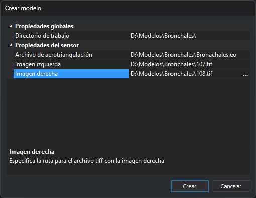

# Crear modelo
<!-- id: crear-modelo -->

Este cuadro de diálogo crea un archivo de modelo (`.d3d`) y lo añade a la pasada seleccionada. Lo abre el botón **Crear** de la lista **Modelos** del cuadro de diálogo [Crear proyecto fotogramétrico](crear-proyecto-fotogrametrico.md).

## Campos

* **Propiedades globales**
  * **Directorio de trabajo**: carpeta en la que se crea el archivo del modelo. Por defecto, la carpeta del archivo de proyecto.
  * **Nombre del archivo .d3d**: nombre, sin extensión, del archivo del modelo. Digi3D.AI propone el nombre del modelo que forma el sensor (con el sensor Cónico, los nombres de las imágenes izquierda y derecha separados por un guion) y lo recalcula cada vez que cambias una propiedad del cuadro de diálogo, salvo que hayas escrito otro nombre en este campo.
* **Propiedades del sensor**: los parámetros del sensor seleccionado en el campo **Sensor** del cuadro de diálogo Crear proyecto fotogramétrico. Cada sensor muestra sus propios parámetros. Por ejemplo, el sensor Cónico solicita el archivo de aerotriangulación y las imágenes izquierda y derecha.
* **Área de descripción**: la parte inferior muestra la descripción del parámetro seleccionado.
* **Crear**: crea el archivo del modelo en el directorio de trabajo, con el valor del campo **Nombre del archivo .d3d** y la extensión `.d3d` (con el sensor Cónico y el nombre propuesto, por ejemplo, **107-108.d3d**). Después añade el modelo a la lista **Modelos** y cierra el cuadro de diálogo.
* **Cancelar**: cierra el cuadro de diálogo sin crear el modelo.

## Observaciones

* Antes de crear el archivo del modelo, Digi3D.AI comprueba las propiedades de los sensores [Web Map Service](../ventana-fotogrametrica/sensores/wms.md), [Web Map Tile Service](../ventana-fotogrametrica/sensores/wmts.md) y Modelos 3D (por ejemplo, la URL del servidor): si una propiedad no es válida, Digi3D.AI muestra un mensaje y el cuadro de diálogo sigue abierto. Con los demás sensores, **Crear** acepta los parámetros tal como estén.
* Antes de crear el archivo, Digi3D.AI quita los espacios del principio y del final del campo **Nombre del archivo .d3d** y la extensión `.d3d` si la has escrito. Si el nombre resultante está vacío, acaba en punto o en espacio, contiene caracteres de control o alguno de los caracteres `\ / : * ? " < > |`, o es un nombre reservado de Windows (`CON`, `PRN`, `AUX`, `NUL`, `COM1` a `COM9` y `LPT1` a `LPT9`, con o sin extensión), Digi3D.AI muestra un mensaje, selecciona el campo y el cuadro de diálogo sigue abierto.
* Si el archivo `.d3d` ya existe en el directorio de trabajo, **Crear** pregunta «¿Quieres guardar el modelo nuevo en el archivo de modelo existente?». Con **No**, el cuadro de diálogo sigue abierto y el campo **Nombre del archivo .d3d** queda seleccionado. Con **Sí**, Digi3D.AI actualiza el archivo con el directorio de trabajo, el sensor y sus parámetros, y conserva el resto de su contenido.
* Si no se puede escribir el archivo, Digi3D.AI muestra el error «No se ha podido crear el modelo fotogramétrico.», con la ruta del archivo y la descripción del fallo. El modelo se añade igualmente a la lista **Modelos**.
* **Crear** no comprueba si el modelo ya está en la lista **Modelos**. Si ya está, el modelo aparece dos veces.
