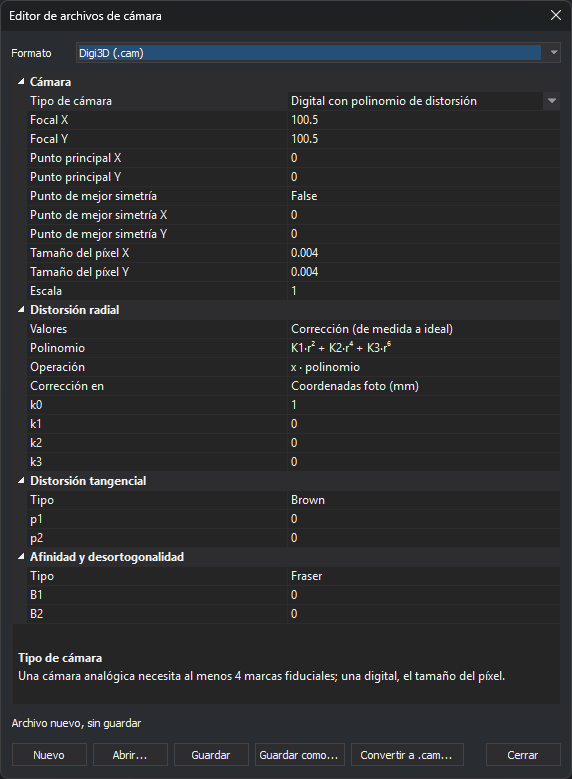

# Editor de archivos de cámara
<!-- id: editor-archivos-camara -->

Este cuadro de diálogo crea, abre y guarda los archivos de cámara de cinco formatos que lee el [sensor cónico](../ventana-fotogrametrica/sensores/camara-conica/README.md). También convierte a archivo `.cam` de Digi3D la cámara de cualquier otro formato o proyecto, por ejemplo la de un proyecto de Inpho. No necesita un modelo abierto.

## Abrir el cuadro de diálogo

Selecciona la opción del menú **Herramientas/Editor de archivos de cámara...**.

## Formatos

En la lista **Formato**, elige el formato del archivo:

| Formato | Archivo | Página |
|---|---|---|
| Digi3D (.cam) | `.cam` con sección `[Camara]` | [Digi3D](../ventana-fotogrametrica/sensores/camara-conica/extensiones/digi3d.md) |
| RapidCal (.cal) | `.cal` | [RapidCal](../ventana-fotogrametrica/sensores/camara-conica/extensiones/rapidcal.md) |
| OpenCV (.cocv) | `.cocv` | [OpenCV](../ventana-fotogrametrica/sensores/camara-conica/extensiones/opencv.md) |
| Pix4D (.cam) | `.cam` cuyo nombre termina en `_pix4d_calibrated_internal_camera_parameters.cam` | [Pix4D](../ventana-fotogrametrica/sensores/camara-conica/extensiones/pix4d.md) |
| Agisoft PhotoScan y Metashape (.xml) | `.xml` con una calibración (elemento raíz `calibration`) | [PhotoScan](../ventana-fotogrametrica/sensores/camara-conica/extensiones/photoscan.md) |

Al cambiar de formato, la cuadrícula se vacía: el cuadro no convierte la cámara de un formato a otro. Para pasar una cámara a `.cam` de Digi3D, usa [Convertir a .cam](#convertir-a-cam).

## Propiedades

La cuadrícula muestra los parámetros del formato elegido. Al seleccionar una propiedad, la parte inferior de la cuadrícula muestra su descripción, sus unidades y la clave del archivo en la que se guarda.

Los números se escriben con punto o con coma decimal. Si el texto de una celda no es un número, la celda recupera el valor anterior.

### Digi3D (.cam)

La propiedad **Tipo de cámara** decide qué propiedades aparecen:

* **Analógica con tabla de distorsión**: necesita al menos cuatro marcas fiduciales y no tiene tamaño de píxel.
* **Digital con tabla de distorsión**.
* **Digital con polinomio de distorsión**.

| Propiedad | Clave del archivo |
|---|---|
| **Focal X**, **Focal Y** | `Focal` (un solo valor si las dos focales son iguales) |
| **Punto principal X**, **Punto principal Y** | `PuntoPrincipal` |
| **Punto de mejor simetría**, X e Y | `PPS`. Si no se activa, la clave no se escribe y la distorsión se centra en el punto principal. |
| **Tamaño del píxel X**, **Tamaño del píxel Y** | `TamanoPixel` (un solo valor si los dos son iguales) |
| **Escala** | `Escala` |
| **Valores** | `TipoValorDistorsion`: **Corrección** (de medida a ideal) o **Error** (de ideal a medida) |
| **Polinomio** | `Pol` |
| **Operación** | `OperacionRadial` |
| **Corrección en** | `TipoCorreccion`: **Coordenadas foto** (`FotoAFiducial`) o **Coordenadas cámara** (`CamaraAFoto`) |
| **k0** a **k3** | `k0` a `k3` |
| **Tabla de distorsión** | `Distorsion1`, `Distorsion2`... |
| **Tipo** (distorsión tangencial) | `TipoDistorsionTangencial` |
| **p1**, **p2** | `p1`, `p2` |
| **Tipo** (afinidad y desortogonalidad) | `TipoDesortogonalidad` |
| **B1**, **B2** | `B1`, `b2` |
| **Coordenadas** (marcas fiduciales) | `Fiducial1`, `Fiducial2`... |

Las tablas se escriben como pares de números separados por punto y coma. En la tabla de distorsión, cada par es un radio y su distorsión, en mm; en las marcas fiduciales, las coordenadas X e Y, en mm. Por ejemplo: `10 0.001; 20 0.002`. Si un par no son exactamente dos números, **Guardar** no escribe el archivo y muestra el mensaje «El texto «*par*» de «*propiedad*» no son dos números separados por un espacio...».

El cuadro escribe el archivo con la sección y las claves en español. Escribe siempre `TipoValorDistorsion` y, en las cámaras con polinomio, también `TipoCorreccion`, aunque tengan el valor por defecto.

### Agisoft PhotoScan y Metashape (.xml)

La propiedad **Parametrización** elige entre dos formas de dar la cámara:

* **Metashape**: focal `f`, afinidad `b1` y desortogonalidad `b2`. `cx` y `cy` son el desplazamiento del punto principal respecto al centro de la imagen.
* **PhotoScan antiguo**: focales `fx` y `fy` y desortogonalidad `skew`. `cx` y `cy` son la columna y la fila del punto principal.

Al cambiar de parametrización, `cx` y `cy` conservan su valor: corrígelos con el significado de la nueva parametrización.

## Botones

* **Nuevo**: vacía la cuadrícula del formato elegido.
* **Abrir...**: abre un archivo de uno de los cinco formatos. El formato se deduce de la extensión; los `.cam` de Pix4D se distinguen porque su primera línea es `Pix4D camera calibration file`. Si el archivo no se puede leer, el mensaje da el motivo e indica que la cámara de otros formatos y de los proyectos se pasa a `.cam` con **Convertir a .cam...**.
* **Guardar**: guarda en el archivo abierto. Si el archivo es nuevo, funciona como **Guardar como...**.
* **Guardar como...**: guarda en un archivo nuevo. En el formato Pix4D, si el nombre no termina en `_pix4d_calibrated_internal_camera_parameters.cam`, se añade esa terminación, porque la extensión de Pix4D solo reconoce los archivos con ese nombre.
* **Convertir a .cam...**: consulta [Convertir a .cam](#convertir-a-cam).
* **Cerrar**: cierra el cuadro. Los cambios sin guardar se pierden.

La línea de encima de los botones muestra la ruta del archivo, o «Archivo nuevo, sin guardar».

## Convertir a .cam

**Convertir a .cam...** crea un archivo `.cam` de Digi3D a partir de la cámara de cualquier formato que lea el sensor cónico: proyectos de Inpho, LPS o ContextCapture, archivos de PhotoScan, Pix4D, RapidCal, etc.

1. Pulsa **Convertir a .cam...**.
2. Selecciona el archivo de cámara o de proyecto.
3. Selecciona una de las fotos tomadas con esa cámara. Digi3D.AI lee de la foto su tamaño en píxeles; la foto tiene que estar en TIFF (también BigTIFF), JPEG, PNG o BMP. En los proyectos, la extensión localiza la cámara por el nombre de la foto, así que la foto tiene que figurar en el proyecto. Si el proyecto tiene varias cámaras, repite la conversión con una foto de cada una.
4. Lee el mensaje con el resultado. La cámara queda en la cuadrícula como archivo `.cam` nuevo, sin guardar.
5. Pulsa **Guardar como...** para guardar el archivo.

Digi3D.AI ajusta una cámara **Digital con polinomio de distorsión** que reproduce los rayos de la cámara de origen en una malla de 40 × 30 píxeles de la foto, bordes incluidos. El ajuste calcula la focal, el punto principal, los coeficientes `k1` a `k3` (con `Pol=K1_R2_K2_R4`, `OperacionRadial=X_CORRECTION` y `TipoCorreccion=FotoAFiducial`), la distorsión tangencial de Brown (`p1`, `p2`) y la afinidad y desortogonalidad de Fraser (`B1`, `b2`). Prueba los dos valores de `TipoValorDistorsion` y se queda con el de menor error.

El mensaje del resultado indica:

* **Error medio cuadrático** y **Error máximo**: distancia, en píxeles de la foto, entre el píxel de la cámara de origen y el del archivo `.cam` para el mismo rayo.
* **Valores**: el valor de `TipoValorDistorsion` elegido.
* **Tamaño del píxel**: si la cámara de origen da la focal en mm, como Inpho, el tamaño del píxel se deduce de ella. Si no, se usa el de la propiedad **Tamaño del píxel X** de la cuadrícula: escribe el tamaño del píxel de la cámara y vuelve a convertir. El tamaño del píxel solo cambia la escala de las longitudes del `.cam`, no los rayos.
* Si la cámara de origen usa otros ejes, como Metashape, el mensaje avisa de que las orientaciones externas del proyecto de origen no sirven con el `.cam`, porque el `.cam` da los ejes con X hacia la derecha e Y hacia arriba de la foto.

El error es casi nulo cuando la cámara de origen usa el mismo modelo. Si la cámara de origen tiene términos que el `.cam` no tiene, queda un error residual. Por ejemplo, el `.cam` no tiene el coeficiente `k4` (r⁸) de Metashape: en una cámara con `k4` = −0,28 quedan 0,05 px de error medio cuadrático y 0,45 px en las esquinas.

Mensajes:

* «No se puede leer el tamaño de la foto *foto*. Elige una foto en TIFF, JPEG, PNG o BMP.»
* «Ninguna extensión de cámara reconoce el archivo *archivo* con la foto *foto*.»
* «La cámara de origen no da un rayo válido en el píxel (*columna*, *fila*): no se le puede ajustar un archivo .cam.»
