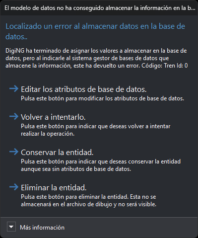

# Error al almacenar datos en la base de datos
<!-- id: error-al-almacenar-datos-en-la-base-de-datos -->

Digi3D.AI muestra el cuadro «El modelo de datos no ha conseguido almacenar la información en la base de datos» cuando el sistema gestor de bases de datos rechaza el registro de un código de una entidad. Aparece al registrar una entidad nueva en un archivo de dibujo conectado a una base de datos y al pulsar **Aceptar** en el cuadro de diálogo [Editar códigos](../ventana-de-dibujo/ordenes/e/editar-cod.md).

El error se produce en uno de estos pasos:

* Al leer el registro que ya tiene enlazado el código.
* Al crear un registro nuevo en la tabla.
* Al guardar el registro, después de asignar los valores de todos los campos. Por ejemplo, la base de datos tiene una columna que no admite valores nulos y que no recibe ningún valor, o un valor repetido en una columna de valores únicos.
* Al leer el identificador del registro recién creado.

Si lo que falla es la asignación del valor de un campo concreto, Digi3D.AI muestra en su lugar el cuadro de diálogo [Error en los atributos de usuario](error-en-los-atributos-de-usuario.md).

## Contenido

* **Instrucción principal**: el paso en el que se produjo el error.
* **Texto**: el código de la entidad y el registro de la base de datos. Cuando el error se produce al guardar el registro, incluye también la descripción del error que devolvió el sistema gestor de bases de datos; en ella suele aparecer el nombre de la columna que rechazó el valor. El registro aparece como «nuevo» si el código todavía no tiene un registro enlazado.
* **Más información**: el módulo que generó el error, la tabla, el código del error en hexadecimal, el mensaje, el origen y la descripción del error que devolvió el sistema gestor de bases de datos.

## Botones

* **Editar los atributos de base de datos**: abre el cuadro de diálogo [Editar códigos](../ventana-de-dibujo/ordenes/e/editar-cod.md) con el código que ha fallado. Al cerrarlo, con **Aceptar** o con **Cancelar**, Digi3D.AI vuelve a intentar almacenar el código. Si el error se repite, se muestra otra vez este cuadro de diálogo.
* **Volver a intentarlo**: intenta almacenar otra vez el código con los mismos valores. Sirve cuando la causa del error se ha corregido fuera de Digi3D.AI, por ejemplo en la propia base de datos.
* **Conservar la entidad**: guarda la entidad en el archivo de dibujo. El código que ha fallado queda sin registro en la base de datos.
* **Eliminar la entidad**: descarta la entidad. No se guarda en el archivo de dibujo ni se muestra.

Si el cuadro aparece al pulsar **Aceptar** en el cuadro de diálogo Editar códigos, **Conservar la entidad** y **Eliminar la entidad** solo cierran este cuadro: la entidad no se elimina y conserva los cambios hechos en el editor, y los códigos siguientes al que ha fallado no se almacenan en la base de datos.
