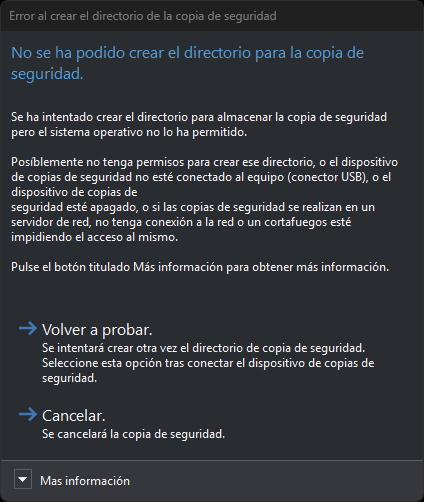

# Error al crear el directorio de la copia de seguridad
<!-- id: error-al-crear-el-directorio-de-la-copia-de-seguridad -->

Antes de hacer una copia de seguridad, Digi3D.AI crea el directorio de destino si no existe. La ruta del archivo de la copia sale de la opción [Destino de copias de seguridad](configuracion/copia-de-seguridad/destino-de-copias-de-seguridad.md) o, si la copia se hace al comprimir, de [Destino de copias de seguridad al comprimir](configuracion/copia-de-seguridad/destino-de-copias-de-seguridad-al-comprimir.md). Digi3D.AI muestra este cuadro cuando el sistema operativo no permite crear ese directorio.

El cuadro aparece con la orden [BAK](../ventana-de-dibujo/ordenes/b/bak.md), con la copia automática que se hace cada cierto número de minutos y con las copias que se hacen al salir y al comprimir.

## Contenido

* **Más información**: el mensaje de error del sistema operativo y el directorio que Digi3D.AI ha intentado crear.

## Botones

El cuadro no se puede cerrar con la tecla Esc ni con el botón de cierre de la ventana: tienes que elegir uno de estos botones.

* **Volver a probar**: Digi3D.AI intenta crear otra vez el directorio. Si vuelve a fallar, muestra otra vez el cuadro. Usa esta opción después de conectar el dispositivo de copias de seguridad o de recuperar el acceso a la red.
* **Cancelar**: Digi3D.AI no hace la copia de seguridad.

## No se ha podido realizar la copia de seguridad

Si el directorio existe o se ha creado, Digi3D.AI escribe la copia de seguridad. Si el exportador del formato del archivo de dibujo devuelve un error, Digi3D.AI muestra el cuadro **No se ha podido realizar la copia de seguridad**. Este cuadro tiene el mismo comportamiento:

* **Más información**: el mensaje de error del exportador y la ruta del archivo de la copia de seguridad.
* **Volver a probar**: Digi3D.AI intenta escribir otra vez la copia de seguridad.
* **Cancelar**: Digi3D.AI no hace la copia de seguridad.
