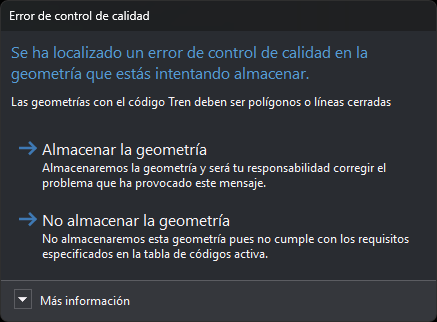

# Error de control de calidad
<!-- id: error-de-control-de-calidad -->

Digi3D.AI muestra este cuadro al terminar de digitalizar una geometría cuando uno de los controles de calidad de su código detecta un error en la geometría o en su relación con otras geometrías. El análisis se hace si la variable [CONTROL\_CALIDAD\_AL\_FINALIZAR\_ENTIDAD](../ventana-de-dibujo/variables/c/control-calidad.md) está activada y el código tiene la propiedad **Analizar control de calidad al digitalizar** a **Sí** en la [tabla de códigos](../editor-de-tablas-de-codigos/pestanas/codigos/propiedades-del-codigo.md#control-de-calidad).

Si los controles de calidad devuelven varios errores, el cuadro muestra solo el primero.

## Contenido

* **Texto**: el mensaje de error que devuelve el control de calidad. En la captura, «Las geometrías con el código Tren deben ser polígonos o líneas cerradas».
* **Más información**: explica que el análisis de control de calidad está activado y que se desactiva con la orden **CONTROL\_CALIDAD\_AL\_FINALIZAR\_ENTIDAD** o con la opción del menú **Control de calidad/Analizar control de calidad al digitalizar entidad**.

## Botones

El cuadro no tiene botón de cierre: tienes que elegir uno de estos botones.

* **Almacenar la geometría**: Digi3D.AI almacena la geometría con el error. Si el control de calidad indica las coordenadas del error, la ventana de dibujo se desplaza hasta ellas y, si la variable [IR\_TENTATIVO](../ventana-de-dibujo/variables/i/ir_tentativo.md) está activada, el cursor se mueve a ese punto.
* **No almacenar la geometría**: Digi3D.AI descarta la geometría, la borra de la pantalla, reproduce el sonido de error y muestra el mensaje del control de calidad en un globo.
