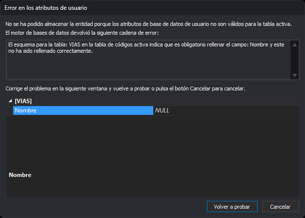

# Error en los atributos de usuario
<!-- id: error-en-los-atributos-de-usuario -->

Digi3D.AI muestra este cuadro de diálogo cuando no puede guardar en la base de datos los atributos de una entidad. Aparece al registrar una entidad nueva en un archivo de dibujo conectado a una base de datos y al pulsar **Aceptar** en el cuadro de diálogo [Editar códigos](../ventana-de-dibujo/ordenes/e/editar-cod.md). Ocurre en estos casos:

* El motor de base de datos rechaza el valor de un atributo. Por ejemplo, un texto más largo que el tamaño del campo en la base de datos.
* El campo tiene desactivada la opción [Permitir longitud 0](../editor-de-tablas-de-codigos/pestanas/base-de-datos/propiedades-de-los-campos.md#permitir-longitud-0) en la tabla de códigos y el atributo no tiene valor. Digi3D.AI hace esta comprobación antes de enviar el valor a la base de datos.
* Un control de calidad que se ejecuta al dibujar rechaza el valor de un atributo.

Si el motor de base de datos acepta los valores de los campos pero rechaza el registro al guardarlo, Digi3D.AI muestra el cuadro de diálogo [Error al almacenar datos en la base de datos](error-al-almacenar-datos-en-la-base-de-datos.md).

## Campos

* **Se ha producido el siguiente error**: el mensaje de error. Lo genera el motor de base de datos, el control de calidad o el propio Digi3D.AI cuando un campo que no admite longitud 0 está vacío.
* **Rejilla de atributos**: muestra solo el atributo que ha fallado. Corrige su valor aquí. La rejilla queda vacía si el campo pertenece a un grupo del esquema de la tabla o está marcado como oculto.
* **Volver a probar**: intenta guardar otra vez la entidad con los valores corregidos.
* **Cancelar** (o la tecla Esc): Digi3D.AI muestra el cuadro [Atributos de base de datos no válidos](atributos-de-base-de-datos-no-validos.md) para que elijas entre volver a asignar el valor, conservar la entidad sin el registro de ese código o eliminar la entidad.

  Si el error lo produjo un control de calidad, **Cancelar** descarta la entidad sin preguntar.
