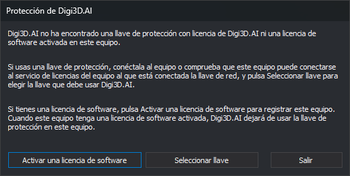
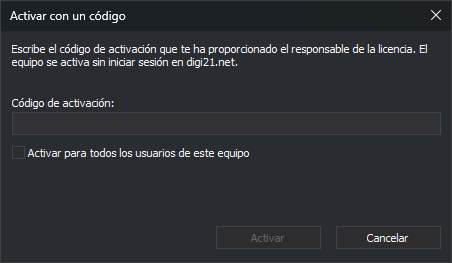

# Licencias de software
<!-- id: licencias-de-software -->

Este cuadro de diálogo muestra el estado de las licencias de software del equipo y permite activar el equipo, renovar la autorización de uso, obtener una sesión simultánea, consultar los módulos con licencia y eliminar la activación del equipo para volver a usar la llave de protección (llave HASP). Digi3D.AI usa licencias de software, en lugar de una llave de protección, cuando el equipo tiene una activación de licencias de software o cuando eliges **Activar una licencia de software** en el cuadro [Protección de Digi3D.AI](#elegir-la-protección-al-iniciar-digi3dai). Para una visión general de las licencias de software, consulta la sección [Licencias de software](../../../licencias-de-software/README.md).

## Elegir la protección al iniciar Digi3D.AI

Al iniciarse, Digi3D.AI decide si usa licencias de software o una llave de protección con las reglas descritas en [Cómo elige el programa entre la licencia de software y la llave de protección](../../../licencias-de-software/README.md#cómo-elige-el-programa-entre-la-licencia-de-software-y-la-llave-de-protección). Cuando el equipo no tiene ninguna activación de licencias de software y Digi3D.AI no inicia sesión en una llave que tenga licencia de Digi3D.AI, Digi3D.AI muestra el cuadro **Protección de Digi3D.AI**.

El cuadro **Protección de Digi3D.AI** indica que Digi3D.AI no ha encontrado una llave de protección con licencia de Digi3D.AI ni una licencia de software activada en el equipo. Tiene tres botones:

* **Activar una licencia de software**: Digi3D.AI usa licencias de software y abre el cuadro de diálogo **Licencias de software** de esta página, con los botones **Continuar** y **Salir**, para que actives el equipo. Cuando el equipo tiene una licencia de software activada, Digi3D.AI deja de usar la llave de protección en ese equipo.
* **Seleccionar llave**: Digi3D.AI abre el programa [Selecciona llave](../../../acerca-llaves-proteccion/programas-relacionados-con-licencias-y-llaves-de-proteccion/selecciona-llave.md), espera a que termine y vuelve a intentar iniciar sesión en una llave de protección. Si la llave tiene licencia de Digi3D.AI, Digi3D.AI se inicia con la llave; en caso contrario, vuelve a mostrar el cuadro **Protección de Digi3D.AI**.
* **Salir**: cierra Digi3D.AI sin completar el inicio.

## Abrir el cuadro de diálogo

El cuadro de diálogo aparece en tres casos:

* Al iniciar Digi3D.AI, si el equipo no tiene licencia de edición. Digi3D.AI no continúa el inicio hasta que el equipo tenga licencia de edición o pulses **Salir**.
* Al seleccionar la opción del menú **Ayuda/Licencias de software...**, tanto si Digi3D.AI usa licencias de software como si usa la llave de protección. En este caso el cuadro de diálogo tiene un único botón de cierre, **Cerrar**. Si Digi3D.AI usa la llave de protección, consulta [Activar licencias de software mientras Digi3D.AI usa la llave de protección](#activar-licencias-de-software-mientras-digi3dai-usa-la-llave-de-protección).
* Cuando el equipo pierde la licencia de edición con un dibujo abierto, por ejemplo porque se ha revocado la activación del equipo. Mientras hay algún dibujo abierto, Digi3D.AI comprueba la licencia cada 5 minutos. En este caso el cuadro de diálogo tiene los botones **Cerrar** y **Salir**.

## Información que muestra

En la parte superior, el cuadro de diálogo muestra estas líneas de texto, sin etiqueta:

* **Estado** de las licencias del equipo. Los textos posibles son:
  * «Digi3D.AI todavía no ha leído las licencias de software de este equipo.»
  * «Este equipo no está registrado. Haz clic en Activar este equipo para registrarlo.»
  * «El registro de este equipo está en curso.»
  * «Este equipo tiene una autorización de uso válida.»
  * «La autorización de uso de este equipo ha caducado o no se ha podido verificar. Conéctate a Internet y haz clic en Renovar la autorización de uso.»
  * «Digi3D.AI necesita sincronizar la hora con el servidor. Conéctate a Internet y haz clic en Renovar la autorización de uso.»
  * «Windows no ha podido abrir ni crear la clave criptográfica de este equipo.» Con este estado, el botón de activación está deshabilitado.
* Si alguna de las licencias del equipo permite ejecutar esta versión de Digi3D.AI (licencia de edición): «Digi3D.AI tiene licencia de software en este equipo.» o «Ninguna de las licencias de software de este equipo permite ejecutar esta versión de Digi3D.AI.»
* La fecha y la hora antes de las cuales el equipo tiene que conectarse con el servidor de licencias («El equipo tiene que conectarse con el servidor de licencias antes del…»). Solo aparece cuando el equipo tiene una autorización de uso válida.
* La sesión simultánea de la licencia de edición (línea **Sesión:**). Solo aparece cuando la licencia de edición tiene una sesión simultánea o necesita una. Los textos posibles son:
  * «Sesión: sin iniciar.» (la licencia de edición necesita una sesión y Digi3D.AI todavía no ha solicitado ninguna)
  * «Sesión: activa con *servidor* (hasta *n* programas abiertos a la vez).»
  * «Sesión: sin conexión con *servidor*; los módulos autorizados por esta sesión conservan la licencia hasta las *hora*.»
  * «Sesión: perdida; los módulos conservan la licencia hasta las *hora*.»
  * «Sesión: sin licencia.»

  La hora es «sin límite» si Digi3D.AI no dispone de la hora límite. Consulta [Sesiones simultáneas](../../../licencias-de-software/sesiones-simultaneas.md).
* El resultado de la última operación (por ejemplo, que el servidor ha concedido la autorización o que la petición ha fallado) o el progreso de la operación en curso.

Debajo de los botones aparece la lista de módulos:

* **Módulos con licencia en este equipo**: una fila por cada módulo con licencia, ordenadas por el nombre del módulo:
  * **Módulo**: el nombre del módulo (consulta [Módulos de Digi3D.AI](#módulos-de-digi3dai)).
  * **Tipo**: compra, alquiler, demostración o desconocido.
  * **Uso permitido hasta**: la fecha y la hora hasta las que se puede usar el módulo. La columna **Uso permitido hasta** muestra «sin límite» si la licencia no tiene fecha de fin.
  * **Versiones compiladas hasta, inclusive**: la fecha de compilación más reciente de las versiones de Digi3D.AI que pueden usar este módulo. Una versión compilada después de esa fecha no puede usar el módulo. La columna **Versiones compiladas hasta, inclusive** muestra «sin límite» si la licencia no limita la fecha de compilación.

## Activar el equipo con aprobación en digi21.net

1. Pulsa **Activar este equipo**. Digi3D.AI solicita un código de usuario al servidor y abre la página de verificación en el navegador. El cuadro de diálogo muestra el código de usuario y la dirección de la página.
2. Comprueba que la página del navegador muestra el mismo código de usuario que el cuadro de diálogo. Si el navegador no se ha abierto, escribe en él la dirección que muestra el cuadro de diálogo («Si el navegador no se ha abierto, ve a esta dirección:»).
3. Inicia sesión en digi21.net.
4. Aprueba el registro del equipo y elige las licencias que quieres activar en él.
5. Vuelve a Digi3D.AI. Mientras Digi3D.AI espera la aprobación del registro del equipo, el programa consulta al servidor de licencias, detecta la aprobación automáticamente y actualiza el estado de las licencias y la lista de módulos. No hace falta pulsar ningún botón.

Si el código de usuario caduca antes de que apruebes el registro, el cuadro de diálogo lo indica; pulsa **Activar este equipo** para solicitar un código nuevo. Si rechazas el registro en la página, el cuadro de diálogo indica que se ha rechazado.

## Activar el equipo con un código de activación

Un código de activación activa el equipo sin que ningún usuario inicie sesión en digi21.net. Digi21 entrega los códigos de activación al titular de la licencia. Consulta [Activar con un código de activación](../../../licencias-de-software/activar-ordenadores.md#activar-con-un-código-de-activación).

1. Pulsa **Activar con un código...**. Digi3D.AI abre el cuadro **Activar con un código**.
2. Escribe el código de activación en el campo **Código de activación**. El botón **Activar** está deshabilitado mientras el campo está vacío.
3. Marca **Activar para todos los usuarios de este equipo** si quieres que todos los usuarios de Windows del equipo usen la activación. Windows pide permisos de administrador. Si no marcas la casilla, solo queda activado el usuario de Windows que ejecuta Digi3D.AI. Si Digi3D.AI ya usa una activación para todos los usuarios del equipo, la casilla aparece marcada y deshabilitada.
4. Pulsa **Activar**. Mientras la activación está en curso, el cuadro muestra «Activando el equipo...» y deshabilita el campo, la casilla y el botón **Activar**. Si la activación se concede, el cuadro **Activar con un código** se cierra y el cuadro **Licencias de software** actualiza el estado y la lista de módulos. Si la activación falla, el cuadro **Activar con un código** muestra el motivo y vuelve a habilitar el campo, la casilla y el botón **Activar**. Los motivos posibles están en [Resultados posibles al activar con código](../../../licencias-de-software/activar-ordenadores.md#resultados-posibles-al-activar-con-código).

Pulsa **Cancelar** para cerrar el cuadro **Activar con un código** sin activar el equipo. La orden de línea de órdenes `/activar-equipo <código>` de `Digi3D.exe` activa el equipo para todos los usuarios de Windows sin mostrar ningún cuadro de diálogo; consulta [Con la orden /activar-equipo](../../../licencias-de-software/activar-ordenadores.md#con-la-orden-activar-equipo).

## Activar licencias de software mientras Digi3D.AI usa la llave de protección

Si Digi3D.AI se ha iniciado con la llave de protección, el cuadro de diálogo que se abre desde **Ayuda/Licencias de software...** muestra en la parte superior el texto «Digi3D.AI está usando la llave HASP. Si activas Licencias de software en este equipo, Digi3D.AI seguirá usando la llave HASP hasta que se cierre y usará Licencias de software la próxima vez que se inicie.».

Desde este cuadro de diálogo puedes activar el equipo con aprobación en digi21.net o con un código de activación, renovar la autorización de uso y consultar los módulos con licencia, igual que cuando Digi3D.AI usa licencias de software. Mientras Digi3D.AI usa la llave de protección, el cuadro de diálogo no solicita sesiones simultáneas: no muestra la línea **Sesión:** ni el botón **Obtener licencia**.

Cuando una activación se concede, Digi3D.AI muestra el mensaje «Se ha activado Licencias de software en este equipo. Digi3D.AI seguirá usando la llave HASP hasta que se cierre, y usará Licencias de software la próxima vez que se inicie.». Digi3D.AI sigue usando la llave de protección hasta que lo cierres; al iniciarse de nuevo, encuentra la activación y usa licencias de software.

## Volver a la llave de protección

El botón **Usar la llave HASP** elimina de este equipo la activación de licencias de software de Digi3D.AI, para que Digi3D.AI vuelva a usar la llave de protección. El botón solo aparece cuando el equipo tiene una activación de licencias de software de Digi3D.AI, del usuario de Windows o para todos los usuarios del equipo.

1. Pulsa **Usar la llave HASP**. Digi3D.AI pide confirmación. Si el equipo tiene una activación para todos los usuarios de Windows y Digi3D.AI no se ejecuta como administrador, el mensaje de confirmación indica que Windows pedirá permisos de administrador.
2. Pulsa **Sí**. Mientras se elimina la activación, el cuadro de diálogo muestra «Digi3D.AI está eliminando la activación de este equipo.» y deshabilita todos sus botones salvo **Mis licencias de software**. Si la eliminación no ha terminado 120 segundos después de pulsar **Sí**, por ejemplo porque la petición de permisos de administrador sigue abierta, el botón de cierre se habilita; si cierras el cuadro de diálogo, la eliminación continúa y Digi3D.AI no muestra su resultado.
3. Espera a que Digi3D.AI elimine la activación del usuario de Windows y la activación para todos los usuarios del equipo, si existen. Digi3D.AI borra la autorización de uso, el estado del reloj y la clave del equipo de cada activación. Para eliminar la activación para todos los usuarios, Digi3D.AI se vuelve a ejecutar con permisos de administrador con la orden [/eliminar-activacion-equipo](../linea-de-comandos/eliminar-activacion-equipo.md). Si cancelas la petición de permisos de administrador, Digi3D.AI no elimina ninguna activación.
4. Lee el resultado que muestra Digi3D.AI.

Lo que ocurre después depende de la protección que usa Digi3D.AI:

* **Digi3D.AI usa licencias de software**: antes de borrar la activación, Digi3D.AI devuelve al servidor las sesiones simultáneas que tenga. Después de eliminar la activación, Digi3D.AI cierra el cuadro de diálogo e inicia su propio cierre; si hay documentos modificados, pregunta si quieres guardarlos. Si cancelas el cierre, Digi3D.AI vuelve a intentar cerrarse cada 5 minutos mientras haya algún dibujo abierto y no haya ningún cuadro de diálogo abierto. Hasta que se cierra, Digi3D.AI no vuelve a abrir el cuadro **Licencias de software** ni permite activar el equipo. La próxima vez que se inicie, Digi3D.AI usa la llave de protección.
* **Digi3D.AI usa la llave de protección**: el cuadro de diálogo sigue abierto y Digi3D.AI sigue usando la llave de protección.

Digi3D.AI no comunica la eliminación a digi21.net: la plaza que ocupaba el equipo en la licencia sigue ocupada hasta que termine la activación o Digi21 la revoque. Para liberar la plaza, ponte en contacto con Digi21. Si vuelves a activar la licencia en el mismo ordenador, la activación nueva comparte la plaza de ese ordenador mientras la licencia admita otra clave de equipo en él; consulta [Número de ordenadores de una licencia](../../../licencias-de-software/activar-ordenadores.md#número-de-ordenadores-de-una-licencia).

Raster2Digi, CreaArchivoHmp y DigiTab muestran el mismo cuadro de diálogo al iniciarse sin licencia de edición, también con el botón **Usar la llave HASP**. Estos programas no pueden pedir permisos de administrador: si el equipo tiene una activación para todos los usuarios de Windows y el programa no se ejecuta como administrador, muestran un mensaje que indica que debes ejecutarlos como administrador o pulsar **Usar la llave HASP** en Digi3D.AI, y no eliminan ninguna activación. Cuando Raster2Digi, CreaArchivoHmp o DigiTab elimina la activación, ese programa termina.

## Botones

* **Activar este equipo**: inicia el procedimiento de aprobación en digi21.net cuando el equipo no está registrado. Si el equipo ya está registrado, el botón se llama **Activar licencias en este equipo** y repite el mismo procedimiento para activar más licencias en el equipo. El botón de activación está deshabilitado mientras hay otra operación en curso, mientras Digi3D.AI inicia el servicio de licencias, mientras el registro del equipo está en curso y cuando Windows no puede abrir ni crear la clave del equipo.
* **Cancelar el registro**: interrumpe la espera de la aprobación. Solo está habilitado mientras hay un registro en curso.
* **Renovar la autorización de uso**: pide al servidor una autorización de uso nueva. El botón de renovación está habilitado cuando el equipo tiene una autorización válida, cuando la autorización ha caducado o cuando hace falta sincronizar la hora del equipo, y está deshabilitado mientras hay otra operación en curso.
* **Mis licencias de software**: abre en el navegador la página de digi21.net con las licencias de software de tu cuenta.
* **Activar con un código...**: abre el cuadro **Activar con un código** (consulta [Activar el equipo con un código de activación](#activar-el-equipo-con-un-código-de-activación)). Está habilitado en las mismas condiciones que **Activar este equipo**.
* **Obtener licencia**: solicita inmediatamente una sesión simultánea de la licencia de edición y muestra en la línea de resultado «Digi3D.AI está obteniendo una licencia.» y, a continuación, «Digi3D.AI ha obtenido una licencia.» o el motivo por el que no la ha obtenido. El botón solo aparece cuando la licencia de edición tiene una sesión simultánea o necesita una. Está habilitado cuando no hay otra operación en curso, el equipo tiene una autorización de uso válida y la línea **Sesión:** indica «sin iniciar», «perdida» o «sin licencia».
* **Usar la llave HASP**: elimina de este equipo la activación de licencias de software de Digi3D.AI (consulta [Volver a la llave de protección](#volver-a-la-llave-de-protección)). El botón solo aparece cuando el equipo tiene una activación y está deshabilitado mientras hay otra operación en curso.
* **Continuar**: cierra el cuadro de diálogo que aparece al iniciar Digi3D.AI y continúa el inicio. El botón **Continuar** está habilitado solo cuando el equipo tiene licencia de edición.
* **Salir**: al iniciar Digi3D.AI, cierra el cuadro de diálogo y Digi3D.AI no se inicia. Cuando el equipo ha perdido la licencia de edición, cierra el cuadro de diálogo y cierra Digi3D.AI igual que al cerrar la ventana principal. No aparece en el cuadro de diálogo abierto desde el menú **Ayuda**.
* **Cerrar**: cierra el cuadro de diálogo abierto desde el menú **Ayuda** o al perder la licencia de edición. Si el cuadro de diálogo se abrió al perder la licencia de edición y el equipo sigue sin licencia de edición, Digi3D.AI muestra el mensaje «No tienes licencia para esta característica» y vuelve a abrir el cuadro de diálogo.

## Autorización de uso y trabajo sin conexión

La autorización de uso permite trabajar sin conexión a Internet hasta la fecha que muestra el cuadro de diálogo en la línea «El equipo tiene que conectarse con el servidor de licencias antes del…». Cuando queda menos de un tercio del plazo de la autorización y hay conexión, Digi3D.AI la renueva automáticamente. Si la fecha pasa sin que el equipo se haya conectado, el estado cambia a que la autorización ha caducado y debes conectarte a Internet y pulsar **Renovar la autorización de uso**.

Cuando Digi3D.AI renueva la autorización de uso, la autorización incluye los módulos añadidos a una licencia del equipo. Para actualizar la autorización de uso sin esperar a la renovación automática, pulsa **Renovar la autorización de uso**. Si el módulo añadido es `digi3d.fotogrametria`, reinicia Digi3D.AI después de renovar la autorización: Digi3D.AI carga las extensiones fotogramétricas al iniciarse.

## Módulos de Digi3D.AI

* `digi3d.edicion`: permite ejecutar Digi3D.AI.
* `digi3d.fotogrametria`: permite usar la ventana fotogramétrica. Sin este módulo, Digi3D.AI solo carga las extensiones Digi3D.Orthophoto y Digi3D.CommonCommands, de modo que la ventana fotogramétrica solo puede abrir modelos de ortofoto. Si la licencia del equipo no incluye `digi3d.fotogrametria`, Digi3D.AI muestra un aviso de falta de licencia cuando intentas abrir un modelo de un sensor distinto de la ortofoto o ejecutar una orden de una extensión fotogramétrica.

## Limitaciones de esta versión

* Las órdenes de modelos digitales del terreno de MDTopX (triangulación e importador de MDT) no están disponibles.
* No se pueden abrir ni crear tablas de códigos cifradas.
