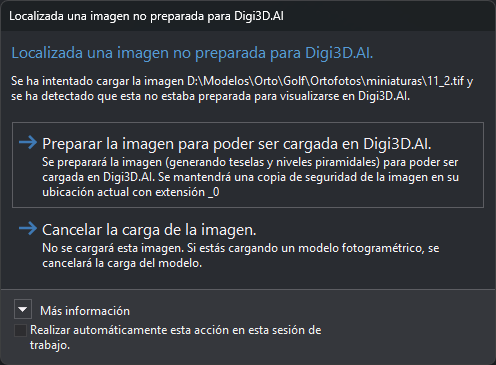

# Localizada una imagen no preparada para Digi3D.AI
<!-- id: localizada-una-imagen-no-preparada-para-digi3d-ai -->

Digi3D.AI muestra este cuadro al cargar las imágenes de un sensor (ortofoto, cámara cónica, sensores satelitales, ADS40...) cuando una imagen TIFF no está teselada. Digi3D.AI necesita que las imágenes TIFF estén formadas por teselas para no cargar la imagen entera en memoria.

Si la imagen está teselada pero no tiene niveles piramidales, Digi3D.AI no muestra este cuadro.

## Contenido

* La ruta de la imagen que no está preparada.
* **Más información**: explica qué son las teselas y los niveles piramidales.

## Botones

El cuadro no tiene botón de cierre. La tecla Esc equivale a **Cancelar la carga de la imagen**.

* **Preparar la imagen para poder ser cargada en Digi3D.AI**: Digi3D.AI renombra el archivo original añadiendo `__0` al final del nombre completo (por ejemplo, `foto.tif` pasa a llamarse `foto.tif__0`; si ese archivo ya existe, usa `__1`, `__2`...). Después escribe en la ruta original una imagen TIFF teselada con los niveles piramidales dentro del mismo archivo y la carga. La ventana de resultados y la barra de estado muestran el progreso. Si la conversión falla, Digi3D.AI no carga la imagen y el original se queda con el nombre terminado en `__0`.
* **Cancelar la carga de la imagen**: Digi3D.AI no carga la imagen. Si la imagen forma parte de un modelo fotogramétrico, Digi3D.AI no carga el modelo.

## Casilla Aplicar esta opción a las demás imágenes no preparadas hasta cerrar Digi3D.AI

Si marcas la casilla «Aplicar esta opción a las demás imágenes no preparadas hasta cerrar Digi3D.AI», Digi3D.AI guarda la acción del botón que pulses (o la cancelación con la tecla Esc) y la aplica sin mostrar el cuadro a todas las imágenes no preparadas que cargue hasta que cierres Digi3D.AI.

## Observaciones

Para preparar varias imágenes a la vez sin abrirlas en Digi3D.AI, usa el [Generador de niveles piramidales](../generador-de-niveles-piramidales.md).
