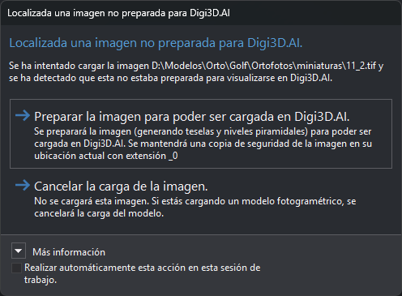

# Localizada una imagen no preparada para Digi3D.AI
<!-- id: localizada-una-imagen-no-preparada-para-digi3d-ai -->

Digi3D.AI muestra este cuadro al cargar las imágenes de un sensor (ortofoto, cámara cónica, sensores satelitales, ADS40...) cuando una imagen TIFF no está teselada. Digi3D.AI necesita que las imágenes TIFF estén formadas por teselas para no cargar la imagen entera en memoria.

Si la imagen está teselada pero no tiene niveles piramidales, Digi3D.AI no muestra este cuadro: muestra el cuadro «Imagen compatible pero sin niveles piramidales», que ofrece generar los niveles (consulta el [Generador de niveles piramidales](../generador-de-niveles-piramidales.md)).

Digi3D.AI no muestra este cuadro para una imagen leída desde una URL: si esa imagen no es compatible, Digi3D.AI muestra el mensaje de error y no ofrece convertirla.

## Contenido

* La ruta de la imagen que no está preparada.
* **Más información**: explica qué son las teselas y los niveles piramidales.

## Botones

El cuadro no tiene botón de cierre. La tecla Esc equivale a **Cancelar la carga de la imagen**.

* **Preparar la imagen para poder ser cargada en Digi3D.AI**: Digi3D.AI renombra el archivo original añadiendo un sufijo `__N` al final del nombre completo, con el primer número libre (por ejemplo, `foto.tif` pasa a llamarse `foto.tif__0`; si ese archivo ya existe, usa `foto.tif__1`, `foto.tif__2`...). Después escribe con el nombre original un COG (*Cloud Optimized GeoTIFF*, GeoTIFF optimizado para la nube): una imagen TIFF teselada con los niveles piramidales dentro del mismo archivo, con la compresión de la imagen original en todos los niveles, y la carga. La ventana de resultados y la barra de estado muestran el progreso. Si la conversión falla o se interrumpe con una excepción, Digi3D.AI intenta borrar el archivo temporal y el archivo de salida que haya escrito y restaurar el nombre inicial del archivo original, y no carga la imagen. Si la conversión falla, Digi3D.AI añade a la ventana de resultados el mensaje «Digi3D no ha podido convertir la imagen *archivo* en un GeoTIFF optimizado para la nube (COG).»; si además no puede restaurar el nombre inicial del archivo original, el mensaje indica la ruta en la que ha quedado el original.
* **Cancelar la carga de la imagen**: Digi3D.AI no carga la imagen. Si la imagen forma parte de un modelo fotogramétrico, Digi3D.AI no carga el modelo.

## Casilla Aplicar esta opción a las demás imágenes no preparadas hasta cerrar Digi3D.AI

Si marcas la casilla «Aplicar esta opción a las demás imágenes no preparadas hasta cerrar Digi3D.AI», Digi3D.AI guarda la acción del botón que pulses (o la cancelación con la tecla Esc) y la aplica sin mostrar el cuadro a todas las imágenes no preparadas que cargue hasta que cierres Digi3D.AI.

## Observaciones

Para preparar varias imágenes a la vez sin abrirlas en Digi3D.AI, usa el [Generador de niveles piramidales](../generador-de-niveles-piramidales.md).
