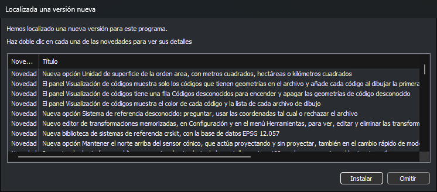
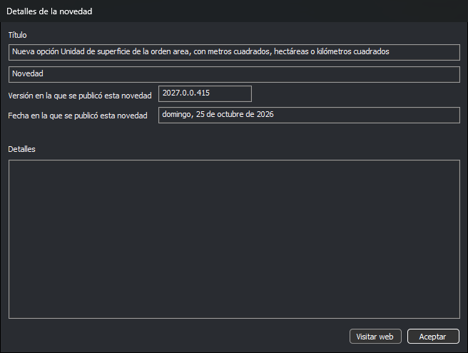
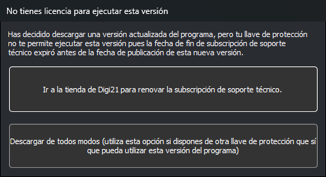

# Localizada una versión nueva
<!-- id: localizada-una-version-nueva -->

Digi3D.AI muestra este cuadro de diálogo cuando hay publicada una versión del programa posterior a la instalada. La lista contiene las novedades y las correcciones de las versiones publicadas después de la fecha de compilación de la versión instalada.

## Cuándo aparece

* Al arrancar Digi3D.AI, si la opción [Comprobar versión nueva](configuracion/comunicacion-con-internet/comprobar-version-nueva.md) vale **Sí**.
* Al seleccionar la opción del menú **Herramientas/Comprobar versión nueva...**. Si no hay ninguna versión nueva, Digi3D.AI muestra el mensaje «No se ha localizado ninguna versión nueva».

Digi3D.AI consulta las versiones publicadas en www.digi21.net. Si la opción [Permitir instalar versiones BETA](configuracion/comunicacion-con-internet/permitir-instalar-versiones-beta.md) vale **Sí**, la lista incluye también las versiones BETA. Las novedades aparecen en el idioma de la interfaz.

## Lista de novedades

Cada fila es una novedad o una corrección de una versión:

* **Novedad/Corrección**: el tipo de la fila.
* **Título**: la descripción breve.
* **Versión**: la versión en la que se publicó.
* **Fecha**: la fecha de publicación de esa versión.

Haz doble clic en una fila para abrir el cuadro de diálogo [Detalles de la novedad](#detalles-de-la-novedad).

## Botones

* **Instalar**: descarga el instalador de la versión más reciente de la lista y lo ejecuta.
  * Si la suscripción de soporte técnico de la llave de protección terminó antes de la fecha de publicación de esa versión, Digi3D.AI muestra antes el cuadro de diálogo [No tienes licencia para ejecutar esta versión](#no-tienes-licencia-para-ejecutar-esta-versión).
  * Durante la descarga aparece el cuadro de diálogo **Descargando** con una barra de progreso. Su botón **Cancelar** detiene la descarga.
  * Si el cuadro de diálogo apareció al arrancar, Digi3D.AI se cierra para que el instalador pueda sustituir el programa. Si lo abriste desde el menú **Herramientas**, Digi3D.AI sigue abierto mientras se ejecuta el instalador.
* **Omitir**: cierra el cuadro de diálogo sin descargar nada.

## Detalles de la novedad

Muestra la novedad de la fila en la que hiciste doble clic:

* **Título**: la descripción breve.
* El tipo: **Novedad** o **Corrección**.
* **Versión en la que se publicó esta novedad**.
* **Fecha en la que se publicó esta novedad**.
* **Detalles**: la descripción completa, si la novedad la tiene.
* **Visitar web**: abre en el navegador la página de la ayuda que explica la novedad. Está deshabilitado si la novedad no tiene página.
* **Aceptar**: cierra el cuadro de diálogo.

## No tienes licencia para ejecutar esta versión

Digi3D.AI muestra este cuadro de diálogo al pulsar **Instalar** si la suscripción de soporte técnico de la llave de protección terminó antes de la fecha de publicación de la versión nueva. Con esa llave, la versión nueva no se puede ejecutar.

* **Ir a la tienda de Digi21 para renovar la subscripción de soporte técnico**: abre la tienda de www.digi21.net en el navegador y cierra los dos cuadros de diálogo sin descargar nada.
* **Descargar de todos modos**: descarga y ejecuta el instalador. Usa esta opción si dispones de otra llave de protección que sí puede ejecutar esta versión.

El cuadro de diálogo no tiene botón de cierre. La tecla Esc equivale a **Descargar de todos modos**.
