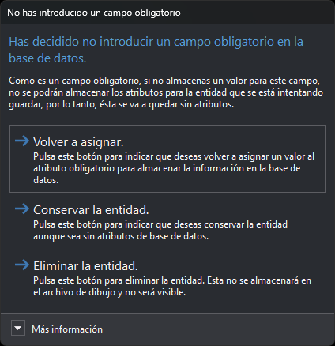

# No has introducido un campo obligatorio
<!-- id: no-has-introducido-un-campo-obligatorio -->

Digi3D.AI muestra este cuadro cuando pulsas **Cancelar** o la tecla Esc en el cuadro de diálogo [Error en los atributos de usuario](error-en-los-atributos-de-usuario.md). Ese cuadro aparece cuando Digi3D.AI no puede asignar el valor de un atributo al registro de la base de datos, en uno de estos casos:

* El campo tiene desactivada la opción [Permitir longitud 0](../editor-de-tablas-de-codigos/pestanas/base-de-datos/propiedades-de-los-campos.md#permitir-longitud-0) en la tabla de códigos y el atributo no tiene valor. Digi3D.AI hace esta comprobación antes de enviar el valor a la base de datos.
* El motor de base de datos rechaza el valor. Por ejemplo, un texto más largo que el tamaño del campo.

El cuadro aparece al registrar una entidad nueva en un archivo de dibujo conectado a una base de datos y al pulsar **Aceptar** en el cuadro de diálogo [Editar códigos](../ventana-de-dibujo/ordenes/e/editar-cod.md). El título habla de un campo obligatorio, pero el cuadro aparece también cuando el motor de base de datos rechaza el valor.

## Contenido

* **Más información**: la tabla de la base de datos, el nombre del campo y el texto del error que muestra el cuadro Error en los atributos de usuario.

## Botones

El cuadro no se puede cerrar con la tecla Esc ni con el botón de cierre de la ventana: tienes que elegir uno de estos botones.

* **Volver a asignar**: Digi3D.AI vuelve a asignar los valores de todos los campos del registro. Si el valor del campo sigue sin ser válido, muestra otra vez el cuadro de diálogo Error en los atributos de usuario.
* **Conservar la entidad**: guarda la entidad en el archivo de dibujo. Digi3D.AI no guarda en la base de datos el registro del código que ha fallado: si la entidad es nueva, ese código queda sin registro enlazado. Los demás códigos de la entidad se almacenan normalmente.
* **Eliminar la entidad**: descarta la entidad. No se guarda en el archivo de dibujo ni se muestra.

Si el cuadro aparece al pulsar **Aceptar** en el cuadro de diálogo Editar códigos, **Eliminar la entidad** no elimina la entidad: el editor se cierra, la entidad conserva los cambios hechos en el editor y los códigos siguientes al que ha fallado no se almacenan en la base de datos.
