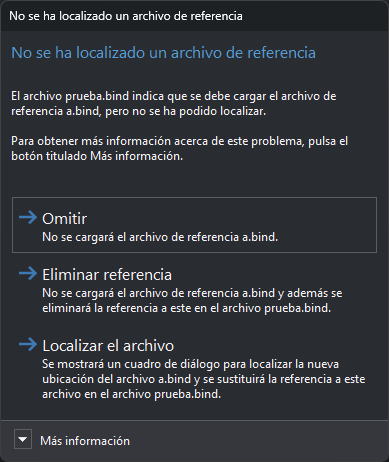

# No se ha localizado un archivo de referencia
<!-- id: no-se-ha-localizado-un-archivo-de-referencia -->

Digi3D.AI muestra este cuadro al abrir un archivo de dibujo cuando uno de sus archivos de referencia ya no existe en la ruta guardada. Aparece un cuadro por cada archivo de referencia que falta. Si has marcado los archivos de referencia en el cuadro [Selección de archivos de referencia](seleccion-de-archivos-de-referencia.md), solo se comprueban los que has marcado.

El contenido indica el archivo de dibujo que contiene la referencia y el nombre del archivo de referencia que falta.

## Contenido

* **Más información**: la ruta completa del archivo de referencia que no se ha podido localizar, tal y como está guardada en el [archivo de archivos de referencia](../archivos/archivo-de-archivos-de-referencia.md) o en el archivo de dibujo.

## Botones

El cuadro no se puede cerrar con la tecla Esc ni con el botón de cierre de la ventana: tienes que elegir uno de estos botones.

* **Omitir**: Digi3D.AI no carga este archivo de referencia y no modifica el archivo de dibujo. La referencia sigue guardada y el cuadro volverá a aparecer la próxima vez que abras el archivo de dibujo.
* **Eliminar referencia**: Digi3D.AI no carga el archivo de referencia y elimina la referencia al instante, sin esperar a que guardes: la quita del archivo de dibujo y del archivo de archivos de referencia. El efecto es el mismo que el de la orden [DEJAR](../ventana-de-dibujo/ordenes/d/dejar.md). No marca el documento como modificado. Si el archivo de dibujo es de solo lectura, la referencia no se elimina de él y el cuadro volverá a aparecer la próxima vez.
* **Localizar el archivo**: muestra un cuadro de diálogo para abrir un archivo, titulado «Localiza la nueva ubicación del archivo», seguido del nombre del archivo que falta. El cuadro propone ese nombre de archivo y se abre en la carpeta del archivo de dibujo, si este está guardado en disco. Si lo aceptas, Digi3D.AI sustituye en el archivo de dibujo la referencia antigua por la ruta completa del archivo elegido y lo carga. Si cancelas el cuadro de diálogo, el resultado es el mismo que con **Omitir**.
