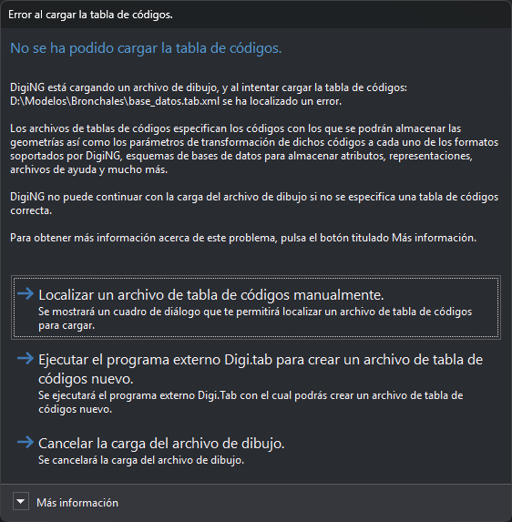

# No se ha podido cargar la tabla de códigos
<!-- id: no-se-ha-podido-cargar-la-tabla-de-codigos -->

Digi3D.AI muestra este cuadro al abrir un archivo de dibujo cuando no puede cargar la [tabla de códigos](nuevo-proyecto/archivo-de-dibujo.md) indicada para ese archivo. El contenido muestra la ruta de la tabla de códigos con los [sustituidores](sustituidores.md) ya resueltos.

Estas son algunas causas del error:

* El archivo de la tabla de códigos no existe.
* El archivo no es un XML válido. El error indica la línea y la columna del fallo.
* La tabla de códigos no tiene paleta de colores, estilos o códigos.
* La tabla de códigos está cifrada y la llave de protección no tiene licencia para usarla, o la licencia ha caducado.

## Contenido

* **Más información**: el texto del error que ha devuelto el cargador de tablas de códigos.

## Botones

El cuadro no se puede cerrar con la tecla Esc ni con el botón de cierre de la ventana: tienes que elegir uno de estos botones.

* **Localizar un archivo de tabla de códigos**: muestra un cuadro de diálogo para seleccionar un archivo `.tab.xml` o `.dt`. Digi3D.AI intenta cargar la tabla seleccionada. Si cancelas la selección, Digi3D.AI vuelve a intentar cargar la misma tabla de códigos y, si falla, muestra otra vez este cuadro.
* **Ejecutar el editor de tablas de códigos para crear una tabla de códigos nueva**: ejecuta el [editor de tablas de códigos](../editor-de-tablas-de-codigos/README.md) (DigiTab) y vuelve a intentar cargar la misma tabla de códigos, así que el cuadro aparece otra vez. Cuando hayas guardado la tabla nueva en el editor, pulsa **Localizar un archivo de tabla de códigos** y selecciónala.
* **Cancelar la carga del archivo de dibujo**: Digi3D.AI no abre el archivo de dibujo.
