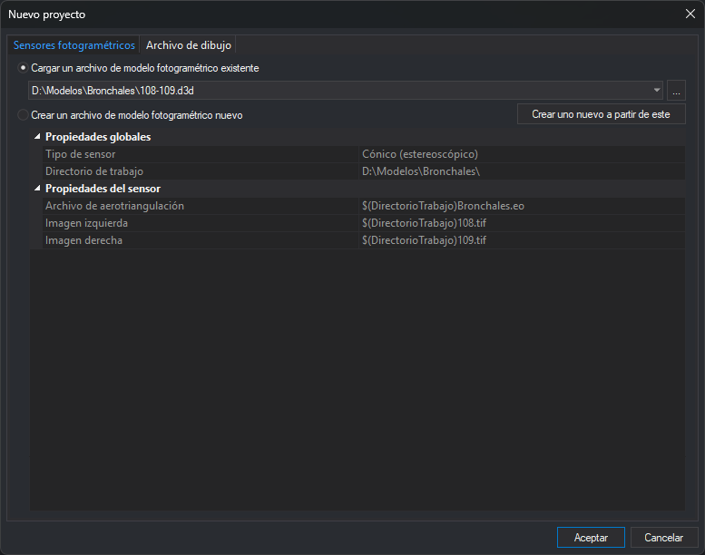

# Sensores fotogramétricos
<!-- id: sensores-fotogrametricos -->

Esta pestaña del cuadro de diálogo [Nuevo proyecto](README.md) abre un modelo fotogramétrico en una ventana fotogramétrica. El modelo se guarda en un archivo de modelo (`.d3d`), que indica el sensor y los archivos del modelo (imágenes, orientaciones, cámara…).

## Campos

* **Cargar un archivo de modelo fotogramétrico existente**: abre un archivo `.d3d` creado previamente.
  * **Lista de archivos**: los últimos diez archivos de modelo abiertos o creados con **Aceptar** en esta pestaña. Los archivos que ya no existen no aparecen.
  * **...**: selecciona otro archivo `.d3d`, lo añade a la lista si no estaba y lo selecciona. El cuadro de diálogo de selección se abre en la última carpeta utilizada en Digi3D.AI. Esa carpeta la actualizan este botón, el campo **Directorio de trabajo** y otros cuadros de diálogo de selección de archivos del programa.
  * **Rejilla de propiedades**: muestra en gris, sin permitir modificarlas, las propiedades del archivo seleccionado. Así puedes comprobar qué datos cargará Digi3D.AI antes de abrir el archivo. La categoría **Propiedades globales** contiene **Tipo de sensor** y **Directorio de trabajo**, que es la carpeta del archivo. La categoría **Propiedades del sensor** contiene los parámetros del sensor; las rutas que el archivo guarda relativas al directorio de trabajo aparecen con el prefijo `$(DirectorioTrabajo)`, por ejemplo `$(DirectorioTrabajo)108.tif`. Si el archivo no se puede leer, la propiedad **Tipo de sensor** muestra el motivo. Con los sensores [Web Map Service](../../ventana-fotogrametrica/sensores/wms.md) y [Web Map Tile Service](../../ventana-fotogrametrica/sensores/wmts.md), la rejilla muestra los valores guardados en el archivo sin conectar con el servidor.
  * **Crear uno nuevo a partir de este**: prepara un modelo nuevo con los datos del archivo seleccionado. Solo está disponible cuando la rejilla muestra las propiedades de un archivo que se ha podido leer. Al pulsarlo, Digi3D.AI marca **Crear un archivo de modelo fotogramétrico nuevo** y rellena **Directorio de trabajo**, **Tipo de sensor** y las propiedades del sensor con los valores del archivo, que se pueden modificar. Las rutas con el prefijo `$(DirectorioTrabajo)` pasan a ser rutas absolutas, para que el modelo nuevo se pueda guardar en otra carpeta. Por ejemplo, para crear el modelo `109-110` a partir del modelo `108-109` del sensor Cónico, basta con cambiar las imágenes: el archivo de aerotriangulación y el directorio de trabajo se conservan. Se copian los datos que el sensor guarda en el archivo de modelo, también los que la rejilla no muestra, como los archivos de cámara del sensor Cónico. No se copian la última posición del cursor, el factor de escala ni los giros aplicados a las imágenes.
* **Crear un archivo de modelo fotogramétrico nuevo**: crea un archivo `.d3d` y lo abre.
  * **Propiedades globales**
    * **Directorio de trabajo**: carpeta en la que se crea el archivo del modelo. Al abrir el cuadro de diálogo muestra la carpeta del último modelo creado.
    * **Tipo de sensor**: el sensor del modelo. El desplegable ofrece, en orden alfabético, los sensores instalados que permite la licencia. Sin el módulo de fotogrametría solo ofrece el sensor de ortofoto.
  * **Propiedades del sensor**: los parámetros del sensor elegido. Cada sensor requiere sus propios parámetros; por ejemplo, el sensor Cónico requiere el archivo de aerotriangulación y las imágenes izquierda y derecha.
* **Aceptar**: abre el archivo seleccionado, o crea el archivo nuevo con el nombre del modelo que proporciona el sensor y lo abre. Si en el directorio de trabajo ya existe un archivo con ese nombre, Digi3D.AI escribe en él los datos del sensor sin pedir confirmación. Si el modelo nuevo se ha preparado con **Crear uno nuevo a partir de este** y su archivo es el mismo que el del modelo copiado (por ejemplo, porque no se ha cambiado ningún dato), Digi3D.AI muestra el aviso «El modelo nuevo se guardaría sobre el modelo que has copiado» y el cuadro de diálogo sigue abierto. Si en **Crear un archivo de modelo fotogramétrico nuevo** no se ha elegido ningún **Tipo de sensor**, no se crea ningún archivo y se abre el archivo seleccionado en la lista de **Cargar un archivo de modelo fotogramétrico existente**. Con los sensores [Web Map Service](../../ventana-fotogrametrica/sensores/wms.md) y [Web Map Tile Service](../../ventana-fotogrametrica/sensores/wmts.md), las propiedades del sensor son solo la **URL del servidor**: si está vacía o no es válida, Digi3D.AI muestra un mensaje, selecciona la propiedad y el cuadro de diálogo sigue abierto. La capa y los demás parámetros del sensor se eligen después de abrir el modelo, en el panel del sensor de la ventana fotogramétrica.
* **Cancelar**: cierra el cuadro de diálogo sin abrir nada.
