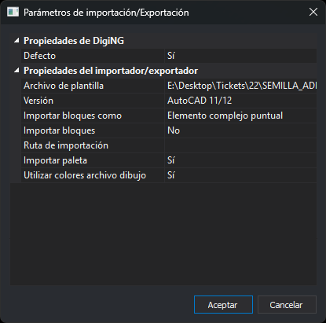

# Parámetros de importación/Exportación
<!-- id: parametros-de-importacion-exportacion -->

Digi3D.AI muestra este cuadro de diálogo para pedir los parámetros del importador/exportador de un archivo, por ejemplo un archivo DWG. Los parámetros de cada formato se describen en su página, dentro de [Importadores y exportadores](/digi3d-ai/referencia/ventana-de-dibujo/importadores-y-exportadores/README.md).

Hay dos versiones del cuadro de diálogo, con el mismo título:

* **Después de elegir el archivo** en el cuadro de diálogo Abrir o Guardar de una orden, como [IMPORTAR](/digi3d-ai/referencia/ventana-de-dibujo/ordenes/i/importar.md), [EXPORTAR](/digi3d-ai/referencia/ventana-de-dibujo/ordenes/e/exportar.md) o [CARGA\_F](/digi3d-ai/referencia/ventana-de-dibujo/ordenes/c/carga-f.md) sin parámetros. Es el de la imagen: solo tiene la rejilla de propiedades y los botones.
* **Al cargar un archivo por su nombre**, por ejemplo con la orden CARGA\_F con el nombre del archivo como parámetro, o al abrir un archivo de dibujo cuyos archivos de referencia guardados no tienen parámetros guardados. Encima de la rejilla muestra la ruta del archivo, un aviso y un enlace.

## Cuándo aparece

**Después de elegir el archivo**, el cuadro de diálogo aparece siempre que el formato tenga parámetros, o que la orden añada propiedades propias o admita una base de datos. Muestra los parámetros por defecto del formato, si los tiene, o los últimos que se usaron con ese formato. Solo no aparece si el proyecto de archivos de dibujo elegido en **Nuevo proyecto** tiene marcada la casilla **Configurar parámetros de importación/exportación** (consulta [Configurar proyectos](configurar-proyectos.md)).

**Al cargar un archivo por su nombre**, el cuadro de diálogo no aparece en estos casos:

* El formato no tiene parámetros que pedir al usuario.
* El formato tiene parámetros por defecto, fijados con **Defecto** o con la orden [PARAMETROS\_IMPORTACIÓN](/digi3d-ai/referencia/ventana-de-dibujo/ordenes/p/parametros-importacion.md).

## Campos

* **Digi3D.AI va a crear/cargar el siguiente archivo**: solo en la versión que aparece al cargar un archivo por su nombre. Es la ruta del archivo que se va a crear o cargar, y no se puede modificar. En algunas operaciones, como la orden CARGA\_F con el nombre del archivo como parámetro, muestra solo la extensión del archivo.
* **Haz clic aquí para aprender a evitar que Digi3D.AI muestre este cuadro de diálogo**: solo en la versión que aparece al cargar un archivo por su nombre. Abre la página de la orden [PARAMETROS\_IMPORTACIÓN](/digi3d-ai/referencia/ventana-de-dibujo/ordenes/p/parametros-importacion.md), que fija los parámetros de un formato sin mostrar este cuadro de diálogo.
* Propiedades de la orden: algunas órdenes añaden una categoría propia antes de **Propiedades de Digi3D.AI**, y las que admiten una base de datos añaden una categoría con el modelo de datos y la cadena de conexión. Solo en la versión que aparece después de elegir el archivo.
* **Propiedades de Digi3D.AI**
  * **Defecto**: con **Sí**, al pulsar **Aceptar** Digi3D.AI guarda estos parámetros como parámetros por defecto del formato hasta que se cierra Digi3D.AI. La orden `PARAMETROS_IMPORTACION` sustituye estos parámetros por los suyos. Algunos formatos no admiten esta opción. Al iniciar Digi3D.AI vale **Sí** en la versión que aparece después de elegir el archivo y **No** en la que aparece al cargar un archivo por su nombre; cada versión recuerda después el último valor elegido, hasta que se cierra Digi3D.AI.
* **Propiedades del importador/exportador**: los parámetros del formato del archivo.
* **Aceptar**: abre, importa o exporta el archivo con estos parámetros. Después de elegir el archivo, los parámetros se guardan además como últimos parámetros usados con ese formato.
* **Cancelar**: cancela la operación. Excepción: en la orden CARGA\_F con el nombre del archivo como parámetro, el cuadro de diálogo se muestra otra vez con la ruta completa del archivo; **Cancelar** en ese segundo cuadro cancela la carga.

El cuadro de diálogo se puede redimensionar y conserva su tamaño y posición.
