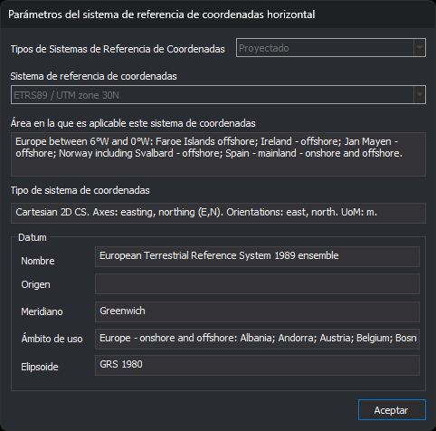
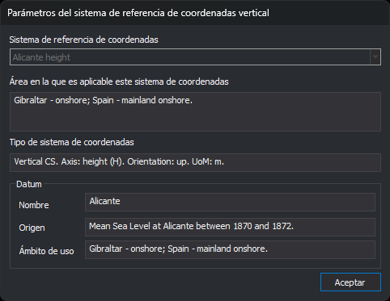
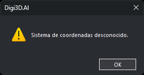

# Parámetros del sistema de referencia de coordenadas
<!-- id: parametros-del-sistema-de-referencia-de-coordenadas -->

Estos cuadros de diálogo muestran los parámetros del sistema de referencia de coordenadas horizontal o vertical de la ventana de dibujo o de un archivo de dibujo. Son de solo lectura: no permiten cambiar el sistema de referencia.

## Abrir los cuadros de diálogo

* En la barra de herramientas [Coordenadas](../barras-de-herramientas/coordenadas.md), despliega la flecha del botón de las unidades y selecciona **Mostrar sistema de referencia de coordenadas horizontal...** o **Mostrar sistema de referencia de coordenadas vertical...**.
* En el panel [Archivos de dibujo](../paneles/archivos-de-dibujo.md), selecciona las mismas opciones en el menú contextual de un archivo.

## Sistema horizontal

* **Tipos de Sistemas de Referencia de Coordenadas**: el tipo de sistema: _Local_, _Proyectado_ o _Geográfico 2D_.
* **Sistema de referencia de coordenadas**: el nombre del sistema.
* **Área en la que es aplicable este sistema de coordenadas**: la zona geográfica en la que EPSG define el sistema.
* **Tipo de sistema de coordenadas**: los ejes del sistema, su orientación y su unidad de medida.
* **Datum**: el datum geodésico del sistema. En un sistema proyectado es el datum de su sistema geográfico base.
  * **Nombre**: el nombre del datum.
  * **Origen**: la descripción del origen del datum. Está vacío cuando EPSG no la define, como en el datum de ETRS89, que es un conjunto (_ensemble_) de realizaciones.
  * **Meridiano**: el meridiano origen de las longitudes.
  * **Ámbito de uso**: la zona en la que EPSG define el datum.
  * **Elipsoide**: el elipsoide del datum.

## Sistema vertical

* **Sistema de referencia de coordenadas**: el nombre del sistema vertical.
* **Área en la que es aplicable este sistema de coordenadas** y **Tipo de sistema de coordenadas**: como en el sistema horizontal.
* **Datum**: el datum vertical, con su **Nombre**, su **Origen** y su **Ámbito de uso**.

## Sistemas que no son de EPSG

Si el sistema de referencia no tiene código EPSG, porque se ha leído de un WKT sin código, los cuadros de diálogo muestran los datos que contiene el propio WKT: en el sistema horizontal, el nombre del datum, del meridiano y del elipsoide; en el vertical, el nombre del datum. El área, el tipo de sistema de coordenadas, el origen y el ámbito de uso quedan vacíos, porque esos datos solo están en el catálogo de EPSG.

## Sistema desconocido

Si el sistema de referencia es desconocido, no se muestran estos cuadros de diálogo, sino este mensaje:

