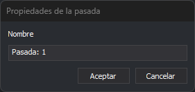

# Propiedades de la pasada
<!-- id: propiedades-de-la-pasada -->

Este cuadro de diálogo pide el nombre de una pasada del proyecto fotogramétrico. Se abre desde el cuadro de diálogo [Crear proyecto fotogramétrico](crear-proyecto-fotogrametrico.md) en dos casos:

* Al pulsar **Crear** en la lista **Pasadas**. El campo **Nombre** contiene **Pasada:** seguido del número de la pasada nueva, que es el número de pasadas del proyecto más uno. Al pulsar **Aceptar**, el cuadro de diálogo añade la pasada al final de la lista y la selecciona.
* Al pulsar **Propiedades** en la lista **Pasadas**, o al hacer doble clic sobre una pasada. El campo **Nombre** contiene el nombre de la pasada seleccionada. Al pulsar **Aceptar**, el cuadro de diálogo sustituye el nombre de la pasada en la lista.

## Campos

* **Nombre**: nombre de la pasada.
* **Aceptar**: si el cuadro se abrió para crear una pasada, añade la pasada nueva a la lista de pasadas; si se abrió desde las propiedades de una pasada, cambia el nombre de esa pasada en la lista. Después cierra el cuadro de diálogo.
* **Cancelar**: cierra el cuadro de diálogo sin crear la pasada ni cambiar su nombre.
