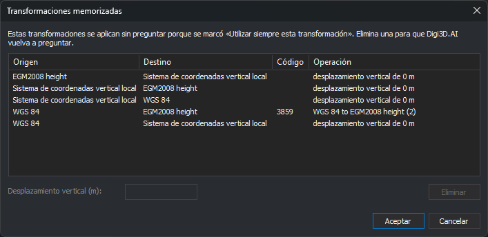

# Transformaciones memorizadas
<!-- id: transformaciones-memorizadas -->

Cuando Digi3D.AI no sabe cómo transformar coordenadas entre dos sistemas de referencia, pregunta al usuario:

* Si no localiza una transformación para la coordenada Z, muestra el cuadro de diálogo **Selección de transformación vertical**, en el que se elige si los dos sistemas verticales son idénticos o se introduce un desplazamiento vertical.
* Si la base de datos EPSG contiene varias transformaciones posibles entre los dos sistemas, muestra la lista para que se elija una.

Si en esos cuadros de diálogo se marca **Utilizar siempre esta transformación**, Digi3D.AI guarda la elección y no vuelve a preguntar para ese par de sistemas. Este cuadro de diálogo muestra las elecciones guardadas y permite eliminarlas o cambiar el desplazamiento vertical.

## Abrir el cuadro de diálogo

Hay dos formas:

* Selecciona la opción del menú **Herramientas/Transformaciones memorizadas...**.
* En el cuadro de diálogo **[Configuración](configuracion/README.md)**, categoría **Sistema de referencia de coordenadas**, pulsa el botón de la opción **[Transformaciones memorizadas](configuracion/sistema-de-referencia-de-coordenadas/transformaciones-memorizadas.md)**.

## Columnas

* **Origen** y **Destino**: sistemas de referencia entre los que se transforma.
* **Código**: código EPSG de la transformación elegida. Solo aparece en las transformaciones elegidas de la lista de la base de datos EPSG.
* **Operación**: nombre de la transformación EPSG o, en las transformaciones verticales, el desplazamiento vertical en metros. Si se marcó que los dos sistemas verticales son idénticos, el desplazamiento es 0 m.

Si Digi3D.AI no reconoce los nombres de los sistemas de referencia como nombres de la base de datos EPSG, muestra los dos nombres seguidos en la columna **Origen** y deja vacía la columna **Destino**.

## Uso del cuadro de diálogo

1. Selecciona una fila.
2. Para que Digi3D.AI vuelva a preguntar por esa transformación, pulsa **Eliminar**.
3. Para cambiar el desplazamiento de una transformación vertical, escribe el valor en metros en el campo **Desplazamiento vertical (m)**. Se admiten la coma y el punto como separador decimal.
4. Pulsa **Aceptar** para guardar los cambios, o **Cancelar** para descartarlos.

## Observaciones

* Los cambios se aplican a los archivos y modelos que se abran después. Los que ya están abiertos siguen usando la transformación con la que se abrieron.
* Las transformaciones memorizadas son propias de cada usuario de _Windows_.
