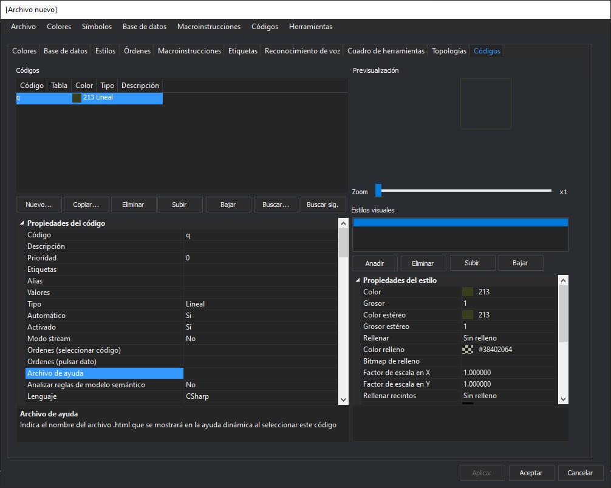
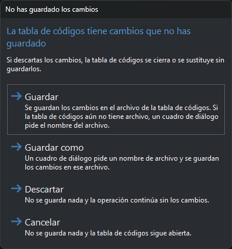

# Editor de tablas de códigos
<!-- id: editor-de-tablas-de-codigos -->

El editor de tablas de códigos (DigiTab) crea y edita tablas de códigos (`.tab.xml`). La ventana tiene una barra de [menús](menus/README.md), una fila de [pestañas](pestanas/README.md) y tres botones.

## Botones

* **Aplicar**: aplica a la tabla de códigos los cambios de la pestaña visible. Se habilita cuando la pestaña tiene cambios sin aplicar.
* **Aceptar**: aplica los cambios pendientes de todas las pestañas; si la tabla tiene cambios sin guardar, muestra el cuadro [No has guardado los cambios](#no-has-guardado-los-cambios), y cierra el editor. Las pestañas Base de datos, Estilos y Códigos preguntan antes si aplicar sus cambios.
* **Cancelar**: cierra el editor sin aplicar ni guardar los cambios.

Al cambiar de pestaña, las pestañas Colores y Topologías aplican sus cambios, y Base de datos, Estilos y Códigos preguntan si aplicarlos. El resto conserva sus cambios sin aplicar hasta que pulses **Aplicar** o **Aceptar**.

Los cambios aplicados están en la tabla de códigos abierta, pero no en el archivo hasta que la guardas con **Archivo/Guardar**.

## No has guardado los cambios

Este cuadro aparece cuando la tabla de códigos tiene cambios sin guardar y pulsas **Aceptar** o eliges **Nuevo** o **Abrir...** en el menú [Archivo](menus/archivo/README.md).

* **Guardar**: guarda la tabla en su archivo. Si la tabla aún no tiene archivo, pide el nombre del archivo como **Guardar como**. Es el botón predeterminado.
* **Guardar como**: pide un nombre de archivo y guarda la tabla en ese archivo.
* **Descartar**: no guarda nada y la operación continúa: el editor se cierra o se crea o abre la otra tabla de códigos.
* **Cancelar**: no guarda nada y la tabla de códigos sigue abierta. Esc equivale a **Cancelar**.

Si cancelas el cuadro de selección del archivo, este cuadro vuelve a aparecer. Si no se puede escribir el archivo, el editor muestra un error y la tabla de códigos sigue abierta.
