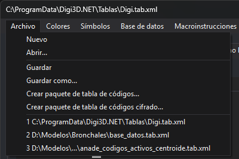
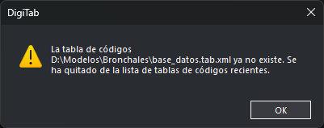

# Archivo
<!-- id: menu-archivo-editor-tablas -->

| Opción | Acción |
| :--- | :--- |
| **Nuevo** | Crea una tabla de códigos vacía. Si la tabla abierta tiene cambios sin guardar, antes muestra el cuadro [No has guardado los cambios](../../README.md#no-has-guardado-los-cambios). |
| **Abrir...** | Abre un archivo `.tab.xml`. Si la tabla abierta tiene cambios sin guardar, antes muestra el cuadro [No has guardado los cambios](../../README.md#no-has-guardado-los-cambios). Al abrir, ejecuta las [comprobaciones](../herramientas/comprobaciones.md) de la tabla. |
| **Guardar** | Guarda la tabla en su archivo. Si la tabla es nueva, funciona como **Guardar como...** |
| **Guardar como...** | Guarda la tabla en otro archivo `.tab.xml`, que pasa a ser el archivo de la tabla. |
| **Crear paquete de tabla de códigos...** | Guarda una copia de la tabla en un paquete `.dt`. La tabla abierta sigue asociada a su archivo. |
| **Crear paquete de tabla de códigos cifrado...** | Abre el cuadro [Crear paquete de tablas de códigos cifrado](crear-paquete-cifrado.md). |
| **1**, **2**... (tablas de códigos recientes) | Abre la tabla de códigos de esa entrada, igual que **Abrir...**: si la tabla abierta tiene cambios sin guardar, antes muestra el cuadro [No has guardado los cambios](../../README.md#no-has-guardado-los-cambios), y al abrir ejecuta las comprobaciones. Si el archivo ya no existe, muestra un aviso y quita la entrada de la lista. Si la unidad no está conectada (por ejemplo, un USB desenchufado o una unidad de red no disponible), la entrada se queda y aparece el aviso de que no se ha podido cargar la tabla. Mientras la lista está vacía, en su lugar aparece la opción **Tablas de códigos recientes**, desactivada. |

Antes de escribir el archivo o el paquete, **Guardar**, **Guardar como...** y las dos opciones de crear paquete aplican los cambios de las pestañas que no se han aplicado con **Aplicar**, como **Aceptar**: Base de datos, Estilos y Códigos preguntan si aplicarlos, y el resto los aplica.

## Tablas de códigos recientes

Al final del menú están las 10 últimas tablas de códigos que has abierto con **Abrir...** o con la propia lista, o que has guardado con **Guardar como...** o desde el cuadro [No has guardado los cambios](../../README.md#no-has-guardado-los-cambios) cuando ese cuadro pide el nombre del archivo. La más reciente es la **1**. Abrir o guardar una tabla que ya está en la lista la pasa al primer puesto. Las tablas cuya ruta tiene 260 caracteres o más no se añaden. En el menú, las rutas largas se abrevian con `...`.

Si eliges una tabla reciente que ya no existe, o cuya ruta es una carpeta, el editor muestra este aviso y quita la entrada de la lista:

Si la tabla no se puede abrir por otro motivo, por ejemplo porque la unidad no está conectada o no tienes permiso de acceso, la entrada se queda en la lista.

La lista se guarda para tu usuario de Windows y se conserva al cerrar el editor.
