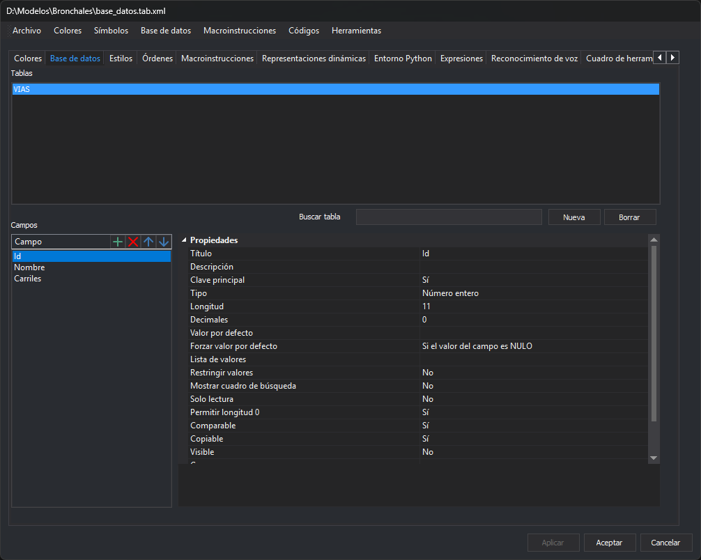
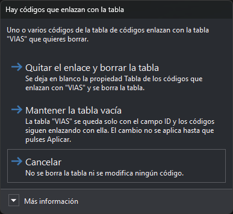
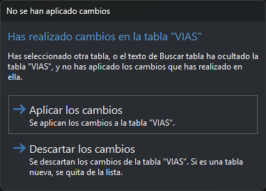
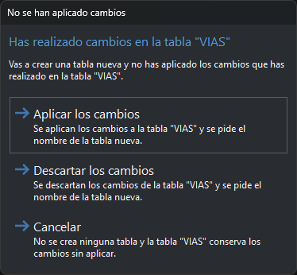
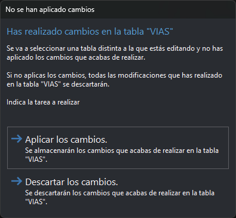

# Base de datos
<!-- id: base-de-datos-3 -->

Esta pestaña configura las tablas de la base de datos y los campos de cada tabla. Cada código puede enlazar con una tabla mediante su propiedad [Tabla](../codigos/base-de-datos.md#tabla).

## Tablas

Lista de las tablas definidas en la tabla de códigos.

* **Buscar tabla**: deja en la lista solo las tablas cuyo nombre contiene el texto escrito, sin distinguir mayúsculas y minúsculas. Con el cuadro vacío, la lista muestra todas las tablas. Si el texto oculta la tabla que estás editando, se carga la primera tabla visible; si la tabla oculta tenía cambios sin aplicar, antes aparece el cuadro [No se han aplicado cambios](#al-seleccionar-otra-tabla). Si la lista se actualiza por otra causa, como las opciones de crear tablas del menú Base de datos, la tabla que estás editando sigue en la lista aunque no contenga el texto; una tabla nueva sin aplicar se muestra siempre.
* **Nueva**: pide el nombre de la tabla y la crea con un campo `ID` de clave principal. La tabla nueva se añade a la tabla de códigos al aplicar los cambios.
* **Borrar**: elimina la tabla seleccionada. Una tabla nueva sin aplicar se quita de la lista. Si algún código enlaza con la tabla, aparece el cuadro [Hay códigos que enlazan con la tabla](#hay-códigos-que-enlazan-con-la-tabla).

### Hay códigos que enlazan con la tabla

Este cuadro aparece al pulsar **Borrar** cuando uno o varios códigos tienen la tabla en su propiedad [Tabla](../codigos/base-de-datos.md#tabla). El contenido muestra el nombre de la tabla.

* **Quitar el enlace y borrar la tabla**: deja en blanco la propiedad **Tabla** de esos códigos y borra la tabla de la tabla de códigos.
* **Mantener la tabla vacía**: elimina los campos de la tabla y deja solo un campo `ID` nuevo. Los códigos siguen enlazando con la tabla. El cambio queda pendiente hasta que pulses **Aplicar**.
* **Cancelar**: no borra la tabla ni modifica ningún código. Es el botón predeterminado. Esc equivale a **Cancelar**.

**Más información** explica que, si se borra la tabla sin quitar el enlace, los códigos quedan enlazados con una tabla que no existe.

## Campos

Lista de los campos de la tabla seleccionada. Su barra de herramientas tiene cuatro botones:

* **Nuevo** (+): añade un campo. Escribe su nombre en la lista.
* **Eliminar** (x): elimina el campo seleccionado.
* **Subir** y **Bajar** (flechas): cambian la posición del campo seleccionado en la tabla.

Al seleccionar un campo, sus [propiedades](propiedades-de-los-campos.md) aparecen a la derecha.

## Aplicar los cambios

Los cambios de la tabla seleccionada se aplican al pulsar **Aplicar** o **Aceptar**. Si la tabla tiene cambios sin aplicar, el editor pregunta qué hacer con ellos al seleccionar otra tabla, al pulsar **Nueva** y al cambiar de página. En los cuadros sin botón **Cancelar**, Esc equivale a **Descartar los cambios**.

### Al seleccionar otra tabla

Aparece al seleccionar otra tabla de la lista y cuando el texto de **Buscar tabla** oculta la tabla con cambios. Volver a pulsar la tabla que estás editando no lo muestra.

* **Aplicar los cambios**: aplica los cambios a la tabla y carga la tabla seleccionada. Es el botón predeterminado.
* **Descartar los cambios**: descarta los cambios y carga la tabla seleccionada. Si la tabla era nueva, la quita de la lista.

### Al pulsar Nueva

Aparece al pulsar **Nueva**. Además de los dos botones del cuadro anterior, tiene **Cancelar**:

* **Aplicar los cambios**: aplica los cambios y pide el nombre de la tabla nueva.
* **Descartar los cambios**: descarta los cambios y pide el nombre de la tabla nueva.
* **Cancelar**: no crea ninguna tabla. La tabla conserva los cambios sin aplicar. Esc equivale a **Cancelar**.

### Al cambiar de página

Aparece al cambiar de pestaña y antes de las operaciones que aplican los cambios de todas las pestañas: **Aceptar** y las opciones **Nuevo**, **Abrir...**, **Guardar**, **Guardar como...** y de crear paquete del menú [Archivo](../../menus/archivo/README.md).

* **Aplicar los cambios**: aplica los cambios a la tabla. Es el botón predeterminado.
* **Descartar los cambios**: descarta los cambios y vuelve a cargar la tabla. Si la tabla era nueva, la quita de la lista.

Con los dos botones, el cambio de pestaña o la operación continúa.

El menú [Base de datos](../../menus/base-de-datos/README.md) tiene opciones que actúan sobre todas las tablas a la vez.
