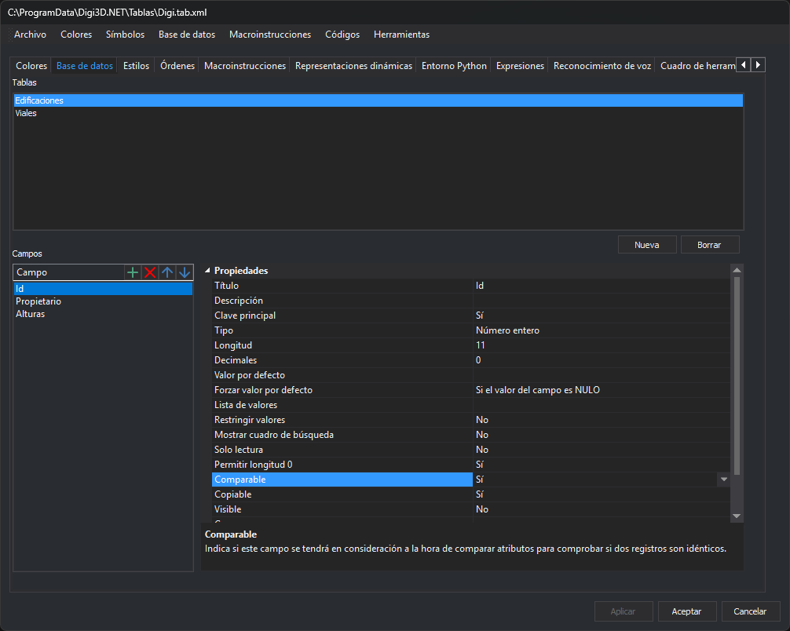
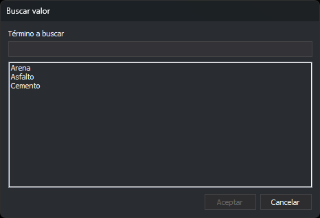

# Propiedades de los campos
<!-- id: propiedades-de-los-campos -->

Esta categoría permite configurar las propiedades de un campo de base de datos.



## Título

Permite configurar el nombre del campo que se mostrará al usuario en las distintas ventanas que muestran campos de base de datos, como el panel [Campos de la base de datos](/digi3d-ai/referencia/paneles/campos-de-la-base-de-datos.md).

El título habitualmente coincide con el nombre del campo, pero no tiene por qué ser así.

## Descripción

Permite configurar una descripción que aparecerá en la parte inferior del _grid de propiedades_ que utilizan las distintas ventanas que muestran campos de la base de datos.

Al hacer clic en un campo, el programa muestra la descripción del campo.

## Clave principal

Permite indicar si el campo es la clave principal de la tabla.

## Tipo

Indica el tipo de información que se va a almacenar en este campo en cada registro almacenado.

Selecciona el tipo de dato del campo:

* **Cadena de caracteres**. Selecciona esta opción si en el campo se van a almacenar textos.
* **Número entero**. Selecciona esta opción si en el campo se van a almacenar números enteros.
* **Número real**. Selecciona esta opción si en el campo se van a almacenar números reales.
* **Fecha**. Selecciona esta opción si en el campo se van a almacenar fechas.

## Longitud

Indica la longitud que tendrá el campo.

Este valor tiene que ser siempre mayor que 0 y debe ser lo suficientemente grande para almacenar la información que se desee.

## Decimales

Si has seleccionado **Número real** en el campo **Tipo**, introduce aquí el número de decimales que se almacenarán.

Este campo tiene sentido en bases de datos de tipo XBASE \(que son las asociadas con Shapefiles\) pues en este tipo de bases de datos los números se almacenan como texto, de manera que es importante indicar el número de decimales.

Este campo carece de sentido en otros tipos de bases de datos como Access pues en estas bases de datos, si un campo es de tipo real, se almacenarán valores de tipo _double_ con todos sus decimales.

## Valor por defecto

Permite especificar opcionalmente un valor por defecto para este campo.

Se puede introducir un valor constante o se puede introducir una [macro de base de datos](macros-de-base-de-datos.md).

## Forzar valor por defecto

Permite indicar si se debe almacenar obligatoriamente el valor configurado en [Valor por defecto](propiedades-de-los-campos.md#valor-por-defecto) independientemente del valor que haya introducido el usuario para este campo en el panel [Campos de la base de datos](/digi3d-ai/referencia/paneles/campos-de-la-base-de-datos.md).

## Lista de valores

Permite indicar un conjunto de valores posibles para almacenar en este campo.

En caso de que se introduzca una lista de valores, las ventanas que muestran campos de base de datos como el panel [Campos de la base de datos](/digi3d-ai/referencia/paneles/campos-de-la-base-de-datos.md), mostrarán en este campo un desplegable para que el usuario seleccione un valor de entre los posibles.

Se pueden introducir valores directamente en la tabla de códigos o se pueden extraer dinámicamente mediante una consulta SQL que se ejecutará sobre la base de datos cargada.

### Valores directos

Puedes introducir tantos valores como necesites. Escribe cada valor con su título y su descripción, separados por el carácter \| \(pulsa _AltGr + 1_ para introducir este carácter\).

`[valor]|[título]|[descripción]`

* Valor es el valor que se va a almacenar en la base de datos.
* Título es el texto que verás en el desplegable. El título no tiene por qué coincidir con el valor almacenado y permite identificar cada opción del desplegable.
* Descripción es el texto que aparecerá al seleccionar el campo de base de datos, en la parte inferior de la ventana en la que introduces valores de base de datos, como el panel [Campos de la base de datos](/digi3d-ai/referencia/paneles/campos-de-la-base-de-datos.md).

#### Ejemplo:

Si en la base de datos se tiene que almacenar un "1" cuando el tipo de vegetación es "monte alto" y un "2" cuando es "monte bajo", introduce este valor:

```text
1|Monte alto|El tipo de vegetación de esta parcela es monte alto|2|Monte bajo|El tipo de vegetación de esta parcela es monte bajo
```

### Mediante consulta SQL

Para extraer los valores mediante una consulta SQL de selección, introduce la consulta entre símbolos de porcentaje, como en este ejemplo:

```sql
%SELECT IdCalle, NombreCalle FROM CALLES%
```

El programa extrae los campos de la consulta.

* Si la consulta devuelve un único campo, se utilizará este campo tanto para el valor como para el texto a mostrar al usuario para cada registro devuelto.
* Si la consulta devuelve más de un campo, se utilizará el primer campo para el valor a asignar y el segundo para el texto a mostrar al usuario.

## Restringir valores

En caso de que se haya indicado una lista de valores, si se activa esta opción, el desplegable mostrado al usuario al seleccionar este campo no permitirá introducir valores manualmente.

## Mostrar cuadro de búsqueda

Si vale **Sí**, el campo muestra un botón **...** junto al botón del desplegable. El botón abre el cuadro de diálogo **Buscar valor**.

El botón aparece solo si se cumplen todas estas condiciones:

* El campo es de tipo **Carácter** o **Numérico**. Los campos de tipo real y de tipo fecha no muestran el botón, aunque esta propiedad valga **Sí**.
* El campo tiene una [Lista de valores](#lista-de-valores). Sin lista de valores, esta propiedad no se guarda en la tabla de códigos.
* Si la lista de valores es una consulta `%SELECT ...%`, la consulta se ejecuta sin error. Si falla, el campo se muestra como un cuadro de texto con el valor almacenado.
* El campo no es la clave principal y es visible.

El botón aparece en las ventanas que muestran los campos como una cuadrícula de propiedades: el panel [Campos de la base de datos](/digi3d-ai/referencia/paneles/campos-de-la-base-de-datos.md), el panel [Propiedades de la entidad seleccionada](/digi3d-ai/referencia/paneles/propiedades-de-la-entidad-seleccionada.md), el cuadro de diálogo [Editor de códigos](/digi3d-ai/referencia/ventana-de-dibujo/ordenes/e/editar-cod.md#cuadro-de-dialogo-editor-de-codigos) y el cuadro de diálogo [Error en los atributos de usuario](/digi3d-ai/referencia/cuadros-de-dialogo/error-en-los-atributos-de-usuario.md). El panel [Editor de la base de datos](/digi3d-ai/referencia/paneles/editor-de-la-base-de-datos-1-2-3-4.md) muestra los registros en una tabla y no tiene este botón.

### Cuadro de diálogo Buscar valor



* **Término a buscar**: texto que se busca. La lista muestra los títulos de la lista de valores que contienen ese texto, sin distinguir mayúsculas de minúsculas, ordenados alfabéticamente.
* **Lista**: al abrir el cuadro de diálogo muestra todos los títulos. **Aceptar** se habilita al seleccionar uno.
* **Aceptar**: asigna al campo el valor que corresponde al título seleccionado.
* **Cancelar**: cierra el cuadro de diálogo sin cambiar el campo.

## Solo lectura

Si se habilita, el usuario no podrá modificar el valor mostrado en este campo.

## Permitir longitud 0

Permite indicar si el usuario puede dejar este campo sin rellenar.

## Comparable

Algunas órdenes, como [UNIR](/digi3d-ai/referencia/ventana-de-dibujo/ordenes/u/unir.md), solo unen dos líneas enlazadas a una base de datos si coinciden tanto los códigos como los atributos de base de datos de ambas líneas.

Si uno de los atributos almacena el perímetro de cada línea, la orden _UNIR_ no permitirá unir dos líneas con distinto perímetro aunque los demás atributos sean idénticos. Para unir dos líneas con distinto perímetro y con los demás atributos idénticos, debes indicar que la orden _UNIR_ no tenga en cuenta el campo que almacena el perímetro.

Con la opción Comparable puedes indicar que un campo no es comparable. En el ejemplo del perímetro, la orden _UNIR_ ignorará el campo que almacena el perímetro al decidir si se pueden unir las dos geometrías.

## Copiable

Indica si al copiar una geometría con la orden [COPIAR](/digi3d-ai/referencia/ventana-de-dibujo/ordenes/c/copiar.md) se debe copiar el valor almacenado en este campo.

## Visible

Indica si el campo de base de datos se mostrará en la interfaz de usuario del programa como por ejemplo en el panel [Campos de la base de datos](/digi3d-ai/referencia/paneles/campos-de-la-base-de-datos.md).

## Grupo

Este campo es opcional, y en caso de introducir aquí algún nombre, las ventanas del programa que muestran campos de base de datos crearán categorías \(cuyo nombre coincide con el introducido aquí\) e introducirán el campo dentro de estas categorías.

El campo Grupo se utiliza para agrupar campos relacionados en la interfaz de usuario de la aplicación.

## Color de fondo

Indica el color de fondo que se utilizará en la interfaz de usuario del programa al mostrar este campo.

