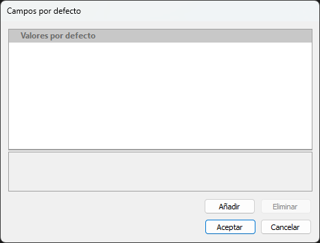
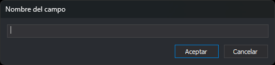

# Base de datos
<!-- id: base-de-datos-4 -->

Esta categoría permite configurar la relación del código que editas con la base de datos.

## Tabla

Este desplegable permite seleccionar la tabla cuyos atributos se mostrarán en ventanas como el panel [Campos de la base de datos](/digi3d-ai/referencia/paneles/campos-de-la-base-de-datos.md) cuando selecciones como activo el código que editas.

Muestra un desplegable que permite seleccionar alguna de las tablas añadidas en la pestaña [Base de datos](/digi3d-ai/referencia/editor-de-tablas-de-codigos/pestanas/base-de-datos/README.md).

## Valores por defecto

Valores que se asignan a los campos de la base de datos de las geometrías que se digitalizan con este código. La propiedad muestra el primer par `campo=valor`, seguido de `...` si hay más de uno.

El botón **...** abre el cuadro de diálogo **Campos por defecto**:



* **Valores por defecto**: un campo por fila, con su valor. Escribe el valor en la columna derecha.
* **Añadir**: abre el cuadro de diálogo **Nombre del campo**, que pide el nombre del campo y añade una fila con el valor vacío. No comprueba si el campo existe en la tabla ni si ya está en la lista.
* **Eliminar**: elimina el campo seleccionado. Se habilita al seleccionar un campo.
* **Aceptar** guarda la lista; **Cancelar** la deja como estaba.



## Condiciones

Especifica las condiciones que debe cumplir un registro de la base de datos para que se asigne el código que editas a la geometría correspondiente.

Este campo opcional tiene significado únicamente en archivos SIG como por ejemplo Shapefiles.

Por ejemplo, un Shapefile tiene una tabla _Edificaciones_ con un campo _Tipo_ que puede tener uno de los siguientes valores:

| Valor | Significado |
| :--- | :--- |
| 0 | Edificio en construcción |
| 1 | Edificio privado |
| 2 | Edificio público |

Ahora supongamos que en la tabla de códigos tenemos tres códigos:

| Código | Descripción |
| :--- | :--- |
| 010101 | Edificio en construcción |
| 010102 | Edificio privado |
| 010103 | Edificio público |
| 010104 | Resto de edificaciones |

En la tabla de códigos tendríamos que seleccionar en el campo [Tabla](base-de-datos.md#tabla) de cada uno de los tres códigos la tabla _Edificaciones,_ pero eso haría que el importador de Shapefiles no supiera qué código asignar a cada una de las geometrías almacenadas en la tabla _Edificaciones_, porque hay tres códigos posibles: 010101, 010102, 010103 y 010104.

El campo **Condiciones** soluciona este problema.

Introduce para el código 010101 el siguiente valor en **Condiciones**:

```text
Tipo=0
```

Para el código 010102:

```text
Tipo=1
```

Para el código 010103:

```text
Tipo=2
```

Deja en blanco para el código 010104 el campo **Condiciones**.

Así, si el importador de Shapefiles encuentra una geometría con el valor 1 en el campo Tipo, asignará el código 010102 a esa geometría.

