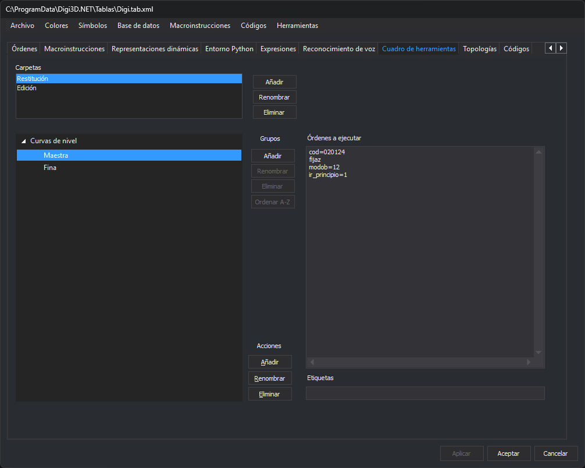

# Cuadro de herramientas
<!-- id: cuadro-de-herramientas-2 -->

Esta pestaña configura el contenido del panel [Cuadro de herramientas](/digi3d-ai/referencia/paneles/cuadro-de-herramientas.md) de Digi3D.AI cuando la ventana de dibujo usa esta tabla de códigos. El contenido se organiza en carpetas; cada carpeta tiene grupos, y cada grupo, acciones. Una acción es un botón del panel que ejecuta una lista de órdenes.

## Carpetas

* **Carpetas**: lista de carpetas de la tabla de códigos.
* **Añadir**: pide el nombre de una carpeta nueva. Si ya existe una carpeta con ese nombre, no la añade.
* **Renombrar**: abre el cuadro **Renombrar carpeta** con el nombre de la carpeta seleccionada.
* **Eliminar**: elimina la carpeta seleccionada con sus grupos y acciones.

## Grupos y acciones

El panel de la izquierda muestra los grupos de la carpeta seleccionada y, dentro de cada grupo, sus acciones.

Botones de **Grupos**. **Añadir** está disponible con una carpeta seleccionada; **Renombrar**, **Eliminar** y **Ordenar A-Z** solo se activan al seleccionar la cabecera de un grupo, no una de sus acciones:

* **Añadir**: pide el nombre de un grupo nuevo para la carpeta seleccionada. Si la carpeta ya tiene un grupo con ese nombre, sin distinguir mayúsculas de minúsculas, no lo añade.
* **Renombrar**: abre el cuadro **Renombrar grupo** con el nombre del grupo.
* **Eliminar**: elimina el grupo con sus acciones.
* **Ordenar A-Z**: ordena alfabéticamente las acciones del grupo.

Botones de **Acciones**:

* **Añadir**: pide el nombre de una acción nueva y la añade al final del grupo seleccionado o del grupo de la acción seleccionada.
* **Renombrar**: abre el cuadro **Renombrar acción** con el nombre de la acción seleccionada.
* **Eliminar**: elimina la acción seleccionada.

Renombrar una carpeta, un grupo o una acción, y añadir una acción, no comprueba si el nombre ya existe. Eliminar no pide confirmación.

## Órdenes a ejecutar y Etiquetas

Al seleccionar una acción se habilitan dos campos:

* **Órdenes a ejecutar**: órdenes que ejecuta la acción, una por línea. Las líneas vacías se descartan.
* **Etiquetas**: etiquetas de la acción.

Los cambios de esta pestaña se aplican a la tabla de códigos al pulsar **Aplicar** o **Aceptar**. Si cambias de pestaña, los cambios se conservan sin aplicar. **Cancelar** cierra el editor sin aplicarlos.
