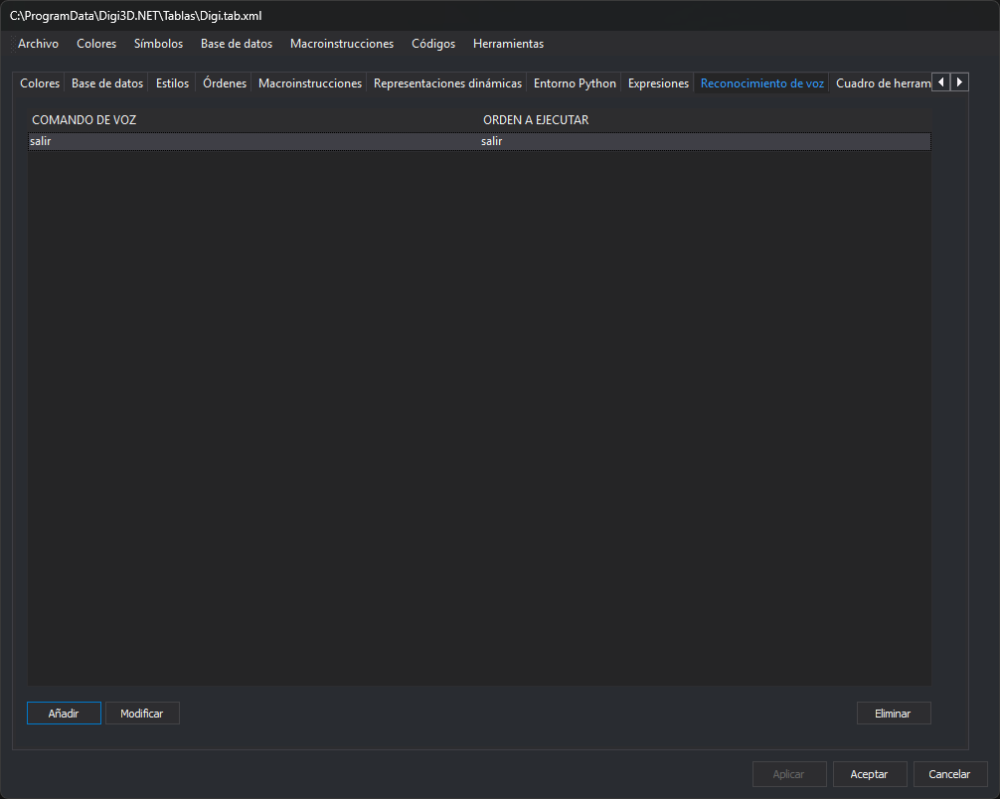

# Reconocimiento de voz
<!-- id: reconocimiento-de-voz -->

Esta pestaña configura frases asociadas a una orden. Cuando el servicio de reconocimiento de voz de Windows reconoce una de esas frases, Digi3D.AI ejecuta la orden asociada. El reconocimiento de voz en Digi3D.AI solo está activo si la variable [RECONOCER\_VOZ](/digi3d-ai/referencia/ventana-de-dibujo/variables/r/reconocer-voz.md) está activada.

## Controles

* **Lista de comandos**, con las columnas **Comando de voz** y **Orden a ejecutar**.
* **Añadir**: abre el cuadro de diálogo **Comando de voz**, con dos campos:
  * **Comandos de voz (separados por punto y coma;)**: una o varias frases que ejecutan la orden, separadas por `;`.
  * **Orden a ejecutar**: la orden que se ejecuta al reconocer cualquiera de las frases.
* **Modificar**: abre el cuadro **Comando de voz** con los datos de la entrada seleccionada.
* **Eliminar**: elimina la entrada seleccionada.

**Modificar** y **Eliminar** se habilitan al seleccionar una entrada.

Los cambios de esta pestaña se aplican a la tabla de códigos al pulsar **Aplicar** o **Aceptar**.
