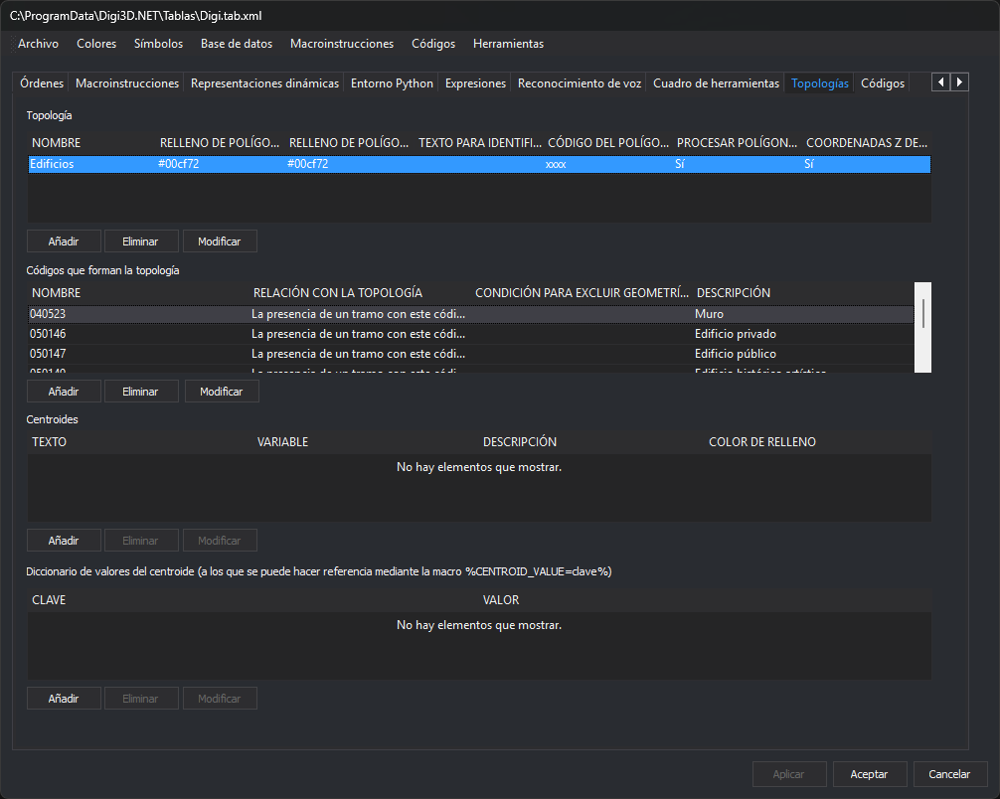

# Topologías
<!-- id: topologias -->

Permite configurar las topologías que se pueden generar mediante el menú [Topología](/digi3d-ai/referencia/ventana-de-dibujo/menus/topologia.md) de Digi3D.AI.

## Descripción

Una topología es una selección de códigos de líneas agrupados bajo un nombre.

Al analizar una determinada topología, el programa analizará geométricamente todas las líneas del archivo de dibujo que tengan algún código de los especificados en la topología.

Se analizará la continuidad de estas líneas para localizar todos los [polígonos topológicos](poligonos-topologicos.md) que se puedan formar.

El programa analiza la presencia de un [Centroide](/digi3d-ai/referencia/editor-de-tablas-de-codigos/pestanas/topologias/centroide.md) en el interior de cada uno de los _polígonos topológicos_. Si el programa localiza más de un centroide en un polígono, considera un error la presencia de varios centroides en ese polígono. Si el programa no localiza ningún centroide en un polígono, la configuración de la topología determina si la ausencia de centroide se considera un error.

## Ventanas

Esta pestaña dispone de las siguientes ventanas:

### Lista de topologías configuradas

Muestra un listado con todas las topologías configuradas en la tabla de códigos.

Dispone de los siguientes botones:

* **Añadir**: permite añadir una nueva topología mediante el cuadro de diálogo [Añadir Topología](anadir-topologia.md). 
* **Eliminar**: elimina la topología seleccionada.
* **Modificar**: permite modificar la topología seleccionada mediante el cuadro de diálogo _Añadir topología_.

### Lista de códigos

Muestra un listado con todos los códigos con los que se forma la topología seleccionada en la **lista de topologías configuradas**.

Dispone de los siguientes botones:

* **Añadir**: permite añadir un código a la topología seleccionada mediante el cuadro de diálogo [Seleccionar códigos para topología](/digi3d-ai/referencia/editor-de-tablas-de-codigos/pestanas/topologias/seleccionar-codigos-para-topologia.md). 
* **Eliminar**: elimina el código seleccionado.
* **Modificar**: permite modificar el código seleccionado mediante el cuadro de diálogo Seleccionar códigos para topología.

### Lista de centroides

Muestra un listado con todos los centroides configurados para la topología seleccionada en la **lista de topologías configuradas**.

Dispone de los siguientes botones:

* **Añadir**: permite añadir centroides mediante el cuadro de diálogo [Añadir centroide](/digi3d-ai/referencia/editor-de-tablas-de-codigos/pestanas/topologias/anadir-centroide.md).
* **Eliminar**: elimina el centroide seleccionado.
* **Modificar**: modifica el centroide seleccionado mediante el cuadro de diálogo _Añadir centroide_.

### Diccionario de valores

Muestra el [diccionario de valores](centroide.md#diccionario-de-valores) asociado con el centroide seleccionado en la **lista de centroides**.

Dispone de los siguientes botones:

* **Añadir**: permite añadir una nueva entrada al diccionario de valores mediante un cuadro de diálogo que permite introducir una clave y un valor.
* **Eliminar**: elimina la entrada seleccionada en el diccionario de valores.
* **Modificar**: modifica la entrada seleccionada en el diccionario de valores.

