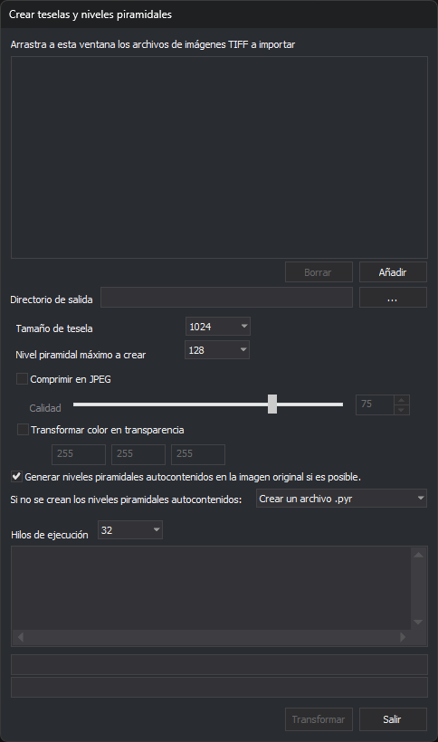

# Generador de Niveles Piramidales
<!-- id: generador-de-niveles-piramidales -->

El Generador de Niveles Piramidales transforma imágenes TIFF (Tag Image File Format, formato de archivo de imagen con etiquetas) por lotes para hacerlas compatibles con Digi3D.AI y crea niveles piramidales. La ventana del programa se titula **Crear teselas y niveles piramidales**.

## Observaciones

Digi3D.AI requiere que las imágenes TIFF estén teseladas (formadas por un mosaico de imágenes pequeñas).

Digi3D.AI requiere además que las imágenes TIFF tengan niveles piramidales (que son la misma imagen, pero a distintas resoluciones). Estos niveles piramidales pueden estar autocontenidos dentro de la propia imagen TIFF o en un archivo externo (habitualmente un archivo con extensión .pyr, que es en realidad un archivo TIFF al que se le ha cambiado la extensión a .pyr y que tiene los niveles piramidales 2, 4, 8...).

Si al cargar en Digi3D.AI una imagen TIFF el programa detecta que esta no está formada por teselas, muestra el cuadro [Localizada una imagen no preparada para Digi3D.AI](cuadros-de-dialogo/localizada-una-imagen-no-preparada-para-digi3d-ai.md), que permite convertirla en compatible.

Si al cargar en Digi3D.AI una imagen TIFF el programa detecta que está teselada pero no tiene niveles piramidales, la imagen ya es compatible y Digi3D.AI no pregunta si convertirla. Muestra el cuadro «Imagen compatible pero sin niveles piramidales», que ofrece generar los niveles piramidales:

* Si la imagen es un archivo TIFF local (`.tif` o `.tiff`) formado por un solo archivo, de 8 o 16 bits por muestra (sin JPEG de 12 bits), con teselas cuadradas de ancho par y con las muestras de cada píxel juntas, Digi3D.AI la reescribe como un COG (*Cloud Optimized GeoTIFF*, GeoTIFF optimizado para la nube) con los niveles piramidales dentro del mismo archivo, con el nombre original. Copia sin recomprimir las teselas del nivel completo y genera los niveles reducidos con la compresión del nivel completo (con calidad 75 si es JPEG). Digi3D.AI conserva el archivo original en la misma carpeta con el primer sufijo libre `__0`, `__1`… añadido al nombre completo (por ejemplo, `foto.tif__0`).
* Si la imagen no cumple esos requisitos, o no es un archivo TIFF, Digi3D.AI genera los niveles piramidales en archivos separados (`.tif_2`, `.tif_4`…).

Digi3D.AI abre sin modificarla una imagen TIFF teselada que ya tiene niveles piramidales internos, aunque no sea un COG.

Con el programa Generador de Niveles Piramidales puedes realizar por lotes lo siguiente:

* Convertir un conjunto de imágenes TIFF no compatibles (sin teselas) en imágenes teseladas compatibles con Digi3D.AI y generar los niveles piramidales de esas imágenes.
* Crear los niveles piramidales de imágenes TIFF que ya están teseladas. Con la opción [Generar niveles piramidales autocontenidos en la imagen original si es posible](#generar-niveles-piramidales-autocontenidos-en-la-imagen-original-si-es-posible) activada, el programa reescribe esas imágenes como COG. Con la opción desactivada, el programa no modifica la imagen y crea los niveles piramidales en un archivo externo, en la carpeta de la imagen original, aunque se haya indicado un **Directorio de salida**.

Con la opción de niveles autocontenidos desactivada, si una imagen ya está teselada y tiene niveles piramidales, el programa no modifica la imagen ni vuelve a generar sus niveles piramidales, y lo indica en la ventana de resultados. En ese caso, el programa considera que una imagen teselada tiene niveles piramidales si el archivo TIFF contiene más de una imagen.

## Arrastra a esta ventana los archivos de imágenes TIFF a importar

Abre un explorador de archivos, selecciona los archivos a transformar y suéltalos en la lista mediante la técnica de Arrastrar y Soltar.

De entre todos los archivos que arrastres, el programa solo añade a la lista los que tienen extensión .tif, .tiff o .smti. Un archivo que ya está en la lista no se añade otra vez.

Mientras dura el proceso, el programa no añade los archivos que se arrastran.

Si arrastras una carpeta, el programa pregunta si quieres incluir los archivos .TIFF de esa carpeta y de sus subcarpetas. Si contestas **Sí**, añade los archivos .tif, .tiff y .smti de la carpeta y de todas sus subcarpetas; si contestas **No**, no añade ningún archivo de la carpeta. La pregunta aparece una sola vez cada vez que arrastras, aunque sueltes varias carpetas.

### Botón Borrar

Elimina de la lista el archivo seleccionado. La lista solo permite seleccionar un archivo cada vez, así que para quitar varios hay que pulsar el botón una vez por cada uno. El botón está deshabilitado si no hay ningún archivo seleccionado.

### Botón Añadir

Abre un cuadro de diálogo que permite seleccionar uno o varios archivos con extensión .tif, .tiff o .smti y los añade a la lista. Los archivos .pyr no se admiten porque son los archivos de niveles piramidales que genera el programa.

## Directorio de salida

Este campo es opcional. El botón **...** abre el selector de carpetas.

* Si indicas un directorio, el programa genera las imágenes resultantes en ese directorio con el mismo nombre que la imagen original. Si el directorio no existe, lo crea; solo crea el último nivel de la ruta, así que la carpeta que lo contiene tiene que existir. Admite [sustituidores](cuadros-de-dialogo/sustituidores.md); si la ruta cambia al sustituirlos, la ventana de resultados muestra la ruta resultante.
* Si lo dejas vacío, el programa renombra la imagen original añadiendo al final del nombre, detrás de la extensión, el sufijo `__0` (o `__1`, `__2`... si ya existe), por ejemplo `foto.tif__0`, y guarda la imagen nueva con el nombre original.

Con la opción de niveles autocontenidos desactivada, el directorio de salida solo se aplica a las imágenes que el programa tesela. Los niveles piramidales externos de una imagen que el programa tesela se crean junto a la imagen resultante, a partir de ella; los de una imagen que ya estaba teselada se crean en la carpeta de la imagen original.

Con la opción de niveles autocontenidos activada, el directorio de salida también se aplica a las imágenes que ya estaban teseladas y que el programa reescribe como COG, y a la copia sin cambios de una imagen que ya es un COG. El programa sobrescribe el archivo del mismo nombre que exista en el directorio de salida.

## Tamaño de tesela

Indica el tamaño en píxeles de las teselas a crear: 64, 128, 256, 512, 1024, 2048 o 4096. El valor por defecto es 1024.

## Nivel piramidal máximo a crear

Selecciona aquí el nivel piramidal máximo a crear: 1, 2, 4, 8... hasta 8192. Cada nivel es la imagen reducida a la mitad del anterior. El valor por defecto es 128. Este nivel será el máximo que podrá seleccionarse en el desplegable de niveles piramidales de la barra de estado de la ventana fotogramétrica.

## Comprimir en JPEG

Selecciona esta opción si quieres que el programa comprima la imagen generada en formato JPEG. Por defecto está desactivada. La compresión se aplica a la imagen teselada, al nivel 2 del archivo .pyr y a los archivos TIFF de cada nivel piramidal; los niveles 4 y siguientes del archivo .pyr se guardan sin comprimir.\
Con **Comprimir en JPEG** y la opción de niveles piramidales autocontenidos activadas, el programa comprime con JPEG y la calidad indicada todos los niveles reducidos de la imagen, si la imagen tiene 8 bits por muestra; con 16 bits por muestra, guarda los niveles reducidos sin comprimir. En una imagen que ya estaba teselada, el programa copia las teselas del nivel completo sin recomprimirlas.\
No es habitual seleccionar esta opción pues Digi3D.AI genera y carga archivos BigTIFF que no tienen limitación en el tamaño.

### Calidad

Selecciona la calidad del JPEG, entre 0 y 100, con la barra deslizante o escribiendo el valor. El valor por defecto es 75. Cuanto mayor sea la calidad, menos comprimida estará la imagen. Solo está habilitada si **Comprimir en JPEG** está activada.

## Transformar color en transparencia

Es posible que la imagen original no tenga canal de transparencia pero que tenga un color especial que signifique transparencia.

Si activas esta opción, el programa generará un archivo con canal de transparencia y los píxeles que tengan el color indicado se convertirán en transparentes. Por defecto está desactivada.

Al activarla se habilitan los tres campos para introducir los valores de Rojo, Verde y Azul que identifican el color transparente. Por defecto, 255, 255 y 255 (blanco).

Solo se aplica a las imágenes que el programa tesela y que tienen 1 o 3 canales. En una imagen de 1 canal, el programa solo usa el valor de Rojo. Las imágenes de 4 canales y las que ya están teseladas no se modifican.

## Generar niveles piramidales autocontenidos en la imagen original si es posible

Con esta opción, activada por defecto, los niveles piramidales se guardan dentro de la imagen resultante, de manera que el resultado es un único archivo TIFF con las teselas y con los niveles piramidales. Ese archivo es un COG (*Cloud Optimized GeoTIFF*, GeoTIFF optimizado para la nube): todos los directorios de imagen están al principio del archivo y las teselas van del nivel más pequeño al nivel completo. Esta organización permite que Digi3D.AI lea la imagen desde una URL descargando solo las teselas que necesita (consulta [Publicar un proyecto fotogramétrico en Azure Blob Storage y cargarlo desde una URL](../procedimientos/publicar-proyecto-fotogrametrico-remoto.md)).

El resultado depende de la imagen de entrada:

* **Imagen sin teselas**: el programa escribe el TIFF teselado con sus niveles piramidales en un archivo temporal con el nombre de la salida y la extensión `.cog.tmp`, lo reorganiza como COG en el archivo de salida y borra el temporal.
* **Imagen teselada**: el programa copia sin recomprimir las teselas del nivel completo, vuelve a generar los niveles reducidos con la compresión elegida (aunque la imagen ya tuviera niveles internos) y escribe el COG.
* **Imagen que ya es un COG**: el programa no la modifica y escribe en la ventana de resultados «El archivo *archivo* ya es un COG (Cloud Optimized GeoTIFF). No se ha modificado.» Si has indicado un **Directorio de salida** y el archivo de salida es un archivo distinto de la entrada, el programa copia la imagen al archivo de salida sin cambios.
* **Imagen teselada con las muestras de cada canal de color en un plano separado, con teselas no cuadradas o con un número impar de píxeles por fila de tesela**: el programa no la convierte a COG y escribe en la ventana de resultados el motivo, con un mensaje que empieza por «Advertencia:». Conserva los niveles piramidales internos que tenga la imagen; si no tiene niveles internos, crea niveles externos como indica la sección siguiente.

Si la conversión a COG falla o la cancelas, el programa restaura el nombre inicial del archivo original, si lo había renombrado. Si la conversión falla, el programa escribe además en la ventana de resultados «Error: No se ha podido crear el COG (Cloud Optimized GeoTIFF): *archivo*. La imagen original no se ha modificado.»; si la cancelas, no escribe ese mensaje.

### Si no se crean los niveles piramidales autocontenidos

Este desplegable indica cómo se crean los niveles piramidales externos. El formato elegido se usa cuando la opción de niveles autocontenidos está desactivada o cuando el programa no puede convertir una imagen teselada a COG:

* **Crear un archivo .pyr** (opción por defecto): un único archivo con el nombre de la imagen y la extensión .pyr, por ejemplo `foto.pyr`.
* **Crear un archivo TIFF por cada nivel piramidal**: un archivo por nivel, con el nombre de la imagen y la extensión `.tif_` seguida del nivel, por ejemplo `foto.tif_2`, `foto.tif_4`...

## Hilos de ejecución

Este desplegable permite indicar cuántos hilos de ejecución utilizar. Ofrece de 1 al número de procesadores lógicos del ordenador, y por defecto selecciona el máximo. Cada hilo transforma un archivo de la lista.

Cuanto mayor sea este valor, más rápido será el proceso, pero más lentas se volverán el resto de tareas del sistema operativo.

## Transformar

Pulsa este botón para comenzar el proceso. Solo está habilitado si la lista tiene algún archivo. Mientras dura el proceso, todos los controles salvo **Salir** quedan deshabilitados, la ventana de resultados muestra el archivo y el nivel piramidal que se están creando, y la primera barra de progreso muestra el avance de la operación en curso y la segunda, cuántos archivos de la lista se han procesado. Cada archivo procesado desaparece de la lista, también si su transformación ha fallado; el motivo del fallo queda en la ventana de resultados. Al terminar, el programa muestra «Trabajo finalizado satisfactoriamente» o el número de errores encontrados.

## Salir

Pulsa este botón para finalizar la aplicación. Si hay un proceso en marcha, el programa lo detiene antes de cerrarse: borra el archivo que estaba creando (los archivos de niveles piramidales ya terminados se conservan) y, si había renombrado la imagen original, le devuelve su nombre.
