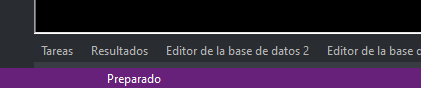

# Modo preparado
<!-- id: modo-preparado -->

Digi3D.AI está en modo preparado cuando no está ejecutando ninguna orden.

Cuando Digi3D.AI está en modo preparado, la barra de estado muestra el mensaje **Preparado.**

