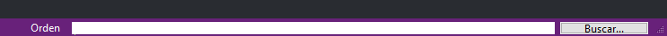
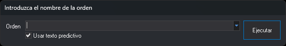

# Ejecutar una orden desde la línea de comandos
<!-- id: ejecutar-una-orden-desde-la-linea-de-comandos -->

En la ventana de dibujo, al pulsar **Intro** la barra de mensajes muestra un campo para escribir el nombre de la orden a ejecutar.

Escribe el nombre de la orden y pulsa **Intro** para ejecutarla.

Se pueden ejecutar tres tipos de órdenes:

* [Órdenes internas del programa](orden-interna-de-digi3d.ai.md)
* [Macroinstrucciones](/digi3d-ai/referencia/ventana-de-dibujo/ordenes/m/macroinstrucciones.md)
* [Guiones Python](/digi3d-ai/referencia/ordenes/formas-de-ejecutar-una-orden/ejecutar-una-orden-desde-la-linea-de-comandos/guiones-python.md)

## Autocompletado y ayuda de los parámetros

Mientras escribes el nombre de la orden, el campo propone el primer nombre de orden que empieza por lo escrito y deja seleccionada la parte que añade. Si sigues escribiendo, el texto seleccionado se sustituye. Pulsa **Tab** para aceptar la propuesta: el cursor pasa al final del texto y la propuesta deja de estar seleccionada.

Para pasar parámetros a la orden, escribe un signo igual (=) después del nombre y los parámetros separados por espacios, por ejemplo `densifica=5 020100`. Un parámetro que contiene espacios se escribe entre comillas dobles o simples.

Si la orden escrita describe sus parámetros, encima del campo aparece una ayuda con las formas de ejecutarla:

* Cada renglón es una forma de ejecutar la orden. Solo aparecen las formas que admiten lo que llevas escrito.
* Cada parámetro aparece como `<nombre: tipo>`. El tipo es un número entero, un número real, un texto, un archivo, un código o la lista de valores que admite, separados por `|`.
* El parámetro que toca escribir aparece en **negrita**.
* `...` detrás de un parámetro indica que admite uno o más valores. Un grupo de parámetros entre paréntesis seguido de `...`, por ejemplo `(<código: código> <tipos de entidad: texto>)...`, se repite completo una o más veces.
* Algunos parámetros solo existen según el valor de un parámetro anterior. Por ejemplo, en [BINTRAM](/digi3d-ai/referencia/ventana-de-dibujo/ordenes/b/bintram.md), los siete parámetros del archivo de errores solo existen si el segundo parámetro vale `1`. Esos parámetros aparecen en la ayuda cuando escribes el valor del que dependen.
* _(abre un cuadro de diálogo)_ al final de un renglón indica que, con esa forma, la orden pide en un cuadro de diálogo los datos que faltan.
* Si el parámetro que toca escribir admite una lista de valores, debajo de las formas aparece lo que hace cada valor que empieza por lo que llevas escrito, por ejemplo `2 = partir las líneas por el cruce`.

Cuando el parámetro que estás escribiendo solo admite una lista de valores, el campo propone el primer valor que empieza por lo escrito, igual que con el nombre de la orden. **Tab** acepta la propuesta.

La ayuda se oculta cuando el campo pierde el foco. Los nombres de los parámetros y las descripciones de los valores aparecen en el idioma de Digi3D.AI.

## Histórico de órdenes

El campo se abre con la última orden ejecutada, seleccionada. Para repetirla, pulsa **Intro** otra vez. Si escribes cualquier carácter, sustituye a la orden seleccionada. Si todavía no se ha ejecutado ninguna orden, el campo se abre vacío.

Las flechas recorren las órdenes ejecutadas anteriormente:

* **Flecha arriba** muestra la orden anterior a la que muestra el campo y, en cada pulsación siguiente, la anterior a esa. Al llegar a la más antigua, el campo la sigue mostrando.
* **Flecha abajo** muestra la orden siguiente, más reciente. Al pasar de la más reciente, el campo queda vacío.

Las flechas recorren el histórico completo aunque el campo contenga texto: no buscan solo las órdenes que empiezan por ese texto.

Digi3D.AI guarda el histórico en el archivo `%APPDATA%\Digi3D\HistoricoOrdenes.txt` cada vez que ejecutas una orden, así que se conserva al cerrar el programa. El archivo contiene las 1000 órdenes más recientes, una por línea. Una orden igual a la anterior no se vuelve a guardar.

Cada ventana de dibujo lee el archivo al abrirse. Una orden ejecutada en otra ventana de dibujo o en otra instancia de Digi3D.AI aparece en el histórico de las ventanas de dibujo que se abran después.

## En la ventana fotogramétrica

En la ventana fotogramétrica, al pulsar **Intro** se abre el cuadro de diálogo **Introduce el nombre de la orden**. _Intro_ abre siempre este cuadro, aunque la tecla tenga órdenes asignadas en el teclado virtual activo.

* **Orden**: el nombre de la orden. Para pasarle parámetros, escribe el nombre, un signo igual (=) y los parámetros, por ejemplo `velocidad=5.75 4.22`. Todo lo que sigue al primer signo igual se pasa a la orden como parámetros.
* **Usar texto predictivo**: con la casilla marcada, la lista del campo **Orden** contiene en minúsculas los nombres de todas las [órdenes de la ventana fotogramétrica](/digi3d-ai/referencia/ventana-fotogrametrica/ordenes/README.md) y completa el nombre mientras se escribe. Con la casilla desmarcada, la lista contiene las órdenes ejecutadas desde este cuadro desde que se inició Digi3D.AI, ordenadas alfabéticamente, y el campo muestra la última orden ejecutada. Digi3D.AI guarda el estado de la casilla al pulsar **Ejecutar**.
* **Ejecutar**: cierra el cuadro y ejecuta la orden. Pulsar _Intro_ equivale a pulsar este botón.

Pulsa _Esc_ para cerrar el cuadro sin ejecutar ninguna orden.

Este cuadro solo ejecuta órdenes de la ventana fotogramétrica. También admite el nombre interno de la orden entre llaves, por ejemplo `{3BE1084C-E1BC-4b4f-AD45-611112560D6B}=5.75` para [VELOCIDAD](/digi3d-ai/referencia/ventana-fotogrametrica/ordenes/v/velocidad.md). Si el nombre no corresponde a ninguna orden de la ventana fotogramétrica, Digi3D.AI emite el sonido de error y no ejecuta nada.
