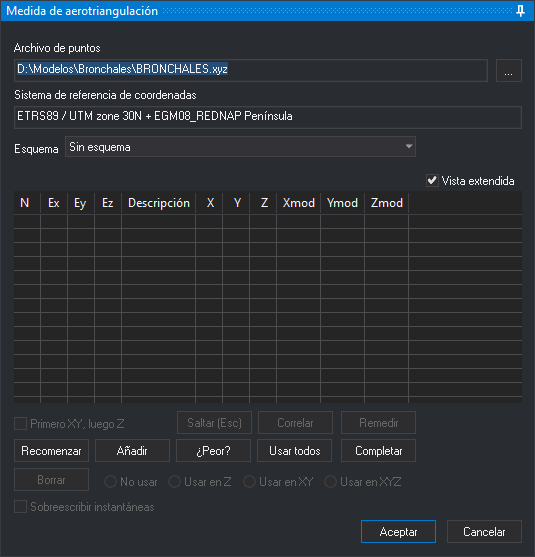

# Medida de aerotriangulación
<!-- id: panel-medida-aerotriangulacion -->

Este panel permite medir los puntos de aerotriangulación y de apoyo del modelo cargado en la ventana fotogramétrica. El panel aparece al ejecutar la orden [AEROTRI](../ventana-fotogrametrica/ordenes/a/aerotri.md), que también se ejecuta con el botón _T_ de la barra de herramientas de la ventana fotogramétrica.

El panel tiene los mismos controles que el panel de la orden [ORI\_ABSOLUTA](../ventana-fotogrametrica/ordenes/o/ori-absoluta.md), con el desplegable **Esquema**, que elige el esquema de aerotriangulación con el que se recorren los puntos, y con las diferencias del botón **Añadir** y del botón **Aceptar** que describe la sección [Panel Medida de aerotriangulación](../ventana-fotogrametrica/ordenes/a/aerotri.md#panel-medida-de-aerotriangulación) de la orden AEROTRI.

Al pulsar **Aceptar**, Digi3D.AI escribe en la carpeta **Aerotriangulación** del proyecto un archivo _.mod_ con las coordenadas modelo de los puntos medidos y un archivo de fotocoordenadas por foto. Para ver un ejemplo de uso, consulta [Midiendo la aerotriangulación del modelo 107-108](../../primeros-pasos/comenzando-a-utilizar-digi3d.ai/comenzando-con-la-ventana-fotogrametrica/sensor-camara-conica/aerotriangulacion-manual/midiendo-aetrotriangulacion-modelo-107-108.md).
