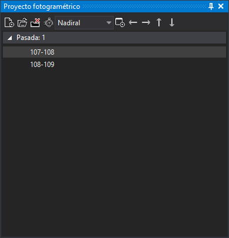

# Proyecto fotogramétrico
<!-- id: proyecto-fotogrametrico -->

Permite crear archivos de proyecto fotogramétrico, así como cargar archivos de proyectos fotogramétricos creados por otros programas. También carga un proyecto publicado en una URL (consulta [Proyecto publicado en una URL](#proyecto-publicado-en-una-url)).

Una vez cargado un proyecto fotogramétrico, el contenido principal muestra un árbol con tantas ramas como pasadas se enumeren en el archivo de proyecto fotogramétrico y con tantas hojas como modelos existan en el proyecto.

Al pulsar sobre un modelo, el programa abre una ventana fotogramétrica con ese modelo. Si ya hay una ventana fotogramétrica abierta, el programa muestra el modelo seleccionado en esa ventana.

Si el proyecto es de fotos y no de modelos, el panel muestra dos listas con las mismas fotos: la izquierda y la derecha. Al seleccionar una foto en cada lista se carga el modelo formado por las dos fotos.

Un proyecto `.d3dprj` puede contener pares del sensor Satélite RPC (estereoscópico) (RPC: coeficientes polinómicos racionales) en lugar de modelos de cámara cónica. Consulta [Proyectos con varios pares](../ventana-fotogrametrica/sensores/rpc/README.md#proyectos-con-varios-pares) para saber cómo crear un proyecto `.d3dprj` con varios pares y cómo elige par el cambio automático de modelo.

El panel guarda la ruta del último proyecto cargado con los botones **Nuevo** o **Cargar**, o con la función Python [open_project](../../programacion/python/referencia/digi3d/functions.md#open_project). Digi3D.AI no carga ningún proyecto al iniciarse, salvo que la línea de comandos incluya el subcomando `proyecto` o que Digi3D.AI abra al iniciarse un archivo de dibujo con un proyecto asociado.

## Proyecto asociado al archivo de dibujo

Con la opción [Almacenar el proyecto fotogramétrico o el modelo fotogramétrico como archivo de referencia](../cuadros-de-dialogo/configuracion/archivos-de-referencia/almacenar-el-proyecto-o-el-modelo-fotogrametrico.md) del cuadro de diálogo **Configuración** activada, al cargar un proyecto con los botones **Nuevo** o **Cargar**, o con la función `open_project`, si hay alguna ventana de dibujo abierta, Digi3D.AI asocia el proyecto al archivo de dibujo de la última ventana de dibujo que ha tenido el foco: guarda la ruta del proyecto en el [archivo de archivos de referencia](../archivos/archivo-de-archivos-de-referencia.md#proyecto-o-modelo-fotogramétrico) de ese archivo de dibujo, salvo si el archivo de dibujo es de solo lectura. Cuando la ventana fotogramétrica activa carga un modelo del proyecto, Digi3D.AI guarda también el nombre del modelo y su punto de vista. La opción está desactivada por defecto.

Con la opción **Almacenar el proyecto fotogramétrico o el modelo fotogramétrico como archivo de referencia** activada, al abrir un archivo de dibujo con un proyecto fotogramétrico asociado, Digi3D.AI carga el proyecto asociado si el panel no tiene ningún proyecto cargado. Si el panel tiene cargado otro proyecto, Digi3D.AI pregunta si quieres sustituir el proyecto del panel por el proyecto asociado al archivo de dibujo. Si el archivo de archivos de referencia indica un modelo del proyecto asociado, la carga de ese modelo depende de las condiciones que describe la misma sección. La sección [Proyecto o modelo fotogramétrico](../archivos/archivo-de-archivos-de-referencia.md#proyecto-o-modelo-fotogramétrico) del archivo de archivos de referencia enumera los casos en los que Digi3D.AI no carga el proyecto asociado. Si cada zona de trabajo tiene su archivo de dibujo y su proyecto, asocia una vez el proyecto de cada zona a su archivo de dibujo: activa la opción **Almacenar el proyecto fotogramétrico o el modelo fotogramétrico como archivo de referencia**, activa la ventana de ese archivo de dibujo, que no debe ser de solo lectura, y carga el proyecto.

Si el proyecto asociado es un proyecto remoto, el archivo de archivos de referencia guarda la URL del proyecto sin consulta de autorización. Al abrir el archivo de dibujo, Digi3D.AI carga el proyecto con la credencial guardada de esa URL. Si no hay credencial guardada, abre el cuadro [Cargar un proyecto desde una URL](../cuadros-de-dialogo/cargar-proyecto-remoto.md) con la URL en el campo **URL del proyecto**.

Con la opción **Almacenar el proyecto fotogramétrico o el modelo fotogramétrico como archivo de referencia** activada, el cuadro de abrir archivo del botón **Cargar** propone el proyecto asociado al archivo de dibujo de la última ventana de dibujo que ha tenido el foco, si ese archivo de dibujo tiene un proyecto asociado. El cuadro de abrir archivo propone el último proyecto cargado si la opción **Almacenar el proyecto fotogramétrico o el modelo fotogramétrico como archivo de referencia** está desactivada, si no hay ninguna ventana de dibujo abierta o si el archivo de dibujo de la última ventana de dibujo que ha tenido el foco no tiene un proyecto asociado.

## Proyecto publicado en una URL

El panel carga un proyecto fotogramétrico publicado en Azure Blob Storage o en cualquier servidor HTTP o HTTPS que atienda peticiones de un rango de bytes. Digi3D.AI descarga el archivo de proyecto y los archivos de modelo a una copia local, y lee las imágenes por URL sin descargarlas enteras. Consulta [Publicar un proyecto fotogramétrico en Azure Blob Storage y cargarlo desde una URL](../../procedimientos/publicar-proyecto-fotogrametrico-remoto.md) para saber qué archivos subir, cómo se calcula la URL de cada imagen y cómo generar la autorización.

El botón **Cargar** es un botón dividido. Un clic en el botón abre el cuadro de abrir archivo, que no propone la URL de un proyecto remoto. La flecha del botón abre un menú con estas cuatro órdenes:

| Orden | Qué hace | Cuándo está habilitada |
| :--- | :--- | :--- |
| **Cargar proyecto desde una URL...** | Abre el cuadro de diálogo [Cargar un proyecto desde una URL](../cuadros-de-dialogo/cargar-proyecto-remoto.md), con los campos vacíos. | Si no se está cargando un modelo en segundo plano y hay instalado al menos un sensor que puede cargar proyectos desde una URL. Al ejecutarla, requiere el módulo de fotogrametría en la licencia. |
| **Renovar la autorización (SAS)...** | Abre el mismo cuadro de diálogo en el [modo de renovación](../cuadros-de-dialogo/cargar-proyecto-remoto.md#modo-de-renovación-de-la-autorización), con las URL y la extensión de la credencial guardada. Al pulsar **Aceptar**, si los campos superan las validaciones, Digi3D.AI guarda las consultas de autorización nuevas sin descargar ningún archivo. | Si hay un proyecto remoto cargado y no se está cargando un modelo en segundo plano. |
| **Abrir la carpeta local del proyecto** | Abre en el Explorador de archivos la carpeta con la copia local del proyecto. Si la carpeta no existe, muestra el mensaje «La carpeta local aún no existe. Digi3D la crea al descargar el proyecto.» | Igual que **Renovar la autorización (SAS)...**. |
| **Descartar la copia local del proyecto...** | Borra la copia local del proyecto y lo vuelve a cargar desde el servidor. Consulta [Descartar la copia local](../../procedimientos/publicar-proyecto-fotogrametrico-remoto.md#descartar-la-copia-local). | Igual que **Renovar la autorización (SAS)...**. |

**Descartar la copia local del proyecto...** rechaza la orden con el mensaje «Cierra las ventanas fotogramétricas del proyecto *URL* antes de descartar su copia local.» si alguna ventana fotogramétrica tiene cargado un modelo del proyecto o un archivo de la carpeta local. Si no, muestra el cuadro «¿Descartar la copia local del proyecto?», que indica la carpeta que se borra y la URL del proyecto, con los botones **Descartar la copia local** y **Cancelar**. Con **Descartar la copia local**, Digi3D.AI vacía el panel, borra la carpeta local y vuelve a cargar el proyecto con la credencial guardada.

La identidad de un proyecto remoto es su URL sin la consulta de autorización. Digi3D.AI guarda esa URL como último proyecto cargado y en el archivo de archivos de referencia; nunca guarda la consulta en esos sitios. Digi3D.AI guarda la consulta de autorización cifrada, en una credencial del registro del usuario de _Windows_ (consulta [Autorización y credenciales guardadas](../../procedimientos/publicar-proyecto-fotogrametrico-remoto.md#autorización-y-credenciales-guardadas)).

### Avisos de un proyecto remoto

* Al iniciarse, Digi3D.AI añade al panel [Tareas](tareas.md) una advertencia por cada credencial guardada cuya autorización (SAS) ha caducado («Proyecto remoto: autorización caducada») o caduca en menos de 24 horas («Proyecto remoto: la autorización caduca en menos de 24 horas»). Renueva la autorización con **Renovar la autorización (SAS)...**.
* Cuando el servidor rechaza la autorización, Digi3D.AI muestra el cuadro de advertencia «Proyecto remoto: autorización rechazada» con el texto «El servidor ha rechazado la autorización (SAS) para *URL*: no es válida o ha caducado. Renuévala con «Renovar la autorización (SAS)...» del panel Proyecto fotogramétrico.» Digi3D.AI muestra un cuadro por contenedor durante la ejecución del programa. Después de renovar la autorización de ese contenedor, Digi3D.AI puede volver a mostrar el cuadro.
* Cuando una imagen cambia en el servidor mientras Digi3D.AI la tiene abierta, muestra el cuadro de advertencia «Proyecto remoto: archivos modificados en el servidor» con el texto «Un archivo del proyecto remoto *URL* ha cambiado en el servidor mientras Digi3D mantenía abierto el archivo. Digi3D ha dejado de leer el archivo modificado. Cierra las ventanas fotogramétricas del proyecto y vuelve a cargar el proyecto.» Digi3D.AI muestra un cuadro por contenedor durante la ejecución del programa.
* Si Digi3D.AI no puede inicializar algunos modelos de un proyecto remoto, los mantiene en la lista de modelos, vuelve a intentar inicializar cada uno al abrirlo y añade al panel Tareas una advertencia por cada mensaje de error distinto, con el número de modelos afectados y el nombre del primero.
* Si el proyecto remoto es de Inpho con la opción **Omitir modelos para los cuales no hay foto** activada, de Summit o de PhotoScan, y Digi3D.AI no puede obtener la lista de blobs de la carpeta de las imágenes en Azure Blob Storage, muestra todos los modelos, también los que tienen imágenes sin publicar, y añade un aviso al panel Tareas. Consulta [Cómo se calcula la URL de cada imagen](../../procedimientos/publicar-proyecto-fotogrametrico-remoto.md#cómo-se-calcula-la-url-de-cada-imagen).
* Si un archivo descargado cambia en el servidor, Digi3D.AI añade una advertencia al panel Tareas que indica si actualiza o conserva la copia local. Si Digi3D.AI no puede consultar al servidor y usa una copia local, añade una advertencia con el motivo. Consulta [Qué copia se usa al cargar el proyecto](../../procedimientos/publicar-proyecto-fotogrametrico-remoto.md#qué-copia-se-usa-al-cargar-el-proyecto).

## Modelos que no se pueden cargar

Por defecto, el árbol solo muestra los modelos que se pueden cargar. Cada modelo que no se puede cargar añade al panel [Tareas](tareas.md) un error «Archivo de modelo: *modelo* no localizado.». Si no se puede cargar ningún modelo del proyecto, aparece el mensaje «No se ha podido cargar ningún modelo del archivo de proyecto. Posiblemente la ruta a las imágenes en el archivo de proyecto no es válida».

Si se desactiva la opción [Mostrar solo modelos cargados](../cuadros-de-dialogo/configuracion/proyecto-fotogrametrico/mostrar-solo-modelos-cargados.md) de la configuración, el árbol muestra también los modelos que no se pueden cargar, deshabilitados, y cada uno sigue añadiendo su error al panel Tareas.

## Sistema de referencia de coordenadas del proyecto

Si el proyecto no tiene asociado un sistema de referencia de coordenadas, al cargarlo aparece el cuadro «No hemos localizado el Sistema de Referencia de Coordenadas de este proyecto» con tres opciones:

* Indicar el sistema de referencia de coordenadas: muestra el cuadro de selección de sistema de referencia de coordenadas y, al aceptar, crea un archivo `.prj` junto al proyecto.
* Indicar que se desconoce: crea un archivo `.prj` con un sistema desconocido.
* Preguntar la próxima vez: asigna temporalmente un sistema desconocido y no crea ningún archivo `.prj`.

### Sistema vertical

Solo los proyectos de Inpho y de PhotoScan muestran este cuadro. Si el sistema del proyecto solo tiene componente horizontal y la opción [Solicitar sistema vertical para sensores](../cuadros-de-dialogo/configuracion/sistema-de-referencia-de-coordenadas/solicitar-sistema-vertical-para-sensores.md) de la configuración está en **Sí**, al cargar el proyecto aparece el cuadro **Sistema de referencia de coordenadas vertical desconocido**, el mismo que al cargar un [modelo sin sistema vertical](../ventana-fotogrametrica/sensores/camara-conica/sistema-de-referencia-del-modelo.md#sistema-de-referencia-de-coordenadas-vertical). Tiene dos opciones:

* **Conozco el Sistema de Referencia de Coordenadas Vertical de este modelo y quiero indicar cuál es.**: muestra el cuadro de selección de sistema de referencia de coordenadas vertical. El proyecto usa el sistema horizontal del archivo con el vertical seleccionado. Si se cancela el cuadro de selección, actúa como la opción siguiente.
* **Desconozco el Sistema de Referencia de Coordenadas de este modelo.**: el proyecto usa el sistema horizontal del archivo con un sistema vertical desconocido. Digi3D.AI no transforma la coordenada Z.

Aunque el texto de las opciones dice que se modificará el archivo, Digi3D.AI no escribe nada en el archivo de proyecto: la elección no se guarda y el cuadro vuelve a aparecer cada vez que se carga el proyecto.

Un proyecto de Inpho puede declarar en `$COORDINATE_SYSTEM` un sistema de Esri con un `VERTCS` a continuación del `PROJCS`, por ejemplo `PROJCS["ETRS_1989_UTM_Zone_30N",…],VERTCS["EGM2008_Geoid",…]`. Si Digi3D.AI reconoce los dos como sistemas de EPSG, el proyecto usa el sistema compuesto equivalente (en el ejemplo, ETRS89 / UTM zone 30N + EGM2008 height) y el cuadro no aparece.

## Mensajes de error al cargar un proyecto

* «No hemos localizado ninguna extensión que permita abrir el archivo seleccionado.»: ningún sensor instalado reconoce el archivo.
* «El archivo de proyecto no proporciona ningún punto de vista, así que no se puede cargar ningún modelo de él.»
* «No se puede cargar un proyecto mientras se está cargando un modelo en segundo plano. Espera a que termine.»

## Barra de herramientas

Dispone de una barra de herramientas que permite interactuar con el contenido del panel.

### Botones

* **Nuevo**: crea un nuevo archivo de proyecto fotogramétrico.
* **Cargar**: botón dividido. Un clic en el botón abre el cuadro de abrir archivo y carga el archivo de proyecto fotogramétrico que selecciones. Sin licencia de fotogrametría, el botón no carga nada. La flecha del botón abre un menú con las órdenes para proyectos publicados en una URL (consulta [Proyecto publicado en una URL](#proyecto-publicado-en-una-url)).
* **Descargar**: descarga el proyecto fotogramétrico cargado.

**Cargar** y **Descargar** están deshabilitados mientras se carga un modelo en segundo plano.
* **Cambio automático de modelo**: activa o desactiva el cambio automático de modelo.
* **Punto de vista**: desplegable que permite seleccionar el punto de vista en caso de que el archivo de proyecto fotogramétrico cargado proporcione distintos puntos de vista desde una misma estación.
* **Abrir en ventana nueva**: si está activado, al pulsar sobre un modelo se abre en una ventana fotogramétrica nueva en lugar de cambiar el modelo de la ventana fotogramétrica activa.
* **Ir al modelo anterior** e **Ir al siguiente modelo** (flechas izquierda y derecha): cargan en la ventana fotogramétrica activa el modelo anterior o el siguiente de la misma pasada.
* **Ir al modelo de la pasada anterior** e **Ir al modelo de la pasada siguiente** (flechas arriba y abajo): cargan en la ventana fotogramétrica activa, de entre los modelos de la pasada anterior o de la siguiente, el más adecuado para la posición del cursor.

Los botones de las flechas solo están habilitados cuando hay un proyecto fotogramétrico cargado y una ventana fotogramétrica abierta.

Una ventana fotogramétrica abierta con un modelo de nube de puntos o de ortofoto estereoscópica no carga otro modelo en segundo plano. Si la ventana fotogramétrica activa se abrió con un modelo de nube de puntos o de ortofoto estereoscópica, al pulsar sobre un modelo se abre en una ventana fotogramétrica nueva, aunque **Abrir en ventana nueva** esté desactivado, y las flechas no cargan ningún modelo.

## Mostrar el panel

Se puede mostrar el panel de las siguientes formas:

* Pulsa el botón correspondiente en la [barra de herramientas Paneles](../barras-de-herramientas/paneles.md).
* Selecciona la opción del menú **Ventana/Proyecto fotogramétrico**.
