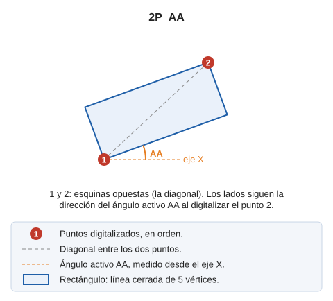

# 2P_AA
<!-- id: 2p-aa -->

Dibuja un rectángulo girado.

## Parámetros

No admite parámetros.

## Observaciones

Esta orden solicita que [introduzcas](../../introduccion-de-coordenadas.md) dos puntos que corresponden a esquinas opuestas del rectángulo y definen una diagonal.

Los lados del rectángulo siguen la dirección del [ángulo activo](../../variables/a/aa.md) configurado en el momento de la digitalización del segundo punto. La orden [RECTANGULO\_2P\_NORTE](/digi3d-ai/referencia/ventana-de-dibujo/ordenes/r/rectangulo-2p-norte.md) dibuja un rectángulo con el ángulo de 0 grados, es decir, con los lados paralelos a los ejes.

## Características de la orden

| Tipo de orden                                    | [Orden interactiva](../../../ordenes/ordenes-interactivas.md)        |
| ------------------------------------------------ | -------------------------------------------------------------------- |
| Repite automáticamente                           | Sí                                                                   |
| Opción del menú donde aparece la orden           | Dibujar/Más/Rectángulo con 2 puntos y ángulo activo                |
| Barra de herramientas en la que aparece la orden | Cuadrados y rectángulos                                              |
| Extensión                                        | DigiNG.OrdenesStandard.dll                                             |
| Implementación | Nativa |
| Variables relacionadas                           | [AA](/digi3d-ai/referencia/ventana-de-dibujo/variables/a/aa.md) — ángulo activo [REPITE](/digi3d-ai/referencia/ventana-de-dibujo/variables/r/repite.md) — repite la última orden ejecutada |
| Órdenes relacionadas                             | [2P](/digi3d-ai/referencia/ventana-de-dibujo/ordenes/2/2p.md) [3P](/digi3d-ai/referencia/ventana-de-dibujo/ordenes/3/3p.md) [RECTANGULO\_2P\_NORTE](/digi3d-ai/referencia/ventana-de-dibujo/ordenes/r/rectangulo-2p-norte.md) [RECTANGULO\_DR](/digi3d-ai/referencia/ventana-de-dibujo/ordenes/r/rectangulo-dr.md) |
| Nombre interno | {63DCF587-DB76-4992-B84E-F1729BBDF3DC} |

## Vídeo

<video controls><source src="https://digi21.blob.core.windows.net/videos-ayuda/2P_AA.mp4" type="video/mp4"></video>
