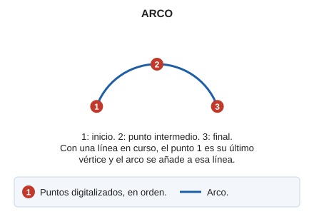

# ARCO
<!-- id: arco -->

Dibuja un arco en el espacio a partir de tres puntos definidos por el usuario.

## Parámetros

No admite parámetros.

## Observaciones

Puedes indicar los tres puntos que definen el arco de forma gráfica o introducir sus coordenadas por teclado mediante la orden [XY](/digi3d-ai/referencia/ventana-de-dibujo/ordenes/x/xy.md).

Si ejecutas la orden mientras dibujas una entidad, indica solo los puntos segundo y tercero del arco: el primer punto del arco corresponde al último punto registrado en la entidad.

## Características de la orden

| Tipo de orden | [Orden interactiva](/digi3d-ai/referencia/ordenes/ordenes-interactivas.md) |
| :--- | :--- |
| Repite automáticamente | No |
| Opción del menú donde aparece la orden | Dibujar/Arco |
| Barra de herramientas en la que aparece la orden | Polilíneas |
| Extensión | DigiNG.OrdenesStandard.dll |
| Implementación | Nativa |
| Variables relacionadas | [PITA](/digi3d-ai/referencia/ventana-de-dibujo/variables/p/pita.md) — activa o desactiva las señales acústicas |
| Órdenes relacionadas | [ACUERDO](/digi3d-ai/referencia/ventana-de-dibujo/ordenes/a/acuerdo.md) [ARCO\_TANGENTE](/digi3d-ai/referencia/ventana-de-dibujo/ordenes/a/arco-tangente.md) [MULTIARCO](/digi3d-ai/referencia/ventana-de-dibujo/ordenes/m/multiarco.md) |
| Nombre interno | {3267A72F-6510-42bd-984F-1CC756AE8E45} |

