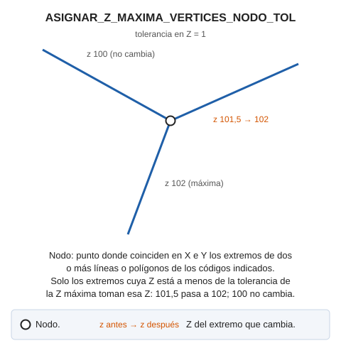

# ASIGNAR\_Z\_MAXIMA\_VERTICES\_NODO\_TOL
<!-- id: asignar-z-maxima-vertices-nodo-tol -->

Localiza todos los vértices que llegan a un determinado nodo y asigna la Z máxima del nodo a cada vértice cuya diferencia de Z respecto a la Z máxima del nodo sea menor que la tolerancia.

Un nodo es un punto en el que coinciden en X e Y los extremos de dos o más líneas o polígonos de los códigos indicados. La orden solo modifica el primer y el último vértice de cada entidad.

## Parámetros

| Número de parámetro | Descripción | Opcional |
| :--- | :--- | :--- |
| 1 | Tolerancia en Z | No |
| 2 | Código o códigos (uno o más) | No |

La orden trata cada entidad de forma independiente: si Digi3D.AI descarta una entidad modificada, la orden conserva la entidad original. Las entidades que Digi3D.AI acepta se modifican.

## Características de la orden

| Tipo de orden | [Orden inmediata](/digi3d-ai/referencia/ordenes/ordenes-no-interactivas.md) |
| :--- | :--- |
| Repite automáticamente | No |
| Opción del menú donde aparece la orden | _Esta orden no tiene asociada ninguna opción de menú_ |
| Barra de herramientas en la que aparece la orden | _Esta orden no tiene asociado ningún botón en ninguna barra de herramientas_ |
| Extensión | DigiNG.OrdenesTopologia.dll |
| Implementación | Nativa |
| Variables relacionadas | No tiene variables relacionadas |
| Órdenes relacionadas | [ASIGNAR\_Z\_MAXIMA\_VERTICES\_NODO](/digi3d-ai/referencia/ventana-de-dibujo/ordenes/a/asignar-z-maxima-vertices-nodo.md) |
| Nombre interno | {80F18AE3-395E-4536-A2BC-2608D2B4888B} |
